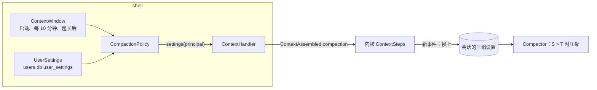

# Design Document

## Overview

需求批准于 2026-11-04（9 条决定 T1–T9、5 条需求）。要做的是三件互相独立的小事，加一处内核改动把它们接起来：

1. **窗口**（T1–T3、需求 1）：shell 里新增 `ContextWindow`，启动时和每 10 分钟从模型那边读窗口大小，Claude 再读备用模型取最小值。
2. **用户选的压缩点**（T4–T5、T8、需求 2）：`users.db` 新表 `user_settings`，设置页“模型”一栏四个选项。
3. **估算系数**（T7、需求 4）：`TokenEstimate` 从“÷ 3”改成“÷ 系数”，系数随压缩设置走。
4. **内核**（T6、需求 3）：每次提问组装上下文时，按用户当前的选择和当前窗口算一份压缩设置，内核换上它。

内核仍是纯函数：窗口和用户选择都在 shell 里读，算好的压缩设置随 `ContextAssembled` 写进 journal，回放读同一份记录。

设计前确认过的事实（2026-11-04）：

| 事实 | 依据 |
|---|---|
| SDK 3.3.0 的 `client.models().retrieve(id)` 返回 `ModelInfo.maxInputTokens()` | `anthropic-java-core-3.3.0.jar` 的 `com/anthropic/models/models/ModelInfo` |
| `allowed_fallback_models` 只在带 `anthropic-beta: server-side-fallback-2026-06-01` 时返回，SDK 没有对应字段 | 实测 curl；走 beta 接口 `client.beta().models().retrieve(...)` 的 `_additionalProperties()` |
| 摘要调用前头部的工具结果已截到每个 4 KB（`max-summarized-tool-result-bytes`） | `Compactor.headForSummary` → `Trimming.trimAll(..., maxSummarizedResultBytes)` |
| 回放会重新跑内核步骤 | `Engine`：`storage.replay(kernel)` |

最后一条决定了内核改动必须分新旧：旧 journal 里每个运行的 `ContextAssembled` 都带着当时的配置，但当时内核只用第一次的那份。如果新内核对旧事件也“每次换上”，回放会和当时走的路不一样。所以只有带新字段的事件才换（见“内核”一节）。

## Steering Document Alignment

### Technical Standards (tech.md)

- 内核只读事件：窗口、用户选择、系数都在 shell 里定，写进 `ContextAssembled.compaction`。
- 用户设置和插件开关一样不进 journal，存在 `users.db`；进 journal 的是每次算出来的结果。
- API Key 只从环境变量读；读窗口的请求和日志不带 Key 和请求头。

### Project Structure (structure.md)

- `shell/model/ContextWindow`：读窗口、后台刷新。和两个模型客户端放在一起，因为它要用同一个 SDK 客户端和 `base-url`。
- `shell/settings/UserSettings`：每个用户自己的设置（目前只有压缩点）。新包，和 `shell/access`（开关、过滤入口）分开：这不是权限。
- `shell/settings/CompactionPolicy`：把窗口、用户选择和配置合成一份 `CompactionSettings`，`ContextHandler` 每次调用它。
- `kernel/compaction/TokenEstimate`：改成按系数算的实例。

## Code Reuse Analysis

### Existing Components to Leverage

- **`PluginSwitches`**：`users.db` 的打开方式（同一个文件、600、`busy_timeout`）、按用户的内存缓存、`inMemory` 测试版本，`UserSettings` 照抄。
- **`TantalumProperties.compactionSettings()`**：预留 `R = max(reserve-tokens, max-tokens)` 的算法搬进 `CompactionPolicy`，不变。
- **`ContextSteps.freezeContext`**：已经在比较会话里记的和新事件的差别（工具、插件、可变内容），压缩设置是又一项。
- **`ModelFailures` / `FailureReason.CONTEXT_OVERFLOW`**：超长时通知 `ContextWindow` 再读一次。
- **控制台 `ModelPane`、`AppearancePane` 的单选组、`usePlugins` 的乐观更新加回滚**：压缩点选项照这几个做。
- **`statusParts`**：状态栏的占比，改提醒的条件。

### Integration Points

- `Engine`：创建 `ContextWindow`（启动最多等 5 秒）、`UserSettings`、`CompactionPolicy`，交给 `ContextHandler`；`ModelHandler` 收到超长时调 `window.refreshSoon()`。
- `/api/config`：`contextWindow` 改为 `ContextWindow` 当前值，加 `windowSource`。
- 新接口 `GET /api/settings`、`PUT /api/settings/compaction`。
- `EventCodec`：`CompactionSettings` 的新字段缺省时解码为 0。

## Architecture



### 1. 窗口（T1–T3、需求 1）

`ContextWindow` 保存当前值 `Reading(long tokens, Source source)`，`Source` 是 `MODEL` 或 `CONFIG`。初始值是配置的 `context-window`、来源 `CONFIG`。

读的方法按供应商不同，用一个小接口 `WindowSource { OptionalLong read() }`，两个实现：

- **Claude**：`client.models().retrieve(model).maxInputTokens()`。开着备用模型时再调 `client.beta().models().retrieve(model, betas=server-side-fallback-2026-06-01)`，取 `_additionalProperties().get("allowed_fallback_models")` 里的每个名字，各 `retrieve` 一次，取最小值。备用模型任何一步失败就只用主模型的值（T3）。
- **OpenAI 兼容**：`GET {base-url}/models`，找 `id` 等于配置模型名的项，依次看 `meta.n_ctx`、`max_model_len`、`context_length`，取第一个正整数。用 JDK 的 `HttpClient`，带 `OPENAI_API_KEY`（有时）。

刷新：

- 启动时同步读一次，最多等 5 秒；超时或失败就先用配置值，日志一条 `WARN context window: <原因>`（原因只写异常类型和 HTTP 状态，不写响应体和请求头）。
- 一个守护线程每 10 分钟读一次；读到的值不大于预留 R 当作失败（需求 1 第 7 条）；失败保留当前值。
- `refreshSoon()`：超长时调用，排一次立即读，和定时读合并（同一时刻最多一个在读）。
- 值变化时写一条 `INFO context window <旧> -> <新> (<来源>)`。

读到的值只影响之后组装的上下文；正在跑的运行用的是它开始时那份设置（需求 3 第 3 条）。

### 2. 用户选的压缩点（T4、T5、T8、需求 2）

表：

```sql
CREATE TABLE IF NOT EXISTS user_settings (
  user       TEXT NOT NULL,
  name       TEXT NOT NULL,
  value      TEXT NOT NULL,
  updated_at TEXT NOT NULL,
  PRIMARY KEY (user, name)
)
```

现在只有一项 `name = compaction_percent`，`value` 是 `50`、`70`、`85`、`100` 之一，`100` 就是“用满”。没有记录时是 100。用 key-value 而不是一列一个设置：以后加设置不用改表。

`UserSettings.compactionPercent(Principal)` 先查内存缓存；`setCompactionPercent(Principal, int)` 不是四个值之一时抛 `IllegalArgumentException`（接口返回 400），先写库再更新缓存。

`CompactionPolicy.settings(Principal)`：

```
W = window.current().tokens()        // 0 表示未知
if W <= 0: return null               // 照旧不自动压缩
R = max(reserve-tokens, max-tokens)
if W <= R: return null               // ContextWindow 已过滤读到的值；这里防配置值写错
T = min(floor(W × percent / 100), W − R)
return new CompactionSettings(W, R, T, bytesPerToken, keepRecent, ...)
```

### 3. 估算系数（T7、需求 4）

`CompactionSettings` 加两个字段：

| 字段 | 含义 | 旧事件里没有时 |
|---|---|---|
| `long point` | 压缩点 T | 0：`threshold()` 照旧返回 `window − reserve` |
| `double bytesPerToken` | 估算系数 | 0：按 3 算 |

`threshold()` 改为 `point > 0 ? point : window − reserve`；新加 `estimate()` 返回 `TokenEstimate`。

`TokenEstimate` 从全静态改成一个记录 `TokenEstimate(double bytesPerToken)`，`ofText` 等变成实例方法：`ceil(UTF-8 字节数 ÷ bytesPerToken)`。图片（`ceil(宽×高/750)`）和 PDF（每页 3000）不按系数，不变。保留 `TokenEstimate.LEGACY`（系数 3）给没有压缩设置的地方：`SummaryPrompt` 里与设置无关的那一处和测试。`Compactor`、`CompactSteps` 里 13 处调用都改成 `settings.estimate().ofXxx(...)`。

配置：`tantalum.claude.bytes-per-token=1.5`、`tantalum.openai.bytes-per-token=2.0`，在 `TantalumProperties` 校验为正数。

### 4. 内核：每次提问换上新设置（T6、需求 3）

`ContextSteps.freezeContext` 在已有会话上多一步：

```java
CompactionSettings incoming = event.compaction();
if (incoming != null && incoming.point() > 0 && !incoming.equals(frozen.compaction())) {
    context = context.withCompaction(incoming);
}
```

- **只有新事件换**：`point > 0` 是新事件的标志。旧 journal 的事件 `point = 0`，照旧只用第一次那份，回放走当时的路（需求 3 第 4 条）。
- **新设置为 null 时不换**：窗口变成未知不应该让已有会话突然不再压缩，留着上一份，自定。
- **不追加消息**：压缩点不改请求，模型不需要知道。
- **新会话和压缩后**：照旧整份冻结（`frozen == null` 分支），用的就是这次算出的新设置。
- 改小以后，如果会话已经超过新的 T，`ContextSteps.contextAssembled` 接着调 `ModelSteps.callModel`，后者照规则 2 先压缩。规则 3 的“刚压缩完不再判断”不受影响。

`SessionContext` 加 `withCompaction`。`Intake.compact`（手动压缩）照旧读会话里的设置。

### 5. 显示（T8、T9、需求 2、5）

**接口**：

```
GET  /api/config   → { ..., contextWindow: 1000000, windowSource: "model" | "config" }
GET  /api/settings → { compaction: { percent: 85, points: [{percent:50,tokens:500000}, ... {percent:100,tokens:936000}] } }
PUT  /api/settings/compaction  { percent: 70 } → 200 同 GET；不是四个值之一 → 400
```

`points` 由服务器按当前 W、R 算好，前端不重复算 R。窗口未知时 `points` 为空。

**设置页“模型”一栏**（`ModelPane`）：现有的模型名、窗口大小下面加一行来源（“模型报告” / “来自配置”），再加一个单选组“自动压缩”：

```
自动压缩
  ○ 50%（约 50 万）
  ○ 70%（约 70 万）
  ○ 85%（约 85 万）
  ● 用满（约 93.6 万）
  从下一次提问开始生效，正在进行的对话也是。
```

选了立即 `PUT`，乐观更新；失败退回并显示错误（照 `usePlugins`）。窗口未知时整组不可选，显示“不知道模型的窗口大小，不做自动压缩”。

**状态栏**：`statusParts` 多一个参数 `point`（当前用户的压缩点 token 数）。提醒条件从 `percent >= 80` 改成 `input >= 0.9 × point`；悬停说明加“到 X% 时自动压缩”，`X = round(point / W × 100)`。设置保存成功后让 `["settings"]` 查询失效，状态栏随之更新（需求 5 第 3 条）。

## Components and Interfaces

### 后端

| 组件 | 包 | 接口 |
|---|---|---|
| `ContextWindow` | `shell/model` | `start(Duration startupWait)`、`current(): Reading`、`refreshSoon()`、`close()` |
| `WindowSource` + `ClaudeWindow`、`OpenAiWindow` | `shell/model` | `OptionalLong read() throws IOException, InterruptedException` |
| `UserSettings` | `shell/settings` | `open(dataDir, clock)`、`inMemory(clock)`、`compactionPercent(p)`、`setCompactionPercent(p, n)` |
| `CompactionPolicy` | `shell/settings` | `settings(Principal): CompactionSettings`（可为 null）、`points(): List<Point>` |
| `SettingsController` | `shell/web` | `GET /api/settings`、`PUT /api/settings/compaction` |
| `CompactionSettings` | `value/state` | 加 `point`、`bytesPerToken`、`estimate()` |
| `TokenEstimate` | `kernel/compaction` | 记录 `(double bytesPerToken)`，实例方法；`LEGACY` |
| `ContextSteps` | `kernel/step` | `freezeContext` 换新设置 |

`ContextHandler` 构造参数从 `CompactionSettings compaction` 换成 `CompactionPolicy policy`；`handle` 里 `policy.settings(principal)`。

### 前端

| 组件 | 改动 |
|---|---|
| `api/types`、`api/client` | `Config.windowSource`；`UserSettingsView`；`getSettings`、`setCompactionPercent` |
| `settings/useCompaction.ts` | 查询加乐观更新和回滚 |
| `settings/ModelPane.tsx` | 来源、单选组 |
| `composer/status.ts`、`StatusBar.tsx` | 按压缩点提醒 |
| `text/zh` | 新文字 |

## Data Models

- `user_settings` 表（上面）。
- `CompactionSettings(long window, long reserve, long point, double bytesPerToken, long keepRecent, int maxKeptResultBytes, int maxSummarizedResultBytes, long summaryMaxTokens)`。紧凑构造器：`point` 为 0 或在 `(0, window − reserve]` 内，`bytesPerToken` 为 0 或正数。字段顺序改了，但 journal 里是按名字存的 JSON，不受影响。
- journal 里 `ContextAssembled.compaction` 多两个字段；旧事件没有，解码为 0。

## Error Handling

| 情况 | 处理 |
|---|---|
| 读窗口超时、网络错误、401/403/404、返回里没有字段 | 保留当前值（启动时是配置值），`WARN` 一条，不影响服务 |
| 读到的值 ≤ R | 当作失败 |
| 本地服务换了更小的 `n_ctx` 重启 | 第一次请求可能超长 → 超长恢复照旧压缩重试，同时 `refreshSoon()`，下一次提问用新窗口 |
| `users.db` 写失败 | `PUT` 返回 500，前端退回原选项；内存缓存不变 |
| `PUT` 的值不在四个之内 | 400 |
| 配置的 `bytes-per-token` 不是正数 | 启动失败，写明是哪个配置 |

## Security

- 读窗口的请求用现有的 SDK 客户端（Key 由 SDK 从环境变量取）或 `OPENAI_API_KEY`；日志只写异常类型和 HTTP 状态。
- `GET/PUT /api/settings` 要登录，只读写当前登录用户自己的一行；不接受用户名参数。
- `user_settings` 在 `users.db` 里，文件权限 600 不变。

## Testing Strategy

### Unit Testing

- `ContextWindowTest`（假的 `WindowSource`）：启动超时用配置值；后台读到新值；失败保留旧值；值 ≤ R 当失败；`refreshSoon` 合并。
- `ClaudeWindowTest`、`OpenAiWindowTest`（`HttpStub`，已有）：`max_input_tokens`；备用模型取最小值、备用模型失败只用主模型；`meta.n_ctx` / `max_model_len` / `context_length` 顺序；模型名对不上；不是 JSON。
- `UserSettingsTest`：默认 100；保存后重开还在；两个用户互不影响；非法值拒绝。
- `CompactionPolicyTest`：四档的算术（需求里两组例子）；W 未知；W ≤ R。
- `TokenEstimateTest`：系数 1.5、2.0、LEGACY；图片和 PDF 不受系数影响。
- 内核 `CompactionSwitchTest`：新事件换设置、不追加消息、请求前缀不变；旧事件（`point = 0`）不换；新设置 null 不换；改小后下一次调用前压缩；运行中途不换。
- `EventCodecTest`：旧的 `ContextAssembled` JSON（没有新字段）解码后 `point = 0`、`bytesPerToken = 0`，`threshold()` 等于旧值。
- 估算对比测试（不调模型）：把实测样本的真实 token 数写进 `estimate-samples.txt`（Claude 和 qwen 各一列），断言新估算都不小于真实值；样本文件变了要重新测。

### Integration Testing

- `SettingsApiTest`（`@SpringBootTest`）：`GET` 默认、`PUT` 后 `GET`、非法值 400、未登录 401、两个用户互不影响。
- `CompactionStressTest`、`CompactionScenario` 按新系数调整常数，只改常数不改判定。
- 旧 journal 回放：现有的回放测试用 `spec-audit-fixes` 时录的 journal 跑一遍，压缩次数和结果不变。

### End-to-End Testing

Playwright `compaction-settings.spec.ts`（用 `e2e2` 账号，结束时恢复成用满）：

1. 打开设置“模型”页，看到窗口、来源、四个选项，默认用满。
2. 选 50%，刷新后还是 50%；另一个账号仍是用满。
3. 选 50% 后在同一个会话里提问，E2eServer 的窗口是 32000：状态栏按新压缩点提醒；会话超过 16000 时下一次提问前出现压缩记录。
4. 手机宽度不横向滚动。

### 真实模型

每项写明判定标准，结果和花费记在实现日志里。

1. **Claude 窗口**：启动日志和 `/api/config` 是 1000000、来源 `model`。不花钱。
2. **Claude 1M 下的压缩**：选 50%（T = 500000）。生成 16 个各 50 KB 的十六进制文本文件（实测每 token 1.52 字节，每个约 3.3 万 token）。第一次提问让模型一次读前 8 个，第二次提问读后 8 个。判定：第二次提问读完后、调模型前自动压缩，头部是第一次提问那部分；摘要调用成功；压缩后的调用不超长；运行正常结束；没有超长恢复。预计 2 美元左右。
3. **本地 qwen**：选 50%（T = 65536），同样的流程，文件小一些。不花钱。
4. **估算对比**：用 `count_tokens` 和 qwen 的 `prompt_tokens` 重测样本，更新 `estimate-samples.txt`。不花钱。

## 阶段

| 阶段 | 内容 | 完成标准 |
|---|---|---|
| 1 | 值和内核：`CompactionSettings` 新字段、`TokenEstimate` 系数、`freezeContext` 换设置、`EventCodec` | 内核和 value 测试、回放测试通过 |
| 2 | shell：`ContextWindow` 和两个读法、`UserSettings`、`CompactionPolicy`、接线、接口 | 单元和接口测试通过，8091 上 `/api/config` 是 1M |
| 3 | 控制台：设置页、状态栏、e2e | vitest、Playwright 通过 |
| 4 | 真实模型测试、文档（README、tech.md、BACKLOG）、全量回归、部署 | 回归全绿，8091 上可选压缩点 |

## 风险

| 风险 | 对策 |
|---|---|
| 1M 下每次调用都很贵：用满时一次调用的输入可达 93 万 token（Sonnet 5.5 缓存读每百万 0.2 美元，一次约 0.19 美元） | 这正是给用户选项的原因；设置页每项写出 token 数 |
| 旧 journal 回放走了新逻辑 | `point = 0` 的事件不换设置；回放测试钉住 |
| 系数改了，已有会话的估算突然变大，第一次提问就压缩 | 只有新事件带新系数；旧会话下一次提问时会换上新系数，可能提前压缩一次，这是期望的“宁可多算” |
| Models 接口限流或暂时不可用 | 每 10 分钟一次，失败保留旧值 |
| 本地服务重启换了 `n_ctx` | 超长恢复兜底 + `refreshSoon()` |

## 偏离或补充需求

- 需求 1 第 4 条写的是“每 10 分钟再读”，这里同样适用于启动时已经读到的情况（本地服务可能换配置重启），和 T2 一致。
- 新设置为 null（窗口变成未知）时保留会话原来的设置，需求里没写，自定。
- （实现时补充）摘要调用的头部原来按阈值 T 截，现在 T 是用户选的压缩点，选 50% 时会把摘要能收的量也减半。改成按 `capacity() = W − R` 截：压缩点只决定什么时候压缩，摘要调用能收多少由模型定。旧事件 T 就是 W − R，回放不变。
- （实现时）新字段放在记录的最后（`…, summaryMaxTokens, point, bytesPerToken`），保留旧的 6 个参数的构造器，少改调用处；`estimate()` 不放在 value 层的 `CompactionSettings` 上（value 不能依赖 kernel），改成 `TokenEstimate.of(settings)`。
