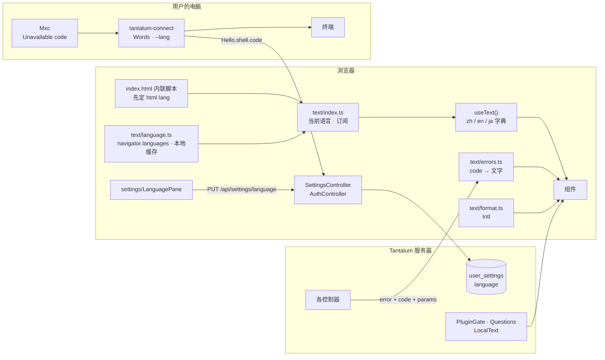

# Design Document

## Overview

四处改动，内核的逻辑不改：

- **控制台：** `console/src/text/` 里一种语言一份字典（`zh.ts` 定键，`en.ts`、`ja.ts` 由类型约束），组件在渲染时用 `useText()` 取当前语言的字典；日期、数字用 `Intl`；设置页加“语言”一栏；四层检查（I6）。
- **服务器：** 用户的语言记在 `user_settings`；接口错误加 `code` 和 `params`；插件作者写的说明和问题改成 `LocalText`。
- **本机：** 沙箱用不了的原因改成代码；`tantalum-connect` 的终端文字放进三种语言的资源文件，加 `--lang`。
- **命令行：** `users`、`check`、`browser install` 的输出放进资源文件。

给模型的文字一个字不改（需求 4.8）：system、工具说明、工具结果、`ToolChanges` 那句、压缩提示词都不经过字典。

## Steering Document Alignment

### Technical Standards (tech.md)
- **不加第三方依赖。** 控制台的字典是普通的 TypeScript 对象，运行时代码约 80 行；Java 用 JDK 的 `ResourceBundle`。DSH 也是自己写的（`packages/client/locale/src/client/index.ts:166`）。
- **会话文件格式不变。** 语言不进会话文件；`Stop.reason`、`RunStatus.detail`、压缩没采用的原因这些写在会话文件里的字符串不动（I10、I11）。回放和 `check` 不受影响。
- **默认只绑 127.0.0.1、凭据不进日志：** 不变。错误的 `params` 只放数字和名字（NFR Security）。
- **TypeScript 7 没有 JS 的语法树接口**（`console/node_modules/typescript/lib` 只有 `tsc.js`、`getExePath.js`），所以 I6 第 ③ 层的源码扫描用正则，不像 DSH 那样解析语法树（`scripts/verify-client-ui-i18n.ts` 用 TypeScript 的解析器）。规则写得窄，配一个带理由的放行清单。

### Project Structure (structure.md)

| 位置 | 文件或类 | 做什么 |
|---|---|---|
| `console/src/text/` | `zh.ts`（改）、`en.ts`、`ja.ts`、`dictionary.ts`、`language.ts`、`index.ts`、`format.ts`、`errors.ts`、`localText.ts`（新）；`time.ts`（删，并进 `format.ts`） | 字典、当前语言、格式化、错误代码、插件文字 |
| `console/src/settings/` | `LanguagePane.tsx`、`useLanguage.ts`（新） | 设置页的“语言”一栏 |
| `console/src/api/` | `errorCodes.json`（新） | 服务器和控制台共用的错误代码清单 |
| `tantalum.value.text`（新） | `Language`、`LocalText`、`Bundle` | 三个模块共用：语言、多语言文字、读资源文件 |
| `tantalum.shell.web` | `ErrorCode`（新）、`WebJson`（改） | 错误代码 |
| `tantalum.shell.settings` | `UserSettings`（改） | 用户的语言 |
| `tantalum.shell.boot` | `CliText`（新）、`Text*.properties` | 命令行的文字 |
| `tantalum.local.sandbox` | `Unavailable`（新）、`Mxc`、`Sandbox`、`Status`（改） | 沙箱用不了的原因 |
| `tantalum.connect` | `Words`（新）、`Text*.properties` | 连接程序的文字 |

- `tantalum-value` 现在只有值类型；`Bundle` 只读类路径上的资源文件，不做别的 I/O，放这里是因为 shell、local、connect 三个模块都要用，而它们共同依赖的只有 `tantalum-value`（`tantalum-connect/pom.xml`、`tantalum-local/pom.xml`）。
- ArchitectureTest 加一条：`java.util.ResourceBundle` 只在 `tantalum.value.text.Bundle` 里用，别处一律经 `Bundle`，免得有人用了会回退到系统语言的默认读法（I14）。

## Code Reuse Analysis

### Existing Components to Leverage
- **`zh.ts` 的结构和写法：** 按页面分组、带参数的文字写成函数（`zh.ts:44`）。这就是键的来源，不改成 `{name}` 字符串。
- **深浅色的做法：** 本地存储加 `index.html` 里的内联脚本（`theme/theme.ts:10-22`、`index.html:10-18`），语言照着做，第一帧不闪。
- **`ui/storage.ts`：** 本地存储读写都经过它，拿不到存储就当没有。
- **`UserSettings`：** 已经是按用户的键值表（`UserSettings.java:59-66`），加一个键 `language`，读不懂的值当没有（同 `compaction_percent`）。
- **代码到文字的现有做法：** `FailureReason`、`EndReason`、工具的合成结果已经按代码翻译（`conversation/runOutcome.ts:34-37`、`process/ToolRow.tsx:45,109`），错误代码照这样做。
- **`AttachmentRejected.Reason`：** 已经是枚举（`AttachmentRejected.java:6-17`），直接对应错误代码，只补参数。
- **插件页的内置工具名单**（`zh.ts:541-546`、`PluginsDialog.tsx:64-74`）：推广到全部内置工具。

### Integration Points
- **登录和 `/api/auth/me`：** 返回值带 `language`，控制台登录成功或刷新后立即用上。
- **`/api/settings`：** 加 `language` 和 `PUT /api/settings/language`。
- **所有返回错误的控制器：** 经 `WebJson.error(ErrorCode, …)`。
- **`/api/plugins`、问题卡片：** 说明和问题的文字变成 `LocalText`。
- **连接消息 `Hello`：** `shell` 一项加 `code`、`params`。

## Architecture



### 控制台怎么决定用哪种语言
1. **页面加载，React 还没起来：** `index.html` 的内联脚本读本地存储 `tantalum.language`；没有就按 `navigator.languages` 选（I2）；写到 `<html lang>`。
2. **`text/index.ts` 加载：** 同样的顺序算出当前语言，作为初值（和内联脚本同一套规则，测试钉住两边一致，同深浅色）。
3. **`/api/auth/me` 返回：**
   - 有 `language`：用它，写进本地存储；
   - `language` 为 `null`：按浏览器选，删掉本地存储；
   - 401：删掉本地存储，按浏览器选（登录页跟浏览器，需求 1.2）。
4. **登录成功：** 登录接口的返回值同 `me`，照第 3 步。
5. **用户在设置页选：** 先换（当场生效），再 `PUT`；`PUT` 失败时换回原来的，并提示（同压缩点 `zh.settings.compactionFailed` 的做法）。
6. **退出登录：** 删掉本地存储，按浏览器选。

### 切换语言不重新挂载（I4）
- `text/index.ts` 持有当前语言，`subscribe`/`getSnapshot` 交给 `useSyncExternalStore`。
- `useText()` 返回当前语言的字典；用到它的组件在语言变了时重新渲染，状态都在，设置窗口不关。
- 不是组件的代码（`api/client.ts`、`conversation/runOutcome.ts`、`composer/status.ts`、`attachment/limits.ts`）在调用时用 `currentText()` 取。它们的结果由组件在渲染时调用，所以跟着变。
- **不许在模块顶层取字典。** 现在有 17 个文件在模块顶层取（`const t = zh.trace` 这类，`trace/Toolbar.tsx:8`、`settings/SettingsDialog.tsx:22-27`、`app/App.tsx:29-31`、`shell/Sidebar.tsx:43-45` 等），都改成在渲染时取：常量里只放 `id` 和图标，文字在渲染时按 `id` 查。检查见 I6 第 ③、④ 层。
- 错误在显示时才变成文字：`ApiError` 只带 `status`、`code`、`params`、诊断，组件渲染时调 `errorText(error)`。这样切换语言后，已经显示着的错误也跟着换。

## Components and Interfaces

### 控制台 `console/src/text/`

**`dictionary.ts`**
- `type Dictionary<T>`：把 `typeof zh`（`as const` 的字面量类型）放宽成“结构相同的文字”：
  - 字符串字面量 → `string`；
  - `(...args: A) => string` → 参数类型不变的 `(...args: A) => string`；
  - 元组 → 同样长度的元组（`trace.timeline.lanes` 是 4 个，`plugins.local.commandHint` 是 4 条）；
  - 对象 → 逐个键递归，键一个不能少、不能多。
- `export type Text = Dictionary<typeof zh>`，`en.ts`、`ja.ts` 写成 `export const en: Text = {…}`。少一个键、多一个键、函数参数不对，`tsc` 报错（需求 2.1、2.2）。

**`zh.ts`**（改）
- 现在的 `as Record<string, string>`（`trace.kind`、`trace.toolStatus`、`plugins.states` 等 17 处）改成 `satisfies Record<某个枚举, string>`：键是接口里的枚举（`api/types.ts` 已有的联合类型），这样英文、日文也必须每个值都写；字典里多出接口没有的值也会报错。接口里没有类型的（例如 `trace.hookPoint`），在 `api/types.ts` 补上联合类型。
- 新加的几组：
  - `language`：设置页那一栏的文字；
  - `errors`：按错误代码（数据模型“错误代码”）；
  - `plugins.tools`：全部内置工具（`read_attachment`、`memory_read`、`memory_write`、`memory_delete`、`web_fetch`，浏览器工具如果那时已经在插件页单独列出也加上，I17）；
  - `plugins.local.sandbox`：按沙箱的原因代码；
  - `time.duration`：时长。
- `time.justNow`、`minutesAgo` 等相对时间的条目删掉，改用 `Intl.RelativeTimeFormat`（I7）。`process.bytes` 的 `toLocaleString("zh-CN")` 改用 `format.ts`。

**`language.ts`**
- `type Language = "zh" | "en" | "ja"`，`LANGUAGES` 按设置页的顺序。
- `detect(tags: readonly string[]): Language`：I2 的规则，先比整个标签，再比主语言；都没有返回 `"en"`。
- `htmlLang(language)`：`zh-CN`、`en`、`ja`；`intlLocale(language)`：`zh-CN`、`en-US`、`ja-JP`。
- `readCached()`、`cache(language)`、`clearCache()`：本地存储键 `tantalum.language`，经 `ui/storage.ts`。
- `NAMES`：`{zh: "中文", en: "English", ja: "日本語"}`，各用自己的语言写，不进字典（需求“可用性”）。

**`index.ts`**
- `currentLanguage()`、`currentText()`、`setLanguage(language)`（换语言、写 `<html lang>`、通知订阅者）、`useLanguage()`、`useText()`。
- 初值：`readCached() ?? detect(navigator.languages)`。

**`format.ts`**（新，替代 `time.ts` 和 `trace/format.ts` 里的时长）
- `formatNumber(n)`：`Intl.NumberFormat(intlLocale(current))`。
- `formatBytes(n)`：按 1024 进位选 B、KB、MB、GB，数字部分用 `formatNumber`；单位写法三种语言相同。
- `clockTime(iso, now)`：现在的规则不变（当天只显示时分，否则带月日；`hourCycle: "h23"` 的理由照 `time.ts:28`），换成当前语言的 `Intl.DateTimeFormat`。日文结果形如 `11/6 09:10`。
- `relativeTime(iso, now)`：`Intl.RelativeTimeFormat(locale, {numeric: "auto"})`，分钟、小时、天的分界照现在（`time.ts:4-14`）。一分钟以内显示 `rtf.format(0, "second")`，中文是“现在”、英文 “now”、日文“今”。
- `formatDuration(ms)`：分界照现在（`time.ts:17-22`），文字取 `time.duration`：中文 `850 毫秒`、`12 秒`、`1 分 5 秒`；英文 `850 ms`、`12 s`、`1m 5s`；日文 `850 ミリ秒`、`12 秒`、`1分5秒`。轨迹页 `trace/format.ts:5-6` 的毫秒、秒（保留两位小数的那种）也改成取字典。

**`errors.ts`**
- `errorText(error: ApiError): {message: string; detail: string | null}`：
  - 429、503 照现在（`api/client.ts:71-72`），分别是 `errors["server/busy"]`、`errors["server/halted"]`；
  - 有 `code` 且字典里有：`message` 是字典里的文字，参数里的数字和字节数经 `format.ts`；`detail` 为 `null`；
  - 否则：`message` 是 `errors.request(status)`（“请求失败（413）”），`detail` 是英文诊断。
- 显示错误的地方都改用它：`composer/Composer.tsx:123,151`、`attachment/uploads.ts:168`、`settings/MemoryPane.tsx:102,122,193`、`plugins/PluginsDialog.tsx:30`、`plugins/LocalWorkspaceCard.tsx:167,172`、`composer/QuestionCard.tsx:68`、`app/App.tsx:107`、`conversation/ConversationPage.tsx:31,43`、`trace/hooks.ts:37`。`detail` 不为空时小字显示在下面。
- `LoginPage.tsx:32-34` 本来就只看状态码，不变。

**`localText.ts`**
- `type LocalText = string | {en: string; zh?: string; ja?: string}`。
- `pick(text, language)`：字符串原样；对象取 `text[language] ?? text.en`（I10）。

**`api/client.ts`**（改）
- `ApiError(status, code: string | null, params: Record<string, string | number>, diagnostic: string)`；`message` 是英文诊断（只给开发者和日志看）。
- 登录、`me` 的返回类型 `User` 加 `language: Language | null`。
- `setLanguage(language: Language | null)` 调 `PUT /api/settings/language`。

**`settings/LanguagePane.tsx`**（新）
- 设置窗口左边加一栏“语言”，放在“外观”下面，图标 `Languages`（lucide-react 已有）。DSH 把它放在“通用”的第一行（`index.ts:622-629`）；我们没有“通用”，单独一栏，免得改动现有几栏。
- 四个选项，单选：“跟随浏览器”（后面灰字写现在检测到的是哪种，例如“跟随浏览器（日本語）”）、`中文`、`English`、`日本語`。照外观那一栏的卡片样式（`settings/AppearancePane.tsx`）。
- 选了立即生效（I4），再存；存不上时换回去并提示“没能保存，已恢复原来的选择。”（三种语言）。

**`index.html`**（改）
- `<html lang="zh-CN">` 去掉写死的值；内联脚本按第 1 步写 `lang`。规则写成和 `language.ts` 同样的几行，测试拿同一组输入比对两边的结果。

**vitest 启动文件**（新，`console/src/test/setup.ts`，`vite.config.ts` 的 `test.setupFiles`）
- 每个测试前 `setLanguage("zh")`（I16）。英文、日文的测试自己切换。

### 控制台的四层检查（I6）

**① `tsc`：** `Dictionary` 类型。

**② `text/dictionaries.test.ts`：** 把 `zh`、`en`、`ja` 都摊成“路径 → 值”的表：
- 三份的路径集合相同（类型已经保证，这里防 `as` 绕过）；
- 同一路径：都是字符串，或者都是参数个数相同的函数，或者都是同样长度的数组；
- 函数用样例参数调用（数字给 `3`，字符串给 `"X"`），结果非空、不含 `undefined`、`NaN`、`[object`；
- 记号不变：从中文原文里取出 `--` 开头的参数、`snake_case` 名字、`tantalum.` 开头的配置项、反引号里的代码、`Enter`、`Shift+Enter`、`Esc`，英文和日文里都要出现同样的一组（照 DSH `shipped-locales.ts:12-14`）；
- 英文的每个值没有中日文字符（`[぀-ヿ㐀-鿿＀-￯]`）；
- 日文的值和中文完全相同的，只能是放行清单里的（例如 `MCP`、`Git`、`Schema`）。日文和中文共用汉字，这条抓“忘了翻、直接复制中文”；
- `errors` 的键和 `api/errorCodes.json` 完全相同（需求 4.4）；`plugins.local.sandbox` 的键和 `Unavailable.Code` 的清单相同（同一个 JSON 文件里的第二组）。
- 条目少于 400 条就失败，免得哪天字典被换成空的、测试照样过（照 DSH `locale-dictionary-parity.spec.ts:320`）。

**③ `text/literals.test.ts`：** 扫 `src/**/*.ts`、`src/**/*.tsx`，跳过 `src/text/`、`*.test.*`、`src/test/`：
- 先去掉注释（`//`、`/* */`、JSX 里的 `{/* */}`）；
- 不许有中日文字符；
- 不许 `aria-label="…"`、`title="…"`、`placeholder="…"`、`alt="…"`、`label="…"` 里写含字母的字面文字（照 DSH `verify-client-ui-i18n.ts:17-33`）；
- 不许有含字母的 JSX 文字节点（`>Copy<` 这种）；
- 不许引用 `text/zh`、`text/en`、`text/ja`：只能经 `text/index.ts`；
- 不许在模块顶层写 `currentText()`（行首的 `const … = currentText()`）；
- 放行清单 `text/literals.allow.ts`：每条写文件、文字和理由，例如品牌名 `Tantalum`、`Ta`（`zh.ts:5-6` 也在字典里，留着）、`macOS`（`LocalWorkspaceCard.tsx:99`，系统名）。
- 扫到的文件少于 50 个就失败（照 DSH `verify-client-ui-i18n.ts:15`）。

**④ `text/english.test.tsx`：** `setLanguage("en")` 后渲染登录页、侧栏、对话页（含一次失败的运行、一个工具调用、一次压缩）、轨迹页、统计页、插件页、设置窗口的每一栏；`document.body.textContent` 去掉测试数据里用户和模型写的内容（测试数据全用英文写）以后，不能有中日文字符（需求 2.5）。这一层抓 ③ 漏掉的，以及模块顶层取了字典的地方。

### 服务器：`tantalum.value.text`

**`Language`**（枚举 `ZH`、`EN`、`JA`）
- `id()`：`zh`、`en`、`ja`；`parse(String)` 返回 `Optional<Language>`，只认这三个。
- `fromTags(List<String>)`：同控制台 `detect` 的规则（先整个标签，再主语言），对不上返回 `EN`。
- `fromEnvironment(Function<String, String> env, Locale system)`：依次看 `LC_ALL`、`LC_MESSAGES`、`LANG`（取 `.` 和 `@` 之前的部分，`ja_JP.UTF-8` → `ja`；`C`、`POSIX` 当没设），再看 `system`，都不是三种之一时 `EN`（I12，照 pi chord `launcher.ts:472-481`）。

**`LocalText`**
- `record LocalText(String plain, Map<Language, String> byLanguage)`：
  - `LocalText.of(String)`：作者只写了一种文字，不知道是哪种语言，原样显示；
  - `LocalText.of(String en, String zh, String ja)`、`LocalText.en(String)` 加 `.zh(…)`、`.ja(…)`：带语言的，`en` 必填；
- 写成 JSON：`of(String)` 是字符串，否则是 `{"en": …, "zh": …, "ja": …}`（同 DSH `LocalizedText`，`package-manifest/src/types.ts:44`）。
- `in(Language)`：服务器自己要用时取（这一 spec 里只有测试用）。

**`Bundle`**
- `Bundle.load(String baseName, Language language)`：`ResourceBundle.getBundle(baseName, locale, ResourceBundle.Control.getNoFallbackControl(FORMAT_PROPERTIES))`，不回退到 JVM 的系统语言（I14）；`Text.properties` 是英文，`Text_zh`、`Text_ja` 找不到某个键时取英文。Java 9 起 `.properties` 资源文件按 UTF-8 读。
- `text(String key, Map<String, ?> params)`：把 `{name}` 换成参数；参数缺了原样留着 `{name}`（同 DSH `index.ts:476-477`），测试会抓到。
- `keys()`、`placeholders(key)`：给测试用。
- 测试辅助 `BundleChecks.assertComplete(baseName, keyEnum)`：每个键三份都有、没有多的键、三份占位符相同、英文没有中日文字符（I14）。三个模块的测试都调它。

### 服务器：用户的语言

- **`UserSettings`**：`language(Principal)` 返回 `Optional<Language>`；`setLanguage(Principal, Optional<Language>)`，空就删掉这一行。读到不认识的值当没有（NFR Reliability）。和 `compaction_percent` 一样缓存。
- **`SettingsController`**：
  - `GET /api/settings` 加 `"language": "ja"` 或 `null`；
  - `PUT /api/settings/language`，请求体 `{"language": "ja"}` 或 `{"language": null}`；别的值 400，代码 `settings/invalid`（需求 1.9）。返回更新后的设置。
- **`AuthController`**：登录成功和 `GET /api/auth/me` 的返回加 `language`（同上，`null` 表示跟随浏览器）。

### 服务器：错误代码（I9）

- **`web/ErrorCode`**（枚举）：每个值有 `wire()`（`attachment/too-large`）和默认状态码。清单见“数据模型”。
- **`WebJson.error(ErrorCode code, String diagnostic)`**、`error(ErrorCode, String diagnostic, Map<String, Object> params)`：返回 `{"error", "code", "params"}`；`params` 为空时不写。旧的 `error(status, message)` 删掉，所有调用改过来，编译器保证没有漏的。
- **各控制器**（`ApiController`、`AttachmentController`、`QuestionController`、`PluginController`、`SettingsController`、`LocalController`、`MemoryController`、`TraceController`、`RunTraceController`）：每个 `WebJson.error` 换成对应的代码；`AuthController` 的 `error` 值保留现在的 `invalid_credentials` 这些（`AuthController.java:56-73`），另加 `code`。
- **带参数的几类：**
  - `AttachmentRejected` 加 `Map<String, Object> params()`，`code()` 由 `Reason` 和种类决定（`TOO_LARGE` 分文件和图片两种）；`AttachmentStore`、`ImageNormalizer`、`AttachmentLimits` 抛出时给参数（上限字节数、像素、张数），消息改成英文诊断。`ToolImages` 给模型的错误结果用这个英文诊断（给模型的本来就该是英文，web-tools 设计里“沿用 `AttachmentRejected` 的消息”不变）。
  - 记忆：`MemoryFormat`、`MemoryStore`、`CredentialGuard` 的拒绝原因加代码和参数（名字的规则、条数上限）；`MemoryWriteTool` 给模型的仍是英文原因（I8：给模型的不变）。
  - `PluginGate.UnknownPlugin`、“必须开启的插件不能关”（`PluginGate.java:218,227`）带插件名。
- **共用清单 `console/src/api/errorCodes.json`：** `{"errors": [...], "sandbox": [...]}`。Java 测试 `ErrorCodeTest` 读这个文件，和 `ErrorCode` 的 `wire()` 集合、`Unavailable.Code` 的集合比对；vitest 拿它和字典比对。两边任何一边加了代码没加另一边，测试失败。

### 服务器：插件作者的文字（I10）

- **`KernelHook.description()`**（`tantalum-kernel/.../hook/KernelHook.java:33`）、**`AfterToolHook.description()`**（`shell/plugin/AfterToolHook.java:21`）、**`WorkType.description()`**（`shell/plugin/WorkType.java:15`）返回 `LocalText`，默认 `LocalText.of("")`。
- **`Question`**（`shell/plugin/Question.java:10`）：`title`、`detail`、`Choice.label` 改成 `LocalText`。问题只在内存里（`question/OpenQuestions.java`），不进会话文件。
- **`PluginGate.overview`** 的 `PluginView.description` 是 `LocalText`；按插件合并说明（`PluginGate.java:244-254` 的 `first`）照旧，判断“空”改成 `LocalText` 的 `isEmpty()`。
- **`tantalum-examples`**：8 个插件的说明（`ToolApprovalHook.java:55`、`PinnedContextHook.java:41`、`DailyQuotaHook.java:33`、`CitationCheckHook.java:60`、`TruncateOutputHook.java:27`、`ReadOnlyHook.java:27`、`ProviderBackoffHook.java:41`、`ApprovalWork.java:57`）和审批问题（`ApprovalWork.java:66-69`）写齐英、中、日。它们是给插件作者照着写的例子，所以要示范带三种语言的写法。

### 本机：沙箱的原因和连接程序

- **`tantalum.local.sandbox.Unavailable`**（新）：`record Unavailable(Code code, Map<String, String> params)`，`Code` 枚举：

  | 代码 | 参数 | 现在的中文（`Mxc.java`） |
  |---|---|---|
  | `sandbox/not-macos` | — | `:61` |
  | `sandbox/mxc-invalid` | `path` | `:66` |
  | `sandbox/mxc-missing` | — | `:72` |
  | `sandbox/temp-dir` | `detail` | `:77` |
  | `sandbox/check-failed` | `detail` | `:105` |
  | `sandbox/start-failed` | `detail` | `:109` |
  | `sandbox/run-failed` | `detail` | `:113` |
  | `sandbox/check-interrupted` | — | `:116` |
  | `shell/not-allowed` | — | `Main.java:38` 的 `NO_SHELL_FLAG` |

  - `detail` 是 MXC 或操作系统的输出，原样显示（I8）。`firstLine` 里的“没有在 N 秒内结束”“退出码 N”（`Mxc.java:121-123`）改成英文，因为它们拼进 `detail`。
  - `Sandbox.unavailable`、`Status.unavailable` 改收 `Unavailable`；`english()` 给模型的那句（`Mxc.java:133` “The command sandbox is not available: …”）由一张英文表生成，不经资源文件，保证给模型的文字不随连接程序的语言变。
- **`wire/Hello.Shell`**：`Shell(boolean available, String reason, String code, Map<String, String> params)`。`reason` 留着，写英文诊断，老服务器照样显示得出东西；新服务器转给控制台 `code` 和 `params`。连接协议的版本号不变，新字段是可选的（老连接程序不送，控制台照原样显示 `reason`，需求“可靠性”）。
- **`/api/local`** 的 `link.shell` 加 `code`、`params`；`LocalWorkspaceCard.refusal`（`:84-92`）按 `code` 取 `plugins.local.sandbox`，没有 `code` 时退回现在的写法。
- **`tantalum.connect.Words`**（新）：键的枚举 `Key` 和 `say(Key, Map<String, ?>)`，经 `Bundle.load("tantalum.connect.Text", language)`。资源文件 `tantalum-connect/src/main/resources/tantalum/connect/Text.properties`、`Text_zh.properties`、`Text_ja.properties`。
  - 搬进去的：`HELP`（`Main.java:45-67`）、`Refused` 的消息（`:133-292` 约 20 条）、令牌提示（`:283`）、启动摘要（`:341-364`）、`Link` 的重连、连上、关闭消息（`Link.java:81,102,139-149,236,250-251`）、沙箱原因（上表，终端里也要说）。
  - 不搬：每次调用的记录行（`Journal.java:20-23`，I12）、给服务器的关闭原因（`LocalEndpoint` 那边的英文代码）、给模型的工具结果（`Calls.java:36-38,102,121,207`）。
- **`--lang`**：`Main` 先单独解析 `--lang`（它决定后面所有报错用什么语言），值不对时用英文说“--lang must be zh, en or ja”并以 `REFUSED` 退出（需求 5.3）；没给就 `Language.fromEnvironment(System::getenv, Locale.getDefault())`。`HELP` 里加这一项。安装包的启动脚本不传 `--lang`，跟系统。

### 命令行（I13）

- **`boot/CliText`**：同 `Words`，资源文件 `tantalum-shell/src/main/resources/tantalum/shell/boot/Text*.properties`。
- `UserCommand`（`auth/UserCommand.java:15-54`）、`RecordCheckCommand`（`boot/RecordCheckCommand.java:38`）和 `RecordCheck` 的输出（`store/RecordCheck.java:68-85`）、`BrowserCommand` 和 `BrowserDriver` 的进度行（`browser/BrowserCommand.java:14`、`BrowserDriver.java:151,154`）改用它。`TantalumApplication.main` 在分派子命令前解析 `--lang`，规则同连接程序。
- `UserStore` 抛出的消息（`auth/UserStore.java:55,58,119`）由 `UserCommand` 按异常种类换成 `CliText` 的文字，`UserStore` 自己不依赖 `CliText`。
- 启动失败和运行日志（`TantalumApplication.java:112-145`、`AdminBootstrap.java:21` 等）不翻译（需求 5.6）。
- `BrowserCommand` 现在可能还在 web-tools 那边改（任务 15）；做这一条时先看它的现状，只换输出的文字。

## Data Models

### 登录和 `GET /api/auth/me`
```json
{"username": "yi", "language": "ja"}
```
`language` 为 `null` 表示跟随浏览器。

### `GET /api/settings`
```json
{
  "compaction": {"percent": 85, "points": [{"percent": 50, "tokens": 100000}]},
  "language": null
}
```
`model-picker` 同时在这里加 `model`（I17），互不影响。

### `PUT /api/settings/language`
```json
{"language": "en"}
```

### 错误
```json
{"error": "the image is larger than the 50 MiB limit", "code": "attachment/image-too-large", "params": {"limit": 52428800}}
```

错误代码（第一版，实施时以 `errorCodes.json` 为准；每一个都在三份字典里）：

| 代码 | 状态码 | 参数 | 中文（字典里的） |
|---|---|---|---|
| `request/invalid` | 400 | — | 请求格式不对，请刷新页面后重试 |
| `server/busy` | 429、503 | — | 服务器忙，请稍后重试 |
| `server/halted` | 503 | — | 服务已停止处理事件 |
| `server/save-failed` | 500 | — | 没有保存好，请重试 |
| `session/not-found` | 404 | — | 这个会话不存在 |
| `session/unreadable` | 500 | — | 这个会话的记录读不出来 |
| `session/busy` | 409 | — | 会话正在运行，或者没有可以压缩的内容 |
| `submission/rejected` | 409 | — | 没有交上，请重发 |
| `run/not-found` | 404 | — | 这次运行不存在 |
| `run/cancel-rejected` | 409 | — | 这次运行已经结束，停不了 |
| `trace/not-found` | 404 | — | 轨迹里没有这一项 |
| `attachment/not-found` | 404 | — | 附件不存在或不属于你 |
| `attachment/read-failed` | 500 | — | 附件读取失败 |
| `attachment/not-stored` | 500 | — | 附件没有存好，请重试 |
| `attachment/too-large` | 413 | `limit` | 单个文件不能超过 `{limit}` |
| `attachment/image-too-large` | 413 | `limit` | 单张图片不能超过 `{limit}` |
| `attachment/image-pixels` | 422 | `width`、`height`、`limit` | 图片 `{width}`×`{height}` 的边长超过 `{limit}` 像素 |
| `attachment/invalid-image` | 422 | — | 文件名是图片，但内容不是 PNG、JPEG、WebP 或 GIF 图片 |
| `attachment/quota-full` | 413 | — | 附件空间已满 |
| `attachment/too-many-images` | 400 | `max`、`count` | 一条消息最多 `{max}` 张图片，这条有 `{count}` 张 |
| `attachment/model-no-images` | 400 | — | 当前模型不支持图片 |
| `question/gone` | 404 | — | 这个问题已经不用回答了 |
| `plugin/not-found` | 404 | `name` | 没有这个插件或工具：`{name}` |
| `plugin/required` | 409 | `name` | `{name}` 是管理员设为必须开启的，不能关 |
| `memory/not-found` | 404 | — | 这条记忆不存在 |
| `memory/invalid-name` | 400 | — | 名称只能用小写字母、数字和连字符，最多 64 个 |
| `memory/invalid` | 400 | `field` | 这一项没有填对：`{field}` |
| `memory/full` | 409 | `max` | 记忆已满（最多 `{max}` 条），先删掉一些 |
| `memory/credential` | 400 | — | 记忆里不能放密码、密钥这类凭据 |
| `settings/invalid` | 400 | — | 这个设置的值不对 |
| `auth/invalid-credentials` | 401 | — | 用户名或密码错误 |
| `auth/too-many-attempts` | 429 | — | 尝试次数过多，请稍后再试 |
| `auth/not-authenticated` | 401 | — | 请先登录 |

- 表里 `{limit}` 是说明写法；字典里是函数 `(limit: string) => …`，`errors.ts` 先把字节数格式化成字符串再传进去。
- `request/invalid` 合并了只有写错的客户端才会碰到的约 20 种（“body is not valid JSON”“missing requestId”“mode must be one of …”），英文诊断照旧写具体原因，方便开发者查（I9）。

### `LocalText`
```json
"每个用户每天的 token 用量上限，超过就停止。"
```
或
```json
{"en": "Stops a user's runs after the daily token limit.", "zh": "每个用户每天的 token 用量上限，超过就停止。", "ja": "ユーザーごとの 1 日のトークン上限です。超えると実行を止めます。"}
```

### `/api/local` 的 `link.shell`
```json
{"available": false, "reason": "MXC could not start the sandbox: ...", "code": "sandbox/start-failed", "params": {"detail": "..."}}
```

### 会话文件
不改。

### 本地存储
`tantalum.language`：`zh`、`en`、`ja`，只是服务器那份的缓存（I3）。

## 术语表

英文句首大写其余小写；日文标签用名词形，说明用です・ます体（I15）。“出处”一栏是 DSH 的同一个词，没有的标“自定”。

| 中文 | English | 日本語 | 出处 / 备注 |
|---|---|---|---|
| 会话 | Session | セッション | DSH `ui-workspace/src/client/locales.ts:21,147,270` |
| 新会话 | New session | 新しいセッション | 同上 `:13,139,262`（DSH 英文是 “New Session”，按 DSH 自己的句首大写规则改小写） |
| 对话（页签） | Conversation | 会話 | 自定 |
| 轨迹 | Trajectory | 軌跡 | DSH `ui-trajectory/src/client/locales.ts:8,225,428` |
| 统计 | Stats | 統計 | 自定 |
| 轮次 / 第 N 轮 | Turn / Turn N | ターン / ターン N | DSH `ui-trajectory/src/client/locales.ts:14,231,434` |
| 步骤 | Step | ステップ | 自定 |
| 调用 | Call | 呼び出し | DSH 同上 `:17,234,437` |
| 工具调用 | Tool call | ツール呼び出し | DSH `docs/i18n/terminology.md:204`（中英） |
| 工具 | Tool | ツール | DSH `ui-trajectory/src/client/locales.ts:31,248,451` |
| 内置工具 | Built-in tools | 組み込みツール | 自定 |
| 插件 | Plugins | プラグイン | DSH `ui-plugin-manager/src/client/locales.ts:11,309,605` |
| 钩子 | Hook | フック | DSH `experimental/hooks-claude-code/locale/{zh,en,ja}.json:3` |
| 钩子插件 | Hook plugins | フックプラグイン | 自定，由上一行组合 |
| 插件工作 | Plugin work | プラグイン処理 | 自定 |
| 本机工作区 | Local workspace | ローカルワークスペース | DSH 工作区 `Workspaces` / `ワークスペース`（`ui-workspace/src/client/locales.ts:20,146,269`） |
| 连接程序 | Connector | 接続プログラム | 自定；产品名 `tantalum-connect` 不翻译 |
| 令牌 | Token | トークン | 自定；和计量用的 `tok` 区分：令牌在英文里需要时写 “connection token” |
| 上下文 | Context | コンテキスト | DSH `ui-trajectory/src/client/locales.ts:27,244,447` |
| 压缩（动作） | Compact | 圧縮 | DSH `ui-commands/src/client/locales.ts:17,52,84` |
| 上下文压缩 | Context compaction | コンテキスト圧縮 | DSH `compaction/compaction-basic/locale/ja.json:3`；英文照 `terminology.md:117` |
| 已压缩 | Compacted | 圧縮済み | DSH `ui-trajectory/src/client/locales.ts:28,245,448`（DSH 英文全大写是标签样式，我们用句首大写） |
| 裁剪 | Trim | トリミング | 自定 |
| 摘要 | Summary | 要約 | 自定 |
| 系统提示词 | System prompt | システムプロンプト | DSH `ui-trajectory/src/client/locales.ts:102,319,522` |
| 记忆 | Memory | メモリ | 自定 |
| 附件 | Attachment | 添付ファイル | 自定 |
| 模型 | Model | モデル | 自定 |
| 思考 | Thinking | 思考 | 自定 |
| 运行 | Run | 実行 | 自定 |
| 排队 | Queue / Queued | キュー / 待機中 | 自定 |
| 插话 | Steer | 割り込み | 自定 |
| 首 token 延迟 | Time to first token | 最初のトークンまで | 自定；表头缩写 `TTFT` 三种语言都可用 |
| 缓存命中 | Cache hit | キャッシュヒット | 自定 |
| 用量 | Usage | 使用量 | 自定 |
| 设置 | Settings | 設定 | 自定 |
| 语言 | Language | 言語 | DSH `client/locale/src/locales/settings.ts:5,13,18` |
| 跟随浏览器 | Use browser language | ブラウザーの言語に合わせる | 自定 |
| 管理员 | Administrator | 管理者 | 自定 |
| 联网 | Web access | Web アクセス | 自定（web-tools 的卡片） |
| 抓网页 | Fetch web pages | Web ページ取得 | 自定 |
| 浏览器 | Browser | ブラウザー | 自定；日文用带长音的写法（微软的写法），全篇统一 |

- 产品名、工具名、命令和参数（`Tantalum`、`MCP`、`Git`、`web_fetch`、`--allow-write`、`tantalum.hooks.required`）三种语言都原样写（I6 的记号检查）。
- 日文里英文单词和日文之间留一个半角空格（`MCP サーバー`、`Git 履歴`），数字和单位之间同中文现在的写法。

## Error Handling

### Error Scenarios

| 情况 | 处理 | 用户看到 |
|---|---|---|
| 浏览器语言三种都不是 | 用英文（I2） | 英文界面 |
| 存语言的 `PUT` 失败 | 换回原来的语言 | “没能保存，已恢复原来的选择。” |
| 服务器上存的值读不懂 | 当没选过 | 跟随浏览器 |
| `PUT` 的值不是三种之一 | 400，`settings/invalid` | 只有写错的客户端会碰到 |
| 本地存储用不了 | 不缓存；每次刷新先按浏览器，`me` 返回后再换 | 刷新时可能闪一下 |
| 错误代码控制台不认识 | 退回“请求失败（状态码）”，下面小字是英文诊断（I9） | 能看懂是哪一步失败，英文诊断方便报告 |
| 插件的 `LocalText` 没有用户的语言 | 用英文；只有一个字符串的照原样 | 英文或插件作者写的那种 |
| 老版本连接程序只送 `reason` | 照原样显示 | 原因文字（可能是中文） |
| `--lang` 的值不对 | 英文提示可选值，退出码 1 | “--lang must be zh, en or ja” |
| 资源文件里少一个键（只会在开发时） | `BundleChecks` 测试失败；万一漏到运行时，用英文那份，英文也没有就显示键名 | 开发时就抓到 |
| 字典少一条 | `tsc` 失败，构建不出来 | 不会上线 |

## Testing Strategy

每个测试都对应一条需求或一个已知风险，写在括号里。

### Unit Testing
- **`language.ts`**（需求 1.1）：表驱动：`["ja-JP"]` → ja；`["zh-TW"]` → zh；`["fr-FR", "ja"]` → ja；`["fr"]` → en；`[]` → en；`["EN-gb"]` → en（大小写）。内联脚本用同一组输入，结果相同。
- **`format.ts`**（需求 3.1–3.3）：三种语言各一组：同一天的时刻、跨天带月日、零点不显示成 24 点（`time.ts:28` 的理由）、5 分钟前、昨天、3 天前、`1,234,567`、字节数、三档时长。
- **`errors.ts`**（需求 4.2、4.3）：认得的代码带参数（字节数按语言格式化）；认不得的代码；没有代码；429、503。
- **`localText.ts`**（需求 4.5）：字符串原样；对象取用户的语言；没有时取英文。
- **四层检查**（需求 2.1–2.5、4.4）：见上面“控制台的四层检查”。③ 和 ④ 各做一次变异：在一个组件里写一句 `aria-label="Close"`、在模块顶层写一次 `const t = currentText().trace`，确认测试失败后删掉。
- **`LanguagePane`**（需求 1.3、1.4）：选英文后标题当场变英文、窗口还开着；`PUT` 失败时换回原来的；选“跟随浏览器”发 `null`。
- **`Language`、`Bundle`、`LocalText`（Java）**（需求 5.2、5.5）：`fromEnvironment` 表驱动（`LC_ALL=ja_JP.UTF-8`、`LANG=C`、`LANG=zh_CN.UTF-8` 加 `LC_ALL` 为空、都没有时看系统语言）；`Bundle` 在 JVM 默认语言设成日文时，`EN` 拿到的是英文（关掉回退的回归）；`{name}` 替换、缺参数留原样；`LocalText` 的 JSON 两种写法。
- **`BundleChecks`**（需求 5.5）：连接程序和命令行各一个测试；变异：删掉日文的一个键，确认失败后恢复。
- **`ErrorCodeTest`**（需求 4.4）：`ErrorCode` 和 `Unavailable.Code` 的集合等于 `errorCodes.json`。

### Integration Testing
- **`SettingsApiTest`**（需求 1.3–1.5、1.9）：默认 `null`；存 `ja` 后再取是 `ja`，另一个用户还是 `null`；存 `null` 删掉；`fr` 回 400 带 `settings/invalid`；未登录 401。
- **`AuthApiTest`**（需求 1.5）：登录和 `me` 的返回带 `language`。
- **各控制器的错误**（需求 4.1）：每个 `ErrorCode` 至少有一个测试触发它，断言状态码、`code`、`params`；`error` 里没有中文字符。现有断言中文消息的测试改成断言代码。
- **插件和问题**（需求 4.5）：`/api/plugins` 里带三种语言的插件说明是对象，只写一个字符串的是字符串；审批问题的标题是对象。
- **沙箱原因**（需求 4.7）：`Mxc.open` 在非 macOS 条件下返回 `sandbox/not-macos`；`Hello` 带 `code` 送到服务器，`/api/local` 转出来；老格式的 `Hello`（没有 `code`）照样能连上。
- **给模型的不变**（需求 4.8）：`E2eServer` 的脚本化模型，同一个会话用 `zh`、`en`、`ja` 三个用户设置各提问一次，记录下来的模型请求（system、工具、消息）逐字相同。
- **连接程序**（需求 5.1–5.3）：`--lang ja` 时 `--help` 是日文；`LANG=ja_JP.UTF-8` 时同样；`--lang fr` 以 1 退出并用英文提示；没有令牌时的报错三种语言各一遍。
- **命令行**（需求 5.4）：`users add` 缺密码时的提示按 `--lang` 变。

### End-to-End Testing
- **`e2e/i18n.spec.ts`**（新）：
  - 浏览器 `locale: "ja-JP"` 的新上下文：登录页是日文，`<html lang="ja">`（需求 1.2、1.8）；
  - 登录后在设置页选 English：标题当场变英文、设置窗口没关（需求 1.3）；刷新后还是英文，第一帧的 `lang` 就是 `en`（需求 1.6）；
  - 用同一用户在 `locale: "zh-CN"` 的另一个上下文登录：英文（需求 1.5）；
  - 退出登录：登录页回到浏览器的语言（需求 1.7）；
  - 日文下传一张超过上限的图片：提示是日文，上限数字按日文格式（需求 4.2）；
  - 日文下打开插件页：每个内置工具的名字不是 `snake_case`、说明里没有给模型的英文原文（需求 2.4）。
- **已有的 Playwright 测试** 照旧用 `zh-CN` 跑，断言不改（I16）。
- **8091 真实检查（任务 20）：** 三种语言各截登录页、对话页、轨迹页、统计页、插件页、设置页；连接程序在终端里用 `--lang ja` 跑一次截图。

## 定下的两件事（批准本设计即批准）

1. **语言单独一栏，不放进“外观”。**
   - 放进“外观”：少一栏，但语言不是外观。
   - 单独一栏：设置窗口多一项，以后有别的“通用”设置可以并进来。
   - **定为单独一栏。** DSH 放在“通用”里第一行（`index.ts:622-629`），我们还没有“通用”。
2. **三种语言都打进主包，不按需加载。**
   - 按需加载：主包少约 20 KB（gzip），但切换时要等一次请求，第一帧可能先显示别的语言。
   - 全部打进去：切换不用等，第一帧就对。
   - **定为全部打进去。** 三种语言的字典 gzip 后合计约 30 KB 以内（NFR），不值得多一次请求。
