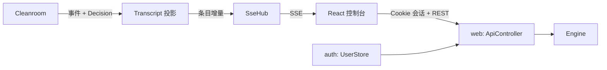

# Design Document

## Overview

把 `console/` 重写成 DSH 风格的界面，并给 Spring Boot 后端加上登录和对话投影。组件全部自己写，只对照 DSH 的布局和设计值（需求 U1）。



依据：`requirements.md`，以及本机运行 DSH 0.2.1-rc.5 的观察。

## Steering Document Alignment

### Technical Standards (tech.md)
技术栈不变。Spring 只在 `boot`、`web`、`auth`；`kernel` 和 `value` 不改。

### Project Structure (structure.md)
项目没有 `structure.md`，结构以本文为准。

## Code Reuse Analysis

- **复用：** `SseHub`、`TurnQuery`、`Engine`、`ExternalGate`、`SubmissionLedger`、`TestServer`。
- **替换：** `console/src` 除 `api/sse.ts` 的解析逻辑外全部重写。
- **对照 DSH 的只有设计值：** 栏宽、断点、圆角、配色方向和布局。不复制它的组件代码。

## Architecture

### 后端新增

```
tantalum.shell
├── auth（新）
│   ├── UserStore            SQLite 用户表 users.db，只存密码哈希
│   ├── AdminBootstrap       首次启动时由环境变量创建第一个用户
│   ├── UserCommand          命令行：添加用户、重置密码、停用用户
│   ├── LoginThrottle        按账号和来源限制失败次数
│   └── SecurityConfig       Spring Security：Cookie 会话、CSRF、未登录返回 401
├── conversation（新）
│   ├── Transcript           事件到对话条目的增量投影，按会话保存；回放和实时同一个函数
│   └── TranscriptItem       条目：用户消息、回复文本、思考、工具步骤（含起止时间和分组）、运行状态
└── web
    ├── ApiController        principal 改为从登录会话取得，去掉 X-Principal
    ├── AuthController（新）  登录、退出、当前用户
    └── SpaController（新）   前端路由回退到 index.html
```

### 对话投影：放在 shell，不进内核

工具链要显示分组、状态和耗时，这些是展示需求，不是运行语义，所以不改 `kernel` 和 `value`（需求 10 第 5 条）。

- `Cleanroom` 每处理完一个事件，把 `(envelope, decision)` 交给 `Transcript`。这步只改内存，不做 I/O，不会阻塞环。
- 启动时 `Startup` 用同样的函数回放 journal，所以刷新和重启后工具链都能还原。
- 每个条目有稳定 ID，由事件序号和块下标算出，回放时相同。
- 变化通过 SSE 事件 `item` 发送完整条目，客户端按 ID 覆盖。`item` 带序号，能用现有规则补读。

| 条目 | 来源 |
|---|---|
| 用户消息 | `UserPrompt`、`FollowUpSubmitted`、`SteerSubmitted` |
| 思考、回复文本 | `ModelReplied` 的内容块，按块的顺序 |
| 工具步骤（等待中、运行中） | `ModelReplied` 的调用和 `Decision` 里的 `RunTool` |
| 工具步骤（结束） | `ToolFinished`、`ToolPairing` 的合成结果、被拦截的结果 |
| 运行状态 | `PhaseChanged`、失败原因、`ModelInterrupted` |

**分组规则：** 同一个事件发出的多条 `RunTool` 是一组并行调用。起始时间取发出命令的事件时间，结束时间取结果事件时间。

**一个局限：** 排队等服务端名额的时间也算在耗时里，因为 journal 不记录真正开始执行的时刻。界面上写“耗时”，不另外区分排队。

**流式分片：** 仍然不进 journal，也不进 `Transcript`。分片事件带运行 ID，客户端先显示在“进行中”的条目里，结算的条目到达后替换。

### 认证

- **会话：** 服务端内存会话，`HttpOnly`、`SameSite=Strict`，非本机部署时 `Secure`。重启后要重新登录。
- **密码：** 用 Spring Security 的 `Argon2PasswordEncoder`。
- **用户数据：** 单独的 `users.db`，权限 600，不进 journal。
- **SSE：** 用户退出或被停用时，`SseHub` 按 principal 关闭订阅（新增 `closeAll`）。
- **CSRF：** `SameSite=Strict` 加 `Origin` 校验，不用 CSRF token。
- **已有数据：** journal 里 `local` 的运行，只有名为 `local` 的用户才看得到。

### 工作目录隔离

- `Tool.run(ToolContext context, Json arguments)`：`ToolContext` 带 principal 和该用户的 `Workspace`。`AfterToolHook`、`WorkType` 同样改为接收 `ToolContext`。
- `Workspaces`（新，`shell.tool`）按 principal 给出 `Workspace`，按 `workspace-mode` 决定每人一个目录或共用。
- `ToolHandler`、`ContextHandler` 从命令的 `RunRef` 取 principal。`kernel` 和 `value` 不变。
- `GrepTool`、`ReadFileTool` 不再持有固定的 `Workspace`，改用上下文里的。
- 旧 journal 的 `ContextAssembled` 已含完整 prompt，回放不受影响。

### 接口

| 方法 | 路径 | 用途 |
|---|---|---|
| POST | `/api/auth/login` | 登录 |
| POST | `/api/auth/logout` | 退出 |
| GET | `/api/auth/me` | 当前用户，未登录返回 401 |
| GET | `/api/sessions` | 会话列表 |
| GET | `/api/sessions/{id}/messages` | 全部条目和排队内容 |
| GET | `/api/config` | 供应商、模型名、是否云端 |
| GET | `/api/runs/{id}/trace` | 轨迹页的时间条和事件列表 |

已有接口不变，只是身份改由会话决定。

### 前端结构

```
console/src
├── app/            App、路由、QueryClient
├── api/            REST、SSE 客户端、类型
├── auth/           LoginPage、useCurrentUser
├── store/          ConversationStore（不依赖 React）
├── shell/          AppFrame、Sidebar、SessionRow、Brand
├── conversation/   ConversationPage、MessageList、UserBubble、EmptyState、JumpToBottom
├── process/        ProcessGroup、ThinkingBlock、ToolChain、ToolRow、ToolGroup
├── markdown/       Markdown、CodeBlock
├── composer/       Composer、QueueDock、StatusBar
├── trace/          TracePage、TimeBars、EventList、ModelCallDetail
├── settings/       SettingsDialog、AppearancePane、ModelPane、AccountPane
├── ui/             Button、Dialog、Menu、Tabs、Tooltip
├── theme/          tokens.css、theme.ts
└── text/           zh.ts（全部文案）
```

**状态：** `ConversationStore` 按条目 ID 保存不可变对象，组件用 `useSyncExternalStore` 只订阅自己的条目。这样一个分片只重绘一个条目（需求 4 第 10 条）。TanStack Query 只管一次性请求。

**路由：** `/login`、`/s/{session}`、`/s/{session}/trace/{run}`。写一个小的路由钩子，不引入路由库，页面只有这几个。

**新依赖：**

| 依赖 | 用途 | 理由 |
|---|---|---|
| `react-markdown`、`remark-gfm` | Markdown、表格 | 默认不渲染原始 HTML，符合安全要求 |
| `highlight.js`（只注册常用语言） | 代码高亮 | 体积可控 |
| `lucide-react` | 图标 | 按需打包；不复制 DSH 的图标 |
| `@playwright/test` | 端到端测试 | 开发依赖 |

版本在实现时固定，并检查 gzip 后不超过 300 KB。

## Components and Interfaces

### 界面规格（来自 DSH 实物）

| 区域 | 规格 |
|---|---|
| 侧栏 | 默认 280 px，浅灰底；顶部品牌和收起按钮；“新会话”是带边框的圆角按钮；下方是会话列表，行右侧显示相对时间；底部“更多”菜单 |
| 主区顶栏 | 会话标题，下方标签页“对话”“轨迹”，选中项带下划线 |
| 用户消息 | 右对齐浅蓝气泡，圆角约 20 px；下方显示时间和复制按钮 |
| 模型回复 | 无气泡；内容列约 680 px 居中 |
| 过程区 | 标题“已完成，用时 32 秒 ⌄”，下有分隔线；每步一行：图标加文字 |
| 回复底部 | 复制、用量、时间。不做点赞和分享 |
| 代码块 | 浅灰圆角卡片，左上语言名，右上复制 |
| 输入栏 | 大圆角卡片，左侧加号位置留空，右侧模型名和圆形发送按钮；运行中变为停止按钮 |
| 状态行 | 输入栏下方：轮数、速度、token、上下文占比 |
| 轨迹页 | 工具条，三行彩色时间条（输入、模型、工具），下面是带类型标签的事件列表 |
| 设置 | 居中大圆角弹窗，左导航右内容；外观用三张卡片选浅色、深色、跟随系统 |

配色在 `tokens.css` 里用自己的变量名定义，浅色和深色各一套。

### 品牌和登录页（原创）

- **标志：** 元素周期表方格样式的 “Ta”，配 “Tantalum” 字样，不用鲸鱼或小鱼。
- **登录页：** DSH 没有本地登录页，所以这是新设计。居中卡片，28 px 圆角，上面是标志，下面是用户名、密码和全宽的黑色主按钮；错误提示显示在按钮上方。手机宽度下卡片占满，留 16 px 边距。

### 响应式

| 宽度 | 行为 |
|---|---|
| ≥ 1024 px | 侧栏展开，可拖动 |
| 768–1023 px | 收成 56 px 图标栏，可手动展开 |
| < 768 px | 抽屉，覆盖内容 |

顶栏、输入栏和状态行在窄屏时收紧，状态行只保留上下文占比。

## Data Models

```java
record ToolStepItem(String id, RunId run, ToolCallBlock call, String group, Status status,
                    Instant startedAt, Instant finishedAt, ToolResultBlock result) {
    enum Status { WAITING, RUNNING, DONE, ERROR, BLOCKED }
}
record SessionSummary(SessionId id, String title, Instant lastActivity, String runStatus) {}
record User(String name, String passwordHash, boolean disabled, Instant createdAt) {}
```

```ts
type Item = UserItem | TextItem | ThinkingItem | ToolStepItem | RunStatusItem;
```

## Error Handling

| 场景 | 处理 |
|---|---|
| 401 | 回到登录页，草稿保留在 `sessionStorage` |
| 登录失败 | 只说“用户名或密码错误” |
| 登录限速 | 提示稍后再试 |
| 提交 429、503 | 保留输入，显示原因，重试用同一个 `requestId` |
| SSE 断开 | 顶部提示，自动重连；重连后重新拉取当前会话的条目 |
| 运行失败 | 对话区显示错误行，按失败原因给出说明 |
| Markdown 渲染出错 | 错误边界，退回纯文本 |

## Testing Strategy

### Unit Testing
- `Transcript`：顺序、并行分组、独占、拦截、合成错误、耗时；回放结果与实时结果相同。
- `UserStore`、`LoginThrottle`：哈希、停用、限速。
- `ConversationStore`、Composer（输入法、Enter）、Markdown（原始 HTML、`javascript:` 链接）。

### Integration Testing
- 两个真实账号：互相看不到会话、运行、回放和 SSE，访问对方的 ID 返回 404。
- 带 `X-Principal` 头的请求被忽略。
- 未登录返回 401；退出后 SSE 断开；登录后会话 ID 变化。
- `TestServer` 改为先登录，现有接口测试继续通过。

### End-to-End Testing
- Playwright 加脚本化模型：登录、提问、工具链、排队、停止、切换会话、断线重连、退出。
- 1280 px 和 390 px、浅色和深色各截图，与 DSH 的截图对照后发给 Yi。

## 对已完成部分的影响

- `core-skeleton` 需求 10 第 7 条（信任请求头）被取代，需求 11 第 1 条的 `steer` 入口被去掉。
- README 和 `TestServer` 里的 `X-Principal` 要更新。
- `Cleanroom` 增加一个投影回调。`ArchitectureTest` 的 Spring 边界规则加入 `auth`。

## 已知限制

- 会话在内存里，重启后要重新登录。
- 没有用户管理界面，只有命令行。
- `Transcript` 和 `KernelState` 一样随历史增长，没有快照。
- 工具耗时包含排队时间。
- 目录隔离靠路径校验，不是操作系统沙箱：工具都在同一进程、同一系统账号下运行，第三方插件工具仍能绕过。真正的沙箱不在本 spec 内。
