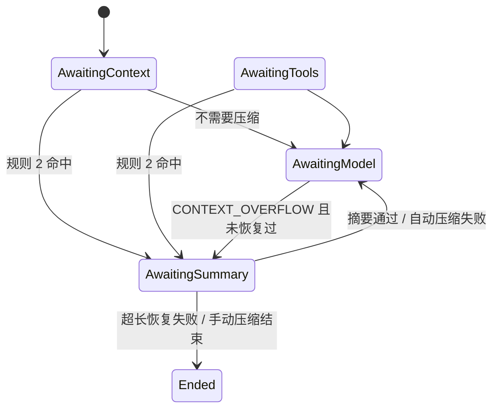

# Design Document

## Overview

压缩放在内核里，是一个新的等待状态 `AwaitingSummary`：调用模型前内核按规则判断要不要压缩，要压就先发一次摘要调用，摘要回来后用“替换视图”代替历史开头，再发原来的模型调用。所有模型走同一条路，两个客户端只多学一件事：按 `Prompt` 的要求禁用工具、限制输出长度。



## 对已批准需求的偏离

| 需求 | 文档写的 | 设计改为 | 理由 |
|---|---|---|---|
| 4.1 | journal 追加 `ContextCompacted` 事件 | `ContextCompacted` 是 **Fact**（进 SSE 和轨迹），不是事件。持久记录是摘要调用自己的 `ModelReplied`，回放时内核从它重新算出替换视图 | 内核只能发命令和事实，不能写事件。摘要文本、用量、停止原因都已在 `ModelReplied` 里，再写一个事件是重复 |
| 1.5 | 配置项 | 配置项照提供，但**在会话第一次组装上下文时随 `ContextAssembled` 快照进 `SessionContext`**，之后该会话一直用这份 | 阈值和保留量决定切点，切点决定 prompt。回放用当时的值才能和实时逐字相同；改配置只影响新会话，与“新工具等新会话”一致 |
| 规则 7 | 调用失败不采用 | 摘要调用**不重试**，限流也不重试（已由 spec-audit-fixes A5 改为：可重试的失败退避重试，用完再按规则 8） | 自动压缩失败后主调用照常进行，真超长再走恢复；多一层重试只会让状态机变复杂 |
| D4 | 手动压缩期间提交排队 | 接口在会话有运行时返回 409；极少数和新运行同时到达的请求被内核忽略 | 排队已由 `followUps` 机制覆盖；竞争窗口只有几毫秒 |

## Steering Document Alignment

### Technical Standards (tech.md)
value 和 kernel 仍只依赖 JDK，零 mock、零线程。决定 11 要求“压缩不能改写含 thinking 的历史”：这里历史（`SessionState.messages`）永远只追加，压缩只换 prompt 投影用的视图；视图里保留段的 thinking 一律去掉，这是实测可行的唯一做法。

### Project Structure (structure.md)
项目没有 `structure.md`。新包 `tantalum.kernel.compaction`，步骤函数 `CompactSteps` 放在已有的 `tantalum.kernel.step`。

## Code Reuse Analysis

### Existing Components to Leverage
- **`ModelSteps.callModel` / `PromptProjection`**：压缩判断插在 `beforeModelCall` 放行之后，投影改为用视图。
- **`CallModel` / `ModelHandler` / `ModelReplied`**：摘要调用就是一次普通模型调用，不加新命令、新 Handler。
- **`RetrySteps.modelFailed`**：超长恢复插在 `onFailure` 钩子放行之后。
- **`SessionContext` 冻结机制**：压缩设置和 system、工具一起冻结。
- **`Transcript` / `TurnQuery`**：摘要调用天然出现在 `/turns`（含完整 prompt）和轨迹里。
- **`UsageProjection`**：摘要用量照常累加，额度钩子不改。
- **`Startup.recover`**：`AwaitingSummary` 的运行和其他等待状态一样标记待恢复。

### Integration Points
- **`ContextHandler`**：往 `ContextAssembled` 多放一个 `CompactionSettings`。
- **`ClaudeClient` / `OpenAiClient`**：读 `Prompt.output()`。
- **`ApiController` / `Engine`**：手动压缩入口。
- **console**：对话页分隔条目、状态栏按钮和提示、轨迹步骤、截断提示。

## Architecture

### 数据流

```
callModel(run)
  ├ beforeModelCall → Stop / NeedWork：原样处理，不压缩
  └ Allow
      ├ Compactor.plan(session, run, AUTO) 为空 → CallModel(普通) → AwaitingModel
      └ 有计划 → run.compacting = Pending(plan) → CallModel(摘要) → AwaitingSummary
                   ├ ModelReplied 通过校验 → session.compaction 替换、anchor 清空 → fact ContextCompacted
                   │                        → CallModel(普通，不再判断) → AwaitingModel
                   ├ ModelReplied 未通过 / ModelFailed → fact CompactionFailed
                   │     AUTO     → run.autoCompactionFailed = true → CallModel(普通) → AwaitingModel
                   │     OVERFLOW → finish(FAILED, 原始错误)
                   │     MANUAL   → finish(FAILED, 原因)
                   └ ModelInterrupted / Cancel → 视图不变，运行 CANCELLED
```

超长恢复：`AwaitingModel` 收到 `ModelFailed(CONTEXT_OVERFLOW)`，`onFailure` 放行且 `run.overflowRecovered == false` 时，`plan(OVERFLOW)`（K = 0）有计划就进入上面的 `AwaitingSummary`，并把原始 `detail` 存进 `Pending`；没有计划按原路结束。

### 视图

`SessionState` 新增两个字段：

```
Compaction compaction   压缩后替代历史开头的那段；null 表示没压过
UsageAnchor anchor      规则 1 的锚点；压缩后为 null
```

```
Compaction(List<Message> replacement, int tailFrom)
  view = replacement ++ messages[tailFrom..]
```

`replacement` 是压缩那一刻的完整视图：摘要消息、当前请求原文（若它在头部）、处理过的保留段。`tailFrom` 等于当时 `messages.size()`，之后新追加的消息原样接在后面。再次压缩时对 `view` 切分，新的 `replacement` 又是完整视图，所以不需要记住多层。

`SessionState.view()` 是唯一出口，`PromptProjection` 和 `Compactor` 都用它；`Transcript.appendedResults` 继续扫 `messages`，不受影响。

### 单元与切分（规则 4）

`Units.split(view)`：从头扫，一条 USER 消息是一个单元；一条 ASSISTANT 消息连同紧随其后的、只含 `ToolResultBlock` 的 USER 消息是一个单元。

`Compactor.plan(view, settings, anchor, mode)`：

1. `mode == AUTO` 时先算 `S`（规则 1）：有锚点 `S = anchor.tokens + estimate(messages[anchor.messageCount..])`，否则 `S = estimate(system) + estimate(tools) + estimate(view)`。`S <= T` 返回空。
2. `K = min(keepRecent, T / 4)`；`OVERFLOW` 时 `K = 0`。
3. 从最后一个单元往前累加估算，加入下一个会超过 `K` 就停；最后一个单元无条件保留。
4. 其余是头部。头部为空返回空。
5. 返回 `Plan(head, kept, request)`，`request` 是头部里最新一条用户亲笔文字消息（USER、全是 `TextBlock`、不以 `[Context update` 或 `[Summary` 开头），没有则 null。

`TokenEstimate.of(...)`：UTF-8 字节数 / 3 向上取整。消息算文本、工具调用的原始参数、工具结果文本、推理块的原始 JSON；工具算 name、description、schema 的 JSON 长度。

### 替换视图怎么生成（规则 5）

`Trimming.keep(message, maxKeptResultBytes)`：去掉 `ReasoningBlock`；`ToolResultBlock.text` 超长时截到上限并加一行 `[truncated: N bytes total]`；内容为空返回 null（丢弃）。

```
replacement = [ Message.user(SUMMARY_PREFIX + summary) ]
            + (request != null ? [request] : [])
            + kept.map(Trimming::keep).filter(nonNull)
```

`SUMMARY_PREFIX = "[Summary of the earlier conversation, not written by the user.]\n\n"`。当前请求原样放，不加前缀，所以下一次压缩仍能把它识别为请求。

### 摘要调用（规则 6）

```
headForSummary = head.map(m -> Trimming.summarize(m, maxSummarizedResultBytes)).filter(nonNull)
while estimate(system + tools + headForSummary + instruction) > T: 丢最早一个单元，dropped = true
prompt = Prompt(run.system + patch.systemAppend, run.toolSpecs + patch.addTools,
                headForSummary + [Message.user(SummaryPrompt.instruction(dropped, manualInstructions))],
                new Prompt.Output(false, summaryMaxTokens))
```

`Trimming.summarize` 与 `keep` 相同，只是上限不同。~~头部前缀与之前的普通调用逐字节相同，所以缓存命中；~~（2026-11-01 更正）这句不成立：头部已去推理块并截断工具结果，至少在那里分叉，缓存只命中此前的部分。上一次的摘要就在头部第一条，指令里要求“保留并更新已有摘要”。

`SummaryPrompt.instruction` 固定英文，结构来自 pi：Goal、Constraints & preferences、Progress（done / in progress / blocked）、Key decisions、Next steps、Key context；要求逐字保留文件路径、函数名、错误信息；`dropped` 为真时加一句“最早的部分已放不下、被省略”；手动压缩附用户说明。

`SummaryPrompt.validate(reply, headEstimate)`（规则 7）：`stop != END_TURN`、含 `ToolCallBlock`、文本为空、`estimate(摘要消息) >= headEstimate` 任一成立即失败，返回原因字符串。

### `Prompt.Output`

```java
record Prompt(String system, List<ToolSpec> tools, List<Message> messages, Output output)
record Output(boolean toolsAllowed, long maxTokens)   // Output.DEFAULT = (true, 0)，0 表示用客户端配置
```

保留三参构造器。`ClaudeClient`：`toolsAllowed == false` 时加 `tool_choice: {type: none}`，工具定义照发（历史里有 `tool_use`，且要命中缓存）；`maxTokens > 0` 时覆盖 `max_tokens`。`OpenAiClient`：`tool_choice: "none"`、`max_tokens`。

### 设置快照

```java
record CompactionSettings(long window, long reserve, long keepRecent, int maxKeptResultBytes,
                          int maxSummarizedResultBytes, long summaryMaxTokens) {
    long threshold() { return window - reserve; }
}
```

`Engine` 从配置算出：`window` 取当前供应商的 `context-window`，`reserve = max(reserve-tokens, 供应商 max-tokens)`；`window <= 0` 时为 null，表示不做自动压缩和超长恢复。交给 `ContextHandler` 放进 `ContextAssembled.compaction`，内核在 `freezeContext` 第一次冻结时存进 `SessionContext.compaction`。旧事件没有这个字段，反序列化为 null，这些会话不压缩。

### 运行状态

`RunState` 新增：

```
Compacting compacting          正在等摘要：trigger(AUTO|OVERFLOW|MANUAL)、plan、manualInstructions、originalDetail
boolean autoCompactionFailed   规则 3.3
boolean overflowRecovered      规则 3.2，ModelReplied 时清零
```

`Compacting` 存的是计划（头部估算、保留段、请求），不存摘要 prompt；prompt 由 `CallModel` 携带，回放时重新算出。

### 手动压缩

事件 `CompactRequested(submission, request, instructions)`，`ANY_STATE` 注册。会话有活动运行、没有 `SessionContext` 或视图为空时内核忽略；接口在发布前用 `StateView` 把这三种情况拦成 409，所以只有竞争才会走到忽略。

开始一个运行 `RunState.start(ref, OwnerRef.OfSession)`，不追加用户消息，不发 `AssembleContext`：system 和工具直接取 `SessionContext`。`plan(MANUAL)` 用和自动相同的 `K`；头部为空 → `finish(FAILED, "nothing to compact")`。摘要通过 → `finish(COMPLETED, "compacted")`，`RunEnd.finish` 照常取下一条排队的提交。

### 钩子

`HookPoint.BEFORE_COMPACT`，`KernelHook.beforeCompact(state, context)` 默认 `Allow.PLAIN`；`HookContext` 多一个 `CompactionPlan plan`（头部单元数、估算、触发方式）。`Stop` 按摘要失败处理；返回 `NeedWork` 也按 `Stop` 处理并上报，第一版不支持。摘要调用本身不再过 `beforeModelCall`，它属于同一次调用尝试。

### 回复被截断（D5）

`modelReplied`：`stop == MAX_TOKENS` 且没有工具调用时，`RunEnd.beforeEnd` 照常，但 `Ended.detail = "reply truncated"`；`Transcript` 把该条 `Text` 的新字段 `truncated` 置 true。有工具调用时参数通常已不完整，`argumentsValid` 为 false 走现有的错误结果路径，不另外处理。

### 事实

```
ContextCompacted(run, trigger, headUnits, keptUnits, estimateBefore, estimateAfter, usage)
CompactionFailed(run, trigger, reason)
```

`Transcript` 在 `reply()` 里看到同一决定带 `ContextCompacted` 或 `CompactionFailed` 时，不生成 `Text`，改生成 `CompactionMark`。`TurnQuery.trace` 把这两个事实挂到对应 `Entry` 上。

## Components and Interfaces

### kernel.compaction.Compactor
- **Purpose:** 规则 1、2、4 的纯函数。
- **Interfaces:** `Optional<Plan> plan(SessionState session, RunState run, CompactionSettings settings, Trigger trigger)`。
- **Dependencies:** `Units`、`TokenEstimate`。

### kernel.compaction.Units / TokenEstimate / Trimming / SummaryPrompt
- 纯函数，各做一件事；都不引用供应商类型。`Trimming` 对 `ReasoningBlock` 一律删除，不看 `provider`。

### kernel.step.CompactSteps
- `static boolean tryStart(Outcome out, RunState run, PromptPatch patch, Trigger trigger, String originalDetail)`：有计划就进入 `AwaitingSummary` 并返回 true。
- `Decision summaryReplied(StepContext)`、`Decision summaryFailed(StepContext)`、`Decision requested(StepContext)`。
- 成功后调用 `ModelSteps.callModel(out, run, null, /*compactionAllowed*/ false)`。

### shell.handler.ContextHandler
- 多传 `CompactionSettings`。

### shell.web.ApiController / boot.Engine
- `POST /api/sessions/{session}/compact`，body `{ "instructions": "..." }` 可选；返回 200 `{submission}`、404、409、429、503。`Engine.compact(principal, session, request, instructions)` 复用 `ExternalGate` 和 `SubmissionLedger`。

### console
- `CompactionMark` 条目：分隔线 + “已压缩，前 N → 后 M”，点开看摘要；失败时显示原因。
- `StatusBar`：占比 ≥ 80% 时文字变色并提示；压缩按钮，运行中禁用，调用接口后依赖 SSE 更新。
- `Text.truncated` → 在该条回复下方显示“回复被截断”。
- 轨迹页：带事实的条目显示为“压缩”步骤，含耗时、用量、前后估算。

## Data Models

```
value.state.Compaction        (List<Message> replacement, int tailFrom)
value.state.UsageAnchor       (long tokens, int messageCount)
value.state.CompactionSettings(window, reserve, keepRecent, maxKeptResultBytes, maxSummarizedResultBytes, summaryMaxTokens)
value.state.Compacting        (Trigger trigger, Plan plan, String manualInstructions, String originalDetail)
value.state.Plan              (int headUnits, int keptUnits, long headEstimate, boolean hasRequest)   // 存进状态的只是数字
value.event.CompactRequested  (SubmissionId submission, RequestId request, String instructions)   v1
value.decision.ContextCompacted / CompactionFailed
value.model.Prompt.Output     (boolean toolsAllowed, long maxTokens)
value.event.ContextAssembled  + CompactionSettings compaction（可空）
value.state.SessionContext    + CompactionSettings compaction
value.state.SessionState      + Compaction compaction, UsageAnchor anchor
value.state.RunState          + Compacting compacting, boolean autoCompactionFailed, boolean overflowRecovered
```

配置（`application.properties`）：

```
tantalum.compaction.reserve-tokens=16384
tantalum.compaction.keep-recent-tokens=20000
tantalum.compaction.max-kept-tool-result-bytes=32768
tantalum.compaction.max-summarized-tool-result-bytes=4096
tantalum.compaction.summary-max-tokens=8192
```

`TantalumProperties.Compaction` 校验全部为正数。`context-window` 仍在各供应商下。

## Error Handling

| 情况 | 处理 |
|---|---|
| 摘要被截断、含工具调用、为空、没变小 | `CompactionFailed`，按触发方式走规则 8 |
| 摘要调用 `ModelFailed`（任何原因） | 同上，不重试（已由 spec-audit-fixes A5 改为可重试的先退避重试） |
| 摘要调用被取消或中断 | `modelInterrupted` 看到 `run.compacting != null` 时不把文本追加进历史，运行 CANCELLED |
| 超长恢复后仍超长 | 第二次 `CONTEXT_OVERFLOW` 时 `overflowRecovered` 已为 true，按原路 FAILED，详情是原始错误 |
| 头部估算超过阈值 | 从最早单元丢起，指令里说明；只在超长恢复时可能发生 |
| `beforeCompact` 返回 `Stop` 或 `NeedWork` | 按摘要失败处理，上报事实 |
| 会话没有 `CompactionSettings`（旧会话、窗口未配置） | `plan` 永远返回空；手动压缩接口返回 409 并说明 |
| 进程在 `AwaitingSummary` 中崩溃 | `Startup.recover` 标记待恢复，与其他等待状态相同；可取消 |
| 配置非正数 | 启动失败，指出配置项 |

## Testing Strategy

### Unit Testing（kernel，零 mock）
- `UnitsTest`：用户消息、助手加结果、连续用户消息、以结果结尾、空视图。
- `TokenEstimateTest`：ASCII、中文、工具调用、推理块；向上取整。
- `TrimmingTest`：去推理块后为空的消息被丢弃；截断在 UTF-8 边界、注明原长度；未超长不动。
- `CompactorTest`：规则 1（锚点、无锚点、锚点后新消息）、规则 2（恰好等于阈值不触发）、规则 4（K 上限 T/4、最新单元超过 K 仍保留、头部为空、OVERFLOW 时 K = 0）、请求识别（排除上下文更新和摘要）。
- `SummaryPromptTest`：四种失败条件；指令含手动说明和“已省略”句。
- `CompactStepsTest`（经 `Kernel.step` 逐步断言）：压缩后下一次调用不再判断；成功后锚点为空、再收到回复才有锚点；自动失败后同一运行不再压缩；超长恢复一次、第二次 FAILED 带原始错误；手动压缩的运行不追加用户消息、结束后取排队提交；取消摘要调用视图不变；`beforeCompact` Stop；旧 `ContextAssembled`（无设置）不压缩；回放每个 `CallModel.prompt` 与实时相同。
- `ModelStepsTest`：`MAX_TOKENS` 无工具调用 → COMPLETED 带 `reply truncated`。

### Integration Testing（shell）
- `ClaudeClientTest` / `OpenAiClientTest`（已有的请求捕获方式）：`Output(false, 8192)` 产生 `tool_choice none` 和 `max_tokens 8192`，工具定义仍在。
- `TranscriptTest`：摘要回复生成 `CompactionMark` 而不是 `Text`；失败也有条目；重启后视图逐字节相同。
- `TurnQueryTest`：摘要调用是一个 turn，轨迹条目带压缩事实。
- `ApiControllerTest`：`/compact` 的 200、404、409（运行中、无可压缩）、`Origin` 校验。
- `CompactionStressTest`（不用真实模型，进 `mvn verify`）：脚本化模型，窗口设小，500 条消息、多次压缩；回放 prompt 相同；重启后视图相同；期间另一用户的运行不受影响。
- 架构测试：`tantalum.kernel.compaction` 不引用 shell 和供应商类型。

### 真实模型（`ClaudeScenarioTest` 严格校验 + `OpenAiScenarioTest` 本地 qwen，同一用例）
- **暗号与约束**：窗口配 `32000`，依次 `read_file` 若干文件，每个带一个暗号和一条约束；越过压缩点后要求报出全部暗号并遵守全部约束。判定：暗号全对、约束未违反、`read_file` 重读次数 ≤ 1。strata 不可用记为未验证。
- **严格校验下的合法性**：压缩后继续带 thinking 的多轮工具调用；保留段含 MCP 工具调用；压缩后该 MCP 工具已下线。都不得 400。
- **代价对比**：同一长任务开/关压缩，记录完成情况和总 token，写进 tech.md。
- **手动压缩**：带说明“重点记住测试结果”，摘要含该内容。

### End-to-End（Playwright，`E2eModel` 增加按关键词返回摘要）
- 分隔标记出现且可展开摘要；状态栏 80% 提示和压缩按钮；轨迹页压缩步骤；截断提示；500 条消息的会话页面可用。

## 实施顺序

1. 两个客户端支持 `Prompt.Output`，并用真实 strata 和 Claude 各发一次禁用工具、限长的请求确认被接受（Claude 已测过，strata 没有）。
2. value：新记录和字段，`EventCodec` 注册 `CompactRequested`，旧事件兼容测试。
3. kernel.compaction 四个纯函数及测试。
4. `CompactSteps` 自动压缩 + 视图投影 + 事实；逐步测试。
5. 超长恢复；D5 截断标记。
6. 设置快照：`ContextHandler`、`Engine`、配置校验。
7. `Transcript`、`TurnQuery`、压测、回放测试。
8. 真实模型场景。
9. 手动压缩：事件、接口、`Engine`。
10. console 与 Playwright。
11. README 能力表、tech.md 结论。
