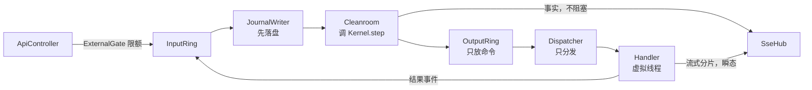

# Design Document

## Overview

本设计实现 `core-skeleton`：三层结构、一个纯函数内核，以及下面这条环。



依据：`requirements.md`、`tech.md`、`QAGENT_DESIGN_BRIEF.md`。

## Steering Document Alignment

### Technical Standards (tech.md)
Spring 只出现在 `tantalum.shell.web` 和 `tantalum.shell.boot`。其余 shell 类是普通 Java 类，通过构造函数注入。

### Project Structure (structure.md)
项目没有 `structure.md`，结构以本文“包和类”一节为准。

## Code Reuse Analysis

项目没有既有代码。对外部实现的取舍如下。

| 问题 | pi | DeepSeek Harness | 本设计 |
|---|---|---|---|
| 工具并行 | 默认并行，可声明串行 | 默认独占，声明安全才并行 | 同 DeepSeek Harness |
| 结果顺序 | 按模型请求顺序 | 按模型请求顺序 | 相同 |
| 工具服务端并发上限 | 文档中未查到 | MCP 客户端文档中未查到，只有每次调用超时 | 我们额外增加（需求 9 第 11 条） |
| MCP 调用超时 | 客户端负责 | 默认 60 秒 | `grep`、读文件默认 60 秒，可配置 |

## Architecture

### 模块和依赖

| Maven 模块 | 顶层包 | 依赖 |
|---|---|---|
| `tantalum-value` | `tantalum.value` | 无 |
| `tantalum-kernel` | `tantalum.kernel` | `tantalum-value` |
| `tantalum-shell` | `tantalum.shell` | 前两者、Spring Boot、Disruptor、SQLite、Jackson、`anthropic-java` |
| `tantalum-examples` | `tantalum.examples` | 只用插件接口；不打进可执行 jar |
| `console/` | 前端，不是 Maven 模块 | 只调用公开接口 |

Maven 模块依赖和 ArchUnit 共同守住 `value ← kernel ← shell`。ArchUnit 还要求 `tantalum.examples` 只依赖 `tantalum.value`、`tantalum.kernel.hook` 和 `tantalum.shell.plugin`，以此证明插件不需要碰内部实现。

### 线程

| 线程 | 数量 | 做什么 | 不能做什么 |
|---|---|---|---|
| `JournalWriter` | 1 | 分配序号，批量写 SQLite，批尾提交 | 调内核 |
| `Cleanroom` | 1 | 调 `Kernel.step`，发布命令和事实 | I/O、等待 |
| `Dispatcher` | 1 | 为每条命令启动虚拟线程 | 执行 Handler |
| Handler | 每条命令 1 个虚拟线程 | 全部模型、工具、文件 I/O | 读写内核状态 |

`Cleanroom` 依赖 `JournalWriter` 的序列。Disruptor 的批处理器在整批处理完才推进序列，而提交发生在批尾，所以 `Cleanroom` 只能看到已提交的事件。这一行为要在第一批 task 中用测试验证。

### 容量

| 配置 | 默认值 | 约束（启动时校验） |
|---|---|---|
| `maxActiveRuns` | 64 | |
| `maxParallelTools` | 10 | |
| `maxUserInFlight` | 8 | |
| `maxExternalInFlight` | 256 | |
| `outputRingSize` | 1024 | 2 的幂，≥ `maxActiveRuns × (maxParallelTools + 1)` |
| `inputRingSize` | 1024 | 2 的幂，≥ `maxActiveRuns × maxParallelTools + maxExternalInFlight` |

默认值是初始值，没有负载实测依据。

三条规则保证上面的公式成立：

1. **Output Ring 只放命令**。事实由 `Cleanroom` 直接交给 `SseHub`，它只向每个订阅者的有界队列做非阻塞写入。公式中的 `+ 1` 留给每个运行结束时的一条 `AbortCommands`。
2. **一条命令最多产生一个结果事件**，所以在途结果不超过 `maxActiveRuns × maxParallelTools`。
3. **迟到结果不占活跃运行的预留**。运行结束后，其 Handler 可能还在收尾，而新运行已占用名额。`ResultPublisher` 发布已中止命令的结果前，先检查 `remainingCapacity` 大于活跃预留；不足时丢弃并记录错误。丢弃只影响已结束的运行，代价是该事件不进 journal，这是需求 2 第 6 条“保留在 journal”的极端例外。

## 包和类

类的职责各一句话。标 `*` 的是接口。

### `tantalum.value`：只有 record、interface、enum

| 包 | 类 | 职责 |
|---|---|---|
| `id` | `Principal` `SessionId` `RunId` `CommandId` `RequestId` `SubmissionId` | 各类标识 |
| `json` | `Json`* 及其 record 变体 | 不依赖 Jackson 的 JSON 值 |
| `event` | `Event`* | 事件，带类型名和版本号 |
| | `EventEnvelope` | 序号、时间、主体 + 事件，journal 的一行 |
| | `UserPrompt` `SteerSubmitted` `FollowUpSubmitted` `Cancel` | 外部事件 |
| | `ContextAssembled` `ModelReplied` `ModelFailed` `ModelInterrupted` `ToolFinished` `TimerFired` `WorkDone` | 结果事件 |
| `command` | `Command`* | 命令，带 `CommandId` |
| | `AssembleContext` `CallModel` `RunTool` `StartTimer` `DoWork` `AbortCommands` | 内置命令 |
| `state` | `KernelState` | 整棵状态树的根 |
| | `PrincipalState` `SessionState` `RunState` | 用户、会话、运行 |
| | `RunPhase`* `Deciding` `Awaiting` `Ended` | 三个固定状态 |
| | `EndReason` | `Completed`、`Failed`、`Cancelled`、`Stopped` |
| | `OwnerRef` | 运行的所有者引用：会话或工具命令 |
| | `ToolRound` `ToolSlot` | 一批工具调用及各自进度 |
| `model` | `Prompt` | 一次模型调用的完整输入 |
| | `Message` `ContentBlock`* `TextBlock` `ReasoningBlock` `ToolCallBlock` `ToolResultBlock` | 与供应商无关的消息 |
| | `ToolSpec` `TokenUsage` `StopReason` `FailureReason` | 工具定义、用量、停止原因、失败原因 |
| `decision` | `Decision` | `newState`、`commands`、`facts` |
| | `Fact`* | 对外通知，如状态变化、钩子上报 |
| `hook` | `HookResult`* `Allow` `Stop` `NeedWork` | 钩子的三种结果 |
| | `PromptPatch` | `Allow` 携带的不可变变更 |

### `tantalum.kernel`：纯逻辑

| 包 | 类 | 职责 |
|---|---|---|
| 根 | `Kernel` | `step(state, envelope)`，查表、执行、捕获异常 |
| | `Replay` | 把事件序列折叠成状态和事实，不执行命令 |
| `table` | `TransitionTable` | `(stateName, eventType)` 到处理函数的注册表，撞行报错 |
| | `StepFunction`* | 一行转移的处理函数 |
| | `BuiltinSteps` | 注册内置行 |
| `step` | `ModelSteps` `ToolSteps` `WorkSteps` `RetrySteps` `CancelSteps` | 按等待点分组的处理函数 |
| | `CommandIds` | 由事件序号和下标算出 `CommandId` |
| `tool` | `ToolScheduler` | 按模型顺序决定下一批可发的工具 |
| | `ToolPairing` | 为没有结果的工具调用生成错误结果 |
| | `ToolSafety`* | 纯函数 `isConcurrencySafe(args)` |
| `projection` | `PromptProjection` | 从状态投影出每圈的 `Prompt` |
| | `UsageProjection` | 把 token 用量累加到 `PrincipalState` |
| `hook` | `KernelHook`* | 五个钩子方法，默认都返回 `Allow` |
| | `HookChain` | 按注册顺序遍历，处理异常规则 |

### `tantalum.shell`：一切 I/O

| 包 | 类 | 职责 |
|---|---|---|
| `boot` | `TantalumApplication` | Spring Boot 入口和装配 |
| | `TantalumProperties` | 全部配置 |
| | `Startup` | 加锁、回放、校验配置，之后才开放接口 |
| `loop` | `InputRing` `OutputRing` | 封装两个 Disruptor，只用 `tryPublishEvent` |
| | `JournalWriter` | Input Ring 的第一个消费者 |
| | `Cleanroom` | Input Ring 的第二个消费者 |
| | `Dispatcher` | Output Ring 的消费者 |
| | `ResultPublisher` | Handler 写回结果的唯一入口 |
| | `InFlightCommands` | 记录在途 Handler，负责中断 |
| | `StateView` | 向查询方发布最新的不可变状态 |
| | `SubmissionLedger` | `requestId` 去重 |
| `journal` | `Journal` | SQLite 追加和按序读取 |
| | `EventCodec` | 事件与 JSON 互转，未注册的类型或版本报错 |
| | `StoreLock` | 进程独占锁 |
| | `TurnQuery` | 回放 journal，返回某一圈的 prompt 和回复 |
| `handler` | `ContextHandler` `ModelHandler` `ToolHandler` `WorkHandler` `TimerHandler` | 五个 Handler |
| | `Handler`* | 共同接口 |
| | `CallLimiter` | 限制并发调用数，可超时、可中断 |
| `plugin` | `Tool`* | 工具：名称、schema、服务端、上限、执行 |
| | `WorkType`* | 插件注册的工作类型 |
| | `AfterToolHook`* | 处理器钩子 `afterToolExecution` |
| `model` | `ModelClient`* | 流式调用模型，返回结算结果 |
| | `OpenAiClient` | OpenAI 兼容实现，用 JDK `HttpClient` |
| | `ClaudeClient` | Claude 实现，用官方 SDK |
| | `ChunkListener`* | 接收瞬态分片 |
| | `StreamWatchdog` | 首块超时和块间超时 |
| | `ModelOutcome` | 一次调用的结算结果：回复或失败 |
| | `OverflowRules` | 识别上下文超长错误 |
| `tool` | `ToolCatalog` | 已注册工具 |
| | `GrepTool` `ReadFileTool` | 内置工具 |
| | `Workspace` | 校验路径，拒绝越出工作目录 |
| `web` | `ApiController` | REST 接口 |
| | `ExternalGate` | 外部事件限额和 429 |
| `sse` | `SseHub` | 按用户推送事实和分片，并支持补读 |

插件作者只需要看 `tantalum.shell.plugin`、`tantalum.kernel.hook` 和 `tantalum.value`。

### `tantalum.examples`：示例插件，独立模块

| 类 | 职责 |
|---|---|
| `DailyQuotaHook` | 每日额度：`beforeModelCall` + `Stop` |
| `ReadOnlyHook` | 只读策略：`beforeToolCall` + `Stop` |
| `CitationCheckHook` `CitationWork` | 引用核对：`beforeRunEnd` + `NeedWork` |
| `TruncateOutputHook` | 输出截断：`afterToolExecution` |

### `console/src`

| 目录 | 内容 |
|---|---|
| `api/` | REST 调用、`fetch` 流式读 SSE、断线补读 |
| `run/` | 提问、`steer`、`follow-up`、撤销 |
| `timeline/` | 等待状态时间轴、流式输出 |
| `turn/` | 某一圈的完整 prompt 和回复 |

## Components and Interfaces

### Kernel

```java
public final class Kernel {
    public Kernel(TransitionTable table, HookChain hooks, ToolSafety toolSafety);
    public Decision step(KernelState state, EventEnvelope envelope);
}
```

- 状态名就是 `Awaiting.resumeAt`，如 `AwaitingModel`。
- 处理函数或钩子抛异常时，`step` 在内部捕获，让该运行进入 `Ended(Failed)`。捕获发生在纯函数内，回放会得到相同结果。
- `CommandId` 为 `<事件序号>-<下标>`。

### Prompt

`CallModel` 携带完整 `Prompt`，由 `PromptProjection` 从状态算出，不单独写 journal。回放重新计算即可还原。

- `system`、`tools` 来自 `ContextAssembled` 事件；钩子的 `PromptPatch` 随后应用。
- `messages` 来自 `SessionState` 的消息视图。本 spec 中视图等于全部消息。
- 回放要还原 `PromptPatch`，就要求钩子的代码和注册顺序不变。本 spec 不记录钩子版本，见“已知限制”。

### 工具调度

`ToolRound` 按模型顺序保存全部调用，每个 `ToolSlot` 的状态为 `Blocked`、`Pending`、`Sent` 或 `Done`。

1. `ModelReplied` 到达时，对每个调用执行 `beforeToolCall`。被拦截或参数无效的调用直接得到错误结果。
2. `ToolScheduler` 发出队首连续的并行安全调用，在途不超过 `maxParallelTools`；独占调用要等前面全部完成，并单独发出。
3. 全部 `Done` 后，结果按模型顺序写入消息，然后进入下一次模型调用。

`CallLimiter` 在 `ToolHandler` 中按服务端统计：只有实际调用服务端时才持有名额，`finally` 中释放，等待时间计入工具超时，运行取消时中断等待。

### 取消

`Cancel` 让运行立即进入 `Ended(Cancelled)`，内核发出 `AbortCommands`。`InFlightCommands` 中断对应的虚拟线程。

- 没有结果的工具调用由 `ToolPairing` 生成错误结果。
- 流式回复被取消时，`ModelHandler` 发布 `ModelInterrupted`，只含已收到的文本。这是需求 2 第 6 条的第二个例外：它不改变运行状态，但会把文本追加到会话的消息视图，这样下一轮 prompt 能看到用户已经看到的内容。

### 模型客户端

```java
public interface ModelClient {
    ModelOutcome call(Prompt prompt, ChunkListener chunks) throws InterruptedException;
}
```

| 差异 | `OpenAiClient` | `ClaudeClient` |
|---|---|---|
| 推理内容 | `reasoning_content` 存为 `ReasoningBlock` | `thinking` 块连同签名存为 `ReasoningBlock` |
| 活动信号 | `: keep-alive` | `ping` |
| 工具参数 | 拼接分片后解析 JSON | 开启 `eager_input_streaming`，自行校验 |
| 用量 | 最后一个分片 | `message_start`、`message_delta` |
| 参数 | 地址、模型名 | 模型名、`effort`、`max_tokens`、`fallbacks` |

- `ReasoningBlock` 记录来源供应商。客户端只回传自己产生的块，所以切换模型后旧的推理内容不会发错格式。原始内容仍保留在 journal 中。
- SDK 的自动重试设为 0。
- 参数不是合法 JSON 时，`ToolCallBlock` 标记为无效，内核给出错误结果。
- `ClaudeClient` 的 SDK 用法在实现时按官方文档核对，本文不写具体调用。

### Journal

```sql
CREATE TABLE events (
  seq        INTEGER PRIMARY KEY,
  type       TEXT NOT NULL,
  version    INTEGER NOT NULL,
  session_id TEXT,
  run_id     TEXT,
  principal  TEXT NOT NULL,
  at         TEXT NOT NULL,
  payload    TEXT NOT NULL
);
```

- WAL 模式，`synchronous=FULL`。批尾提交事务，因此不存在写了一半的事件。需求 3 第 7 条中“文件末尾未完成的写入”由 SQLite 事务处理。
- 启动时检查序号连续、`quick_check` 通过，否则拒绝启动并指出位置。
- 数据目录权限 700，存储文件权限 600，包括 WAL 附属文件。
- 写入失败时，`JournalWriter` 把进程置为停止状态，`ExternalGate` 返回 503，`Cleanroom` 不再收到新事件。

### Web 接口

| 方法 | 路径 | 用途 |
|---|---|---|
| POST | `/api/sessions/{id}/submissions` | 提交 `{requestId, mode, text}`，`mode` 为 `prompt`、`steer` 或 `follow-up` |
| POST | `/api/runs/{id}/cancel` | 撤销 |
| GET | `/api/runs/{id}` | 运行状态，包括“待恢复” |
| GET | `/api/runs/{id}/turns` | 每一圈的概要 |
| GET | `/api/runs/{id}/turns/{n}` | 某一圈的完整 prompt 和回复 |
| GET | `/api/events` | SSE，支持 `Last-Event-ID` |

- `SubmissionLedger` 用 `putIfAbsent` 按 `(principal, requestId)` 原子去重，启动时由回放重建。
- 补读优先用内存中的近期事实；超出范围时回放 journal。本 spec 没有快照，回放是全量的。
- 查询接口按 principal 校验归属，不属于该用户的运行返回 404。

## Data Models

```java
record EventEnvelope(long seq, Instant at, Principal principal,
                     SessionId session, RunId run, Event event) {}

record Decision(KernelState newState, List<Command> commands, List<Fact> facts) {}

record RunState(RunId id, SessionId session, Principal principal, OwnerRef owner,
                RunPhase phase, ToolRound tools, int retries, boolean pendingRecovery) {}

record Awaiting(Set<CommandId> commands, String resumeAt) implements RunPhase {}

record ModelReplied(CommandId command, List<ContentBlock> content, StopReason stop,
                    String actualModel, TokenUsage usage) implements Event {}

record ModelFailed(CommandId command, FailureReason reason, boolean retryable,
                   Duration retryAfter, String partialText) implements Event {}
```

`RunStarted` 不单独建事件：`UserPrompt` 就是创建事件，携带 `principal` 和 `owner`。

## Error Handling

| 场景 | 处理 | 用户看到 |
|---|---|---|
| journal 写入失败 | 进程停止处理，需重新打开 | 接口返回 503 |
| 回放遇到未知类型或损坏 | 拒绝启动，指出位置 | 启动失败 |
| 内部 `tryPublishEvent` 失败 | 记录错误并报警，运行进入 `Ended(Failed)` | 运行失败 |
| 外部超限 | 不排队 | 429 |
| `step` 抛异常 | 只影响该运行 | 运行失败 |
| 模型可重试失败 | 退避后重试，最多 3 次 | 时间轴显示重试 |
| 模型上下文超长 | `onFailure`，未处理则 `Ended(Failed)` | 明确的超长错误 |
| 模型拒答 | 不可重试 | 拒答类别 |
| 工具失败或超时 | 错误结果交给模型，运行继续 | 工具错误 |
| Handler 抛异常 | 转成对应的失败结果事件 | 同上 |
| 重启后未结束的运行 | 标记“待恢复”，不发命令，可取消 | 状态为待恢复 |
| SSE 订阅者过慢 | 断开该订阅者 | 客户端补读 |

## Testing Strategy

### Unit Testing
- `value`、`kernel`：不用 mock、不启线程。
- `TheLoopTest`：逐圈断言十圈。
- 转移表每一行至少一个测试；另测撞行注册、过期 `cmdId`、工具配对、`ToolScheduler` 的屏障和上限、钩子异常规则。
- `ArchitectureTest`：需求 1 的全部规则。

### Integration Testing
- `ScriptedModelClient`：脚本化模型，走真实的环、journal、Web 和 SSE 跑完十圈，再回放比对状态和每圈 prompt。这个测试要用引用核对插件，放在 `tantalum-examples` 模块；`TheLoopTest` 在 `tantalum-kernel` 中，使用测试内的钩子。
- 背压：Output Ring 满、Input Ring 满、外部超限。
- `SingleRequestServer`：同一时刻只处理一个请求的替身服务端，验证需求 9 第 14 条。
- 杀进程重启：第 K 圈后重建状态，与最后一个已落盘事件一致。
- 挂起工具：其他运行不受影响。

### End-to-End Testing
- 可选冒烟测试：Claude 和 strata 各跑一次带工具的运行。覆盖 `tech.md` 中列出的待实测项。
- 控制台：提问、查看时间轴、查看某一圈的 prompt、断线补读。

## 对需求的补充

下面三点是写设计时发现的，需求文档已有的条文没有覆盖。批准本文档即批准这些补充。

| # | 问题 | 决定 |
|---|---|---|
| A1 | 被取消的回复要进入下一轮 prompt，但需求 2 第 6 条规定迟到事件不改变状态 | 新增事件 `ModelInterrupted`，只改会话消息，不改运行状态 |
| A2 | `beforeToolCall` 返回 `NeedWork` 时，状态表只写了回到 `AwaitingModel` | `WorkDone` 后按 `Awaiting.resumeAt` 回到原处，这种情况下继续发工具 |
| A3 | 已中止命令的迟到结果可能挤占活跃运行的容量 | 容量不足时丢弃迟到结果并记录错误 |

## 已知限制

- **回放依赖钩子代码**：钩子改变后，旧运行的 prompt 无法精确还原。记录钩子版本留给 `plugin-model`。
- **内存随历史增长**：`KernelState` 保留全部消息，没有快照。快照属于 `durable-semantics`。
- **取消后的短暂竞态**：如果 `follow-up` 的 prompt 先于 `ModelInterrupted` 发出，这段文本要到再下一轮才出现。历史只追加，不会错序或改写。
- **默认容量未经实测**。
