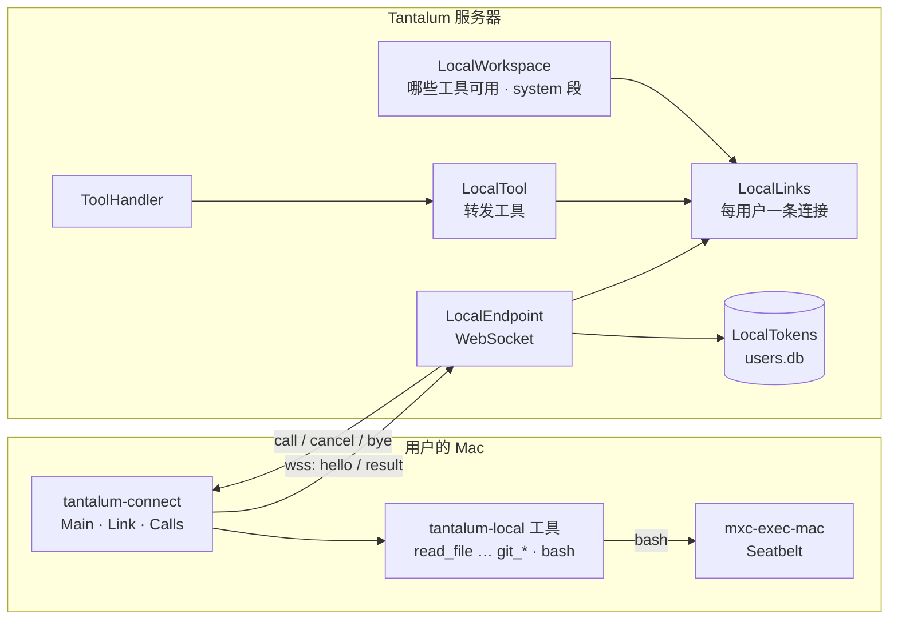

# Design Document

## Overview

新增一个连接程序 `tantalum-connect`，在用户的 Mac 上运行，主动用 WebSocket 连到服务器。服务器上的文件工具改成“转发工具”：模型调 `read_file` 时，服务器把调用发给这个用户连着的电脑，电脑上执行完再把结果送回来，之后照现有流程走（进会话文件、交给模型、显示在画面上）。命令行 `bash` 在电脑上用微软 MXC 的 `mxc-exec-mac` 隔离执行。

内核不改。工具在会话开始时就以固定定义进入工具全集，电脑连上、断开只改变“这个用户现在开着哪些工具”。这个名单本来就在每次提问开始时算一次，变了由内核追加工具变化消息（core-tools C14），对话页显示一行（one-line-journal 需求 5）。

改动分三块：
- 新模块 `tantalum-local`：工具代码和消息格式，服务器和连接程序共用。
- 新模块 `tantalum-connect`：连接程序。
- `tantalum-shell` 新包 `local`：令牌、连接、转发工具、插件页接口。

另有控制台插件页的一张卡片。

## Steering Document Alignment

### Technical Standards (tech.md)
- **计算线程不做 I/O：** 不变。转发在 `ToolHandler` 的虚拟线程上等结果，和现在工具的执行一样。
- **journal 不含凭据：** 令牌不进会话文件、轨迹和日志。`ContextAssembled.toolSources` 里本机工作区的工具记为 `local`，不记电脑名和目录（目录在 system 段里，属于给模型的上下文）。
- **默认只绑 127.0.0.1：** 不变。连接程序连同一个端口。
- **不加新的第三方依赖：**
  - 服务器用 Tomcat 自带的 Jakarta WebSocket（`tomcat-embed-websocket` 已在依赖里）。
  - 连接程序用 JDK 的 `java.net.http.WebSocket` 和现在用的 Jackson。
  - MXC 是外部程序，随安装包分发，许可证写进 `THIRD_PARTY_NOTICES.md`。

### Project Structure (structure.md)
- 共用代码放进新模块 `tantalum-local`，不依赖 Spring，也不依赖 `tantalum-shell`。
- 依赖关系：`tantalum-shell` → `tantalum-local` → `tantalum-value`；`tantalum-connect` → `tantalum-local`。ArchitectureTest 加规则：`tantalum.local` 不引用 `tantalum.shell`、`tantalum.kernel`、`org.springframework`。

## 实测（2026-11-06，Yi 的 Mac：macOS 26.2，arm64；MXC v1.0.1 发布包里的 `mxc-exec-mac`，已有微软签名）

| 试了什么 | 结果 |
|---|---|
| 允许目录里读写 | 能 |
| 写 `$HOME` 下允许目录以外的文件 | `Operation not permitted`（不用 MXC 时能写） |
| 读 `~/.ssh/config`、列出 `~/Documents` | 被拒（不用 MXC 时能读） |
| `egress: deny` 时访问 `https://example.com` | 连不上（不用 MXC 时 200） |
| `egress: allow` 时访问外网 | 200 |
| `egress: allow` 时访问本机 `127.0.0.1:8091` | 连不上（`hostLoopback` 默认拒绝，命令碰不到 Tantalum 自己的接口） |
| `git log` | 能用；`/tmp` 不可写时有警告，要给可写的临时目录并设 `TMPDIR` |
| `/opt/homebrew` 里的 `javac`、`java`、`mvn` | 默认读不到；把 `/opt/homebrew` 加进只读目录、`PATH` 加上之后能编译运行 |
| `HOME` 设成真实的家目录 | git 读 `~/.gitconfig` 被拒、报 fatal。要把 `HOME` 设成连接程序自己的目录 |
| MXC 自身开销 | 跑 `/usr/bin/true` 一次 10–20 ms |
| MXC 的 `timeout` 到期 | 结束整个进程树，后台 `sleep &` 也结束 |
| 直接结束 `mxc-exec-mac` 进程（TERM 或 KILL） | **子进程留下来**（它们在自己的进程组里）。Java 先取 `ProcessHandle.descendants()` 再逐个结束，就没有残留 |

结论：
- MXC 能做到 L13 要的隔离。
- 连接程序要做四件事：
  1. 给命令一个可写的临时目录（`TMPDIR`）；
  2. 把 `HOME` 设到自己的目录；
  3. 放开常见工具链的只读目录；
  4. 取消时自己结束整个进程树。

## Code Reuse Analysis

### Existing Components to Leverage
- **`tool/ReadFileTool`、`GrepTool`、`ListDirTool`、`FindFilesTool`、`WriteFileTool`、`EditFileTool`、`TextFiles`、`ToolArguments`、`Observations`、`WritePaths`：**
  - 搬到 `tantalum-local`，逻辑不变，只把“一个工作目录”换成“几个允许的目录”。
  - 它们只依赖 JDK 和 `tantalum-value`（已核对 import），搬得动。
  - 现有测试跟着搬。
- **`plugin/Workspace`：** 越界和不存在用同一句话、符号链接解析后再检查、写入时检查最近存在的上级目录。这些规则变成 `local/fs/AllowedDirs`，逐条保留。
- **`ToolCatalog`、`PluginGate`、`PluginSwitches`：**
  - 转发工具注册进 `ToolCatalog`，算“已注册的工具”，会话开始就在全集里（L9）。
  - `PluginGate.toolEnabled` 对这些工具改问 `LocalWorkspace`。
  - 开关表照用，加一个种类 `LOCAL`。
- **`ToolHandler`：** 等名额、超时、`afterTool` 钩子、结果写成 `ToolFinished` 照用。工具可以声明自己的超时（`bash` 最长 600 s，比默认 60 s 长）。
- **`ContextHandler`、`ContextSection`、`ContextDiff`：**
  - “本机工作区”一段和电脑上的 `AGENTS.md` 都作为会变的 system 段；
  - 变了照现有规则追加更新消息。
- **内核的工具变化（`ContextSteps.freezeContext`、`ToolChangeBlock`、`ToolsGone`）和控制台 `ToolChangeNotice`：** 照用。工具来源为 `local` 时，说明文字换成“本机工作区没有连上或没有允许”。
- **`AttachmentStore`、`ImageNormalizer`：** 电脑读到图片时送回原始字节，服务器照现在的规则规范化、存进本人附件目录，再交给模型。
- **`users.db`（`UserStore`、`PluginSwitches` 用的同一个 SQLite 文件）：** 加一张令牌表。

### Integration Points
- **Spring Security：**
  - `/api/local/connect`（WebSocket 握手）不走登录会话和 CSRF，改由令牌认证；
  - `/api/local/**` 的其余接口照常要求登录并检查 Origin。
- **`Engine`：** 创建 `LocalLinks`、注册转发工具和 `read_attachment`，去掉服务器上的文件工具。
- **控制台插件页：** 新卡片调 `/api/local`。

## Architecture



### 一次调用

1. 模型回复里有 `read_file`。内核发出 `RunTool`，`ToolHandler` 在虚拟线程上调 `LocalTool.run`。
2. `LocalTool` 先看路径：以 `/attachments/sha256-` 开头的直接在服务器读附件（旧会话里模型习惯这样读，见 L7）。其余的交给 `LocalLinks.call(principal, session, tool, args, timeout)`。
3. 这个用户没有连接时，立即返回错误 “The local workspace is not connected.”。有连接时：
   - 在这条连接上占一个名额（每条连接最多 4 个，L11）；
   - 发 `call`，等对应的 `result`。
4. 电脑上 `Calls` 收到 `call`，做三步检查：用户对不对、工具在不在允许范围（`--allow-write`、`--allow-shell`）、路径在不在允许的目录（`AllowedDirs`）。通过后在虚拟线程上执行，终端打一行记录（L15），送回 `result`。
5. 服务器把 `result` 变成 `ToolOutput`。图片照附件规则存好再交给模型。之后和现在一样：`afterTool` 钩子、`ToolFinished`、进会话文件。

### 断开、取消、超时

- **线程被打断**（用户取消运行、服务器关机）：服务器发 `cancel`，不等回复，返回 “cancelled”。电脑上结束这次调用；如果是命令，结束整个进程树。
- **超时：** 服务器发 `cancel`，返回 “Tool timed out … Its outcome is unknown.”（现有措辞）。
- **连接断开时还有调用没回来：** 全部返回 “The computer disconnected. Whether this operation finished is unknown.”（L8）。电脑那边连接一断，就结束这条连接上所有在跑的命令。
- **重连之后：** 旧调用不重发；新调用照常。

### 什么时候算“工具变了”

工具名单在每次提问开始组装上下文时算（`ContextHandler`）。所以：
- 电脑在运行中途连上，新工具从下一次提问开始才有；
- 电脑在运行中途断开，这次运行里再调用会得到第 3 步的错误，下一次提问时变成“工具不能用了”。

这比需求 5.2 写的“下一次请求”粗一点：粒度是下一次提问，不是下一次调模型。这是现有工具变化机制的粒度（core-tools C14 也是提问时算），这样不用改内核。

## Components and Interfaces

### 模块 `tantalum-local`（新）

**`tantalum.local.fs.AllowedDirs`**
- 构造参数：允许的目录列表，第一个是主目录。保存的是真实路径。
- `resolve(path)` / `resolveForWrite(path)` 的规则同现在的 `Workspace`：
  - 相对路径按主目录解析；
  - 绝对路径解析后必须落在某个允许的目录里；
  - 越界和不存在都抛同一句 “path not found in the allowed directories: …”。
- `main()` 返回主目录，`all()` 返回全部目录。

**`tantalum.local.tool.LocalTool`（接口）**
- 方法：`name()`、`description()`、`schema()`、`kind()`、`isConcurrencySafe(args)`、`timeout(args, standard)`、`run(LocalContext, args)`。
- `kind()` 取值 `READ | GIT | WRITE | SHELL`，对应插件页的四个子开关和 `--allow-*`。
- `run` 返回 `LocalResult(text, error, List<LocalImage>)`，`LocalImage(mime, bytes)`。
- `LocalContext(String session, AllowedDirs dirs, Observations observations, Sandbox sandbox)`。

**`tantalum.local.tool.*`**
- 搬过来的六个文件工具，参数和行为同 core-tools。说明文字改成“在用户电脑上允许的目录里”，并去掉附件那句。
- 新增五个 Git 工具：`GitLog`、`GitShow`、`GitDiff`、`GitBlame`、`GitBranches`。
  - 都调本机的 `git`，参数固定、不经过 shell，都加 `--no-pager`。
  - 环境变量设 `GIT_TERMINAL_PROMPT=0`、`GIT_OPTIONAL_LOCKS=0`（只读，不碰索引锁）。
  - 输出最多 2000 行或 50 KB。
  - 子命令只用 `log`、`show`、`diff`、`blame`、`branch --list`，不接受模型给的任意参数，只接受路径、提交号、行范围、条数这些字段。
- 新增 `Bash`，见下面的 `Sandbox`。

**`tantalum.local.tool.Tools`**
- `all()` 返回全部工具的固定列表，顺序和名字固定。
- 服务器用它注册转发工具（只用定义部分）；连接程序用它执行。

**`tantalum.local.sandbox.Sandbox`、`Mxc`**
- `Sandbox.check()` 返回“可用”，或者“不可用 + 原因”。
- `Mxc` 的检查顺序：
  1. 找 `mxc-exec-mac`：先找安装包里的，再找 `--mxc` 指定的路径；
  2. 用 `--dry-run` 跑一份最小的规则；
  3. 再真跑一次 `/usr/bin/true`。

  任何一步失败都算不可用，原因写清楚（L13）。
- `Mxc.run(command, workdir, timeout, network)`：
  1. 写一份 JSON 规则到连接程序的私有临时目录（权限 600）：
     - `readwritePaths`：允许的目录（有 `--allow-write` 时）、这次调用的临时目录；
     - `readonlyPaths`：没有 `--allow-write` 时的允许目录、`/opt/homebrew`、`/usr/local`、`--allow-read` 加的目录；
     - `deniedPaths`：`~/.ssh`、`~/Library/Keychains`；
     - `network.egress`：`allow`，`--no-network` 时为 `deny`；`hostLoopback` 一律 `deny`；
     - `process.env`：`PATH`（`/opt/homebrew/bin:/usr/local/bin:/usr/bin:/bin:/usr/sbin:/sbin`）、`HOME`（连接程序的 `sandbox-home` 目录）、`TMPDIR`、`LANG`，以及用户用 `--env NAME` 明确放行、名字里不含 `KEY`/`TOKEN`/`SECRET`/`PASSWORD` 的变量（L14）。MXC 本来就不继承宿主的环境变量，这里只加这几个。
  2. 起 `mxc-exec-mac <规则文件>`，同时读标准输出和错误输出，只保留最后 2000 行或 50 KB。
  3. 超时交给 MXC 的 `process.timeout`；取消时先取 `descendants()` 再逐个结束（实测，见上表）。
  4. 结束后删掉规则文件和临时目录。

**`tantalum.local.wire.*`**
- 消息是 JSON 文本帧，每条带 `type`。`Wire.encode/decode` 用 Jackson，未知字段忽略，未知 `type` 关掉连接。
- 版本号 `protocol: 1`，以后不兼容的改动加 1；服务器不认识的版本拒绝连接。

| type | 方向 | 字段 |
|---|---|---|
| `hello` | 电脑→服务器，第一条 | `protocol`、`connector`（版本）、`device{name, os, osVersion, arch}`、`roots[{path, git}]`、`write`、`shell{available, reason}`、`network` |
| `welcome` | 服务器→电脑 | `user`、`expiresAt` |
| `call` | 服务器→电脑 | `id`、`user`、`session`、`tool`、`arguments`、`timeoutMs` |
| `result` | 电脑→服务器 | `id`、`text`、`error`、`images[{mime, base64}]` |
| `cancel` | 服务器→电脑 | `id` |
| `context` | 服务器→电脑 | `id`：要主目录里 `AGENTS.md` 的内容 |
| `contextResult` | 电脑→服务器 | `id`、`agents`（最多 64 KB，同现在的上限） |
| `bye` | 服务器→电脑 | `reason`：`expired`、`revoked`、`replaced`、`shutdown` |

- **关闭码：** 4401 令牌无效，4403 已到期或已撤销，4409 被替换，4400 协议版本不对。连接程序收到这几个就退出，不重连；其他关闭都重连。
- **心跳：** 服务器每 15 秒发 WebSocket ping，45 秒收不到 pong 就关连接。
- **大小：** 单帧最大 16 MB，够放图片。

### 模块 `tantalum-connect`（新）

**`tantalum.connect.Main`**
- 解析参数：`--server URL`（默认 `http://127.0.0.1:8091`）、`--allow DIR`（可多个）、`--allow-write`、`--allow-shell`、`--allow-read DIR`、`--env NAME`、`--no-network`、`--name`（电脑名，默认主机名）、`--mxc PATH`、`--help`。
- 令牌从环境变量 `TANTALUM_TOKEN` 读；没有就在终端提示粘贴，输入不回显（`Console.readPassword`）。
- 检查目录，检查沙箱（有 `--allow-shell` 时），打印一段启动说明：连到哪、允许什么、命令行可不可用以及原因。然后交给 `Link`。

**`tantalum.connect.Link`**
- 用 `java.net.http.WebSocket` 连 `/api/local/connect`，`Authorization: Bearer <令牌>`。
- 断线按 1、2、4、8、16、30、30… 秒重连。收到 4401/4403/4409/4400 时打印原因并退出，退出码 2。
- 收到 `welcome` 后打印“已连接，HH:mm 到期”。

**`tantalum.connect.Calls`**
- 按 `id` 记录在跑的调用；`cancel` 时打断对应线程。
- 连接断开时打断全部调用。
- 每次调用执行前检查三件事：`user` 和 `welcome` 一致、工具类别被允许、参数里的路径在 `AllowedDirs` 里。
- 每个会话一份 `Observations`（先读后写），只在内存里。连接程序重启后清空，模型要先重新读文件才能改，这是保守的方向。

**`tantalum.connect.Journal`**（终端记录，L15）
- 每次调用打一行：`10:02:13 s-1a2b read_file src/Order.java ok`。
- 不打文件内容和令牌；命令打出原文。

**打包**
- `mvn -pl tantalum-connect package -Pmac` 用 `jpackage` 做出 `Tantalum Connect.app`，再打成 `.zip`。
- 包里有：自带的 Java 运行环境（`jlink` 裁剪）、`mxc-exec-mac`、启动脚本 `tantalum-connect`。
- MXC 程序从 `microsoft/mxc` v1.0.1 的发布包里取，构建时校验 SHA-256，不进 Git 仓库。
- 包本身不签名、不公证。README 写明第一次打开要在“系统设置 → 隐私与安全性”里放行，或者用 `xattr -dr com.apple.quarantine` 去掉隔离标记（L16）。

### 包 `tantalum.shell.local`（新）

**`LocalTokens`**
- `users.db` 新表 `local_tokens(hash TEXT PRIMARY KEY, principal TEXT, created_at INTEGER, expires_at INTEGER, revoked_at INTEGER)`。
- `issue(principal, validity)`：
  - 有效期只认 30 分钟、1 小时、4 小时、1 天；
  - 生成 32 字节随机数，令牌是 `tc_` 加 base64url；
  - 存 SHA-256；
  - 返回令牌和到期时间。
- `verify(token)` → 用户和到期时间，或者“无效 / 到期 / 撤销”。
- `revokeAll(principal)`。
- 到期超过 7 天的行在启动时删掉。

**`LocalEndpoint`**
- Jakarta WebSocket 端点 `/api/local/connect`，注册方式是 `ServerContainer.addEndpoint`，加一个 `Configurator`。
- 握手时读 `Authorization` 头调 `verify`。不通过就带关闭码关掉，日志只记用户名和原因。
- 第一条必须是 `hello`，5 秒内没来就关。
- 之后把消息交给 `LocalLinks`。

**`LocalLinks`**
- 每个用户最多一条 `Link`，记录 `hello` 的内容、到期时间、在跑的调用（`id` → `CompletableFuture`）、4 个名额。
- `attach(principal, hello, session)`：已有连接时给旧的发 `bye replaced` 并关掉（L10）；安排到期时刻发 `bye expired` 并关掉（L3）。
- `revoke(principal)`：撤销令牌，发 `bye revoked` 并关掉。
- `call(...)`：发 `call` 并等结果，返回 `LocalResult`。
- `agents(principal)`：发 `context`，最多等 2 秒；超时当作没有 `AGENTS.md`，日志记一行。
- `status(principal)`：给插件页用。
- 连接断开时，所有在跑的调用按断开处理。

**`LocalTool`（服务器端，实现 `plugin/Tool`）**
- 包一个 `tantalum.local.tool.LocalTool` 的定义。
- `run` 走上面“一次调用”的第 2、3、5 步。
- `server()` 是 `local-workspace`，`serverConcurrency()` 是 64。用户之间不共用名额，每个用户的上限由 `LocalLinks` 管。
- `timeout` 取工具自己声明的。

**`LocalWorkspace`**
- `enabled(principal, tool)` = 总开关开 && 子开关开 && 有连接 && 这条连接允许这一类（`WRITE` 要 `write`，`SHELL` 要 `shell.available`，`GIT` 要主目录是 Git 仓库）。
- `section(principal)`：“本机工作区”一段的英文文字，如：
  `Local workspace: macOS 26.2 arm64 "Yi's MacBook". Main directory: /Users/yi/work/shop (git). Other allowed directories: /Users/yi/.m2. File changes: allowed. Shell: bash, network on.`
  没连接时没有这一段。
- `agents(principal)`：转给 `LocalLinks.agents`。

**`read_attachment`（`tool/ReadAttachmentTool`，新）**
- 参数 `path`（`/attachments/sha256-…`）、`offset`、`limit`。
- 读附件的代码从 `ReadFileTool` 原样拆出来。
- 服务器内置工具，不受本机工作区开关影响。
- `AttachmentText`、`ImageBudget` 里的提示改成用 `read_attachment`（只影响新写的文字，旧会话照文件还原）。

### 改动的已有代码

- **`tool/BuiltinTools`：** 只剩 `read_attachment`。文件工具类删掉（已搬到 `tantalum-local`）。
- **`access/PluginSwitches.Kind`：** 加 `LOCAL`，名字 `local-workspace`、`fs-read`、`git`、`file-edit`、`shell`，默认开（要真正能用，还得用户生成令牌、启动连接程序）。
- **`access/PluginGate`：**
  - `toolEnabled` 对本机工作区的工具改问 `LocalWorkspace.enabled`；
  - `overview` 不再把它们列在内置工具里，改为插件页的本机工作区卡片；
  - `set` 接受 `LOCAL`。
- **`handler/ContextHandler`：**
  - `AGENTS.md` 改从 `LocalWorkspace.agents` 取，不再读服务器目录；
  - 加“本机工作区”一段（会变的段，标签 `local-workspace`）；
  - `sources()` 对本机工作区的工具写 `local`。
- **`plugin/Tool`：** 加 `default Duration timeout(Json arguments, Duration standard) { return standard; }`。
- **`handler/ToolHandler`：** 用 `tool.timeout(...)` 代替固定的超时。
- **`boot/Engine`、`boot/TantalumProperties`、`web/SecurityConfig`：** 接线，放行握手路径。
- **`web/LocalController`（新）：**
  - `GET /api/local`：连接状态和开关；
  - `POST /api/local/tokens {validity}`：返回 `{token, command, expiresAt}`；
  - `DELETE /api/local/tokens`：撤销；
  - 开关照用 `PUT /api/plugins/local/{name}`。
- **控制台：**
  - 插件页新卡片 `LocalWorkspaceCard`：总开关、四个子开关、连接状态、到期倒计时、“连接这台电脑”（选有效期，弹出令牌和命令，只显示一次）、“撤销”。页面打开时每 2 秒取一次状态。
  - `ToolChangeNotice` 遇到来源为 `local` 的工具，说明写“本机工作区没有连上或没有允许”。

## Data Models

### 令牌表
```
local_tokens
  hash        TEXT PRIMARY KEY   -- SHA-256(token)，base64url
  principal   TEXT NOT NULL
  created_at  INTEGER NOT NULL   -- epoch ms
  expires_at  INTEGER NOT NULL
  revoked_at  INTEGER            -- 撤销时间，没撤销为 NULL
```

### 插件页状态 `GET /api/local`
```json
{
  "switches": {"local-workspace": true, "fs-read": true, "git": true, "file-edit": true, "shell": true},
  "link": {
    "device": {"name": "Yi's MacBook", "os": "macos", "osVersion": "26.2", "arch": "arm64"},
    "roots": [{"path": "/Users/yi/work/shop", "git": true}],
    "write": true,
    "shell": {"available": false, "reason": "--allow-shell was not given"},
    "network": true,
    "connectedAt": "2026-11-06T02:01:00Z",
    "expiresAt": "2026-11-06T03:00:00Z"
  }
}
```
没连接时 `link` 为 `null`。

### 会话文件
不改格式。
- 本机工作区的工具和其他工具一样，记在 `ContextAssembled`，`toolSources` 为 `local`。
- 调用和结果记在 `RunTool` / `ToolFinished` 里。
- “本机工作区”一段和 `AGENTS.md` 记在 `sections` 里。

## Error Handling

### Error Scenarios

| 情况 | 处理 | 用户看到 |
|---|---|---|
| 令牌错、到期、撤销 | 握手拒绝，关闭码 4401/4403 | 连接程序：“令牌无效 / 已到期 / 已在网页上撤销”，退出 |
| 运行中到期、撤销 | `bye`，关闭；在跑的调用按断开处理 | 连接程序写明原因退出；插件页变成未连接；下一次提问显示工具变化 |
| 同一用户第二条连接 | 旧的收到 `bye replaced`，4409 | 旧连接程序：“已被另一台电脑的连接替换”，退出 |
| 网络断开 | 服务器把在跑的调用记成“结果不确定”；电脑结束在跑的命令；电脑重连 | 模型收到错误；连接程序显示“正在重连” |
| 电脑没连时调用 | 立即返回 “The local workspace is not connected.” | 模型收到错误；下一次提问时工具变化 |
| 路径越界、符号链接逃逸 | 电脑拒绝，措辞和“不存在”相同 | 模型收到 “path not found …”；终端记 `denied` |
| 服务器硬发写文件、命令（电脑没允许） | 电脑拒绝：“This computer does not allow file changes / shell commands.” | 终端记 `denied` |
| MXC 不可用 | 没有 `bash`；`hello.shell.available=false` 带原因 | 启动说明和插件页写明原因 |
| 命令超时 | MXC 结束进程树；返回截断的输出加 “Command timed out after N s.” | 模型收到错误 |
| 命令退出码不是 0 | 错误结果，带输出末尾和 “Command exited with code N.” | 模型收到错误 |
| 结果帧超过 16 MB | 电脑那边先截断：文字工具本来有上限，图片超过 10 MB 就返回错误 | 模型收到 “Image too large” |
| `AGENTS.md` 2 秒没回 | 这次组装不带它，日志记一行 | 无 |
| 协议版本不对 | 4400 | 连接程序：“服务器版本不同，请下载新的连接程序”，退出 |

## Testing Strategy

### Unit Testing
- **`AllowedDirs`：** 多个目录、相对和绝对路径、`..`、符号链接逃逸、写入时不存在的上级目录、越界和不存在报同一句话。现有 `WorkspaceTest` 改写。
- **搬过来的六个工具：** 现有测试跟着搬，确认行为不变。
- **Git 工具：** 在临时仓库里造提交，测输出、截断、拒绝任意参数、不改仓库（执行前后 `.git` 不变）。
- **`Wire`：** 每种消息编码解码往返；未知字段忽略；未知 `type` 报错。
- **`LocalTokens`：** 只认四种有效期、存的是哈希、到期和撤销、清理旧行。
- **`LocalWorkspace.enabled`：** 总开关 × 子开关 × 连接 × `write`/`shell`/`git` 的组合。
- **`LocalLinks`：** 用假的连接测替换、到期、撤销、断开时在跑的调用怎么结束、名额。

### Integration Testing
- **服务器加连接程序**（同一个 JVM 里起 Spring 服务器和 `Link`，真的 WebSocket）：
  - 生成令牌 → 连上 → 调 `read_file`、`edit_file` → 结果对；
  - 没有 `--allow-write` 时服务器硬发 `write_file` 被电脑拒（绕过 `LocalWorkspace`，直接调 `LocalLinks.call`）；
  - 到期、撤销、替换、强关连接时，在跑的调用得到“结果不确定”。
- **真实 MXC（`MxcIT`，只在 macOS 上跑，`mxc-exec-mac` 不在时跳过并写明原因）：**
  - 读不到 `~/.ssh` 和另造的一个家目录下的文件；
  - 没有 `--allow-write` 时写不了；有时只能写允许的目录；
  - `--no-network` 连不上外网；
  - 连不上本机服务器端口；
  - 超时和取消后没有残留进程；
  - 环境变量里没有 `TANTALUM_TOKEN` 和含 `KEY` 的变量。
- **内核链路**（`E2eServer` 加假的连接）：电脑连上 → 下一次提问出现 `toolChange` 新增；断开 → 下一次提问出现不再可用；旧会话（服务器上执行过 `read_file`）照文件还原。

### End-to-End Testing
- Playwright：
  1. 插件页生成令牌（选 1 小时），拿到命令；
  2. 测试代码用这个令牌在后台起连接程序，允许一个临时目录并加 `--allow-write`；
  3. 卡片显示已连接；
  4. 对话里“读 a.txt，把 hello 改成 hi”（E2E 的脚本模型）→ 文件真的改了；对话里这一轮上方显示工具变化（新增）；
  5. 点“撤销” → 连接程序退出 → 下一次提问显示不再可用。
- **8091 演示：** 用 Yi 的 Mac 和真实 Claude，在一个小的 Maven 项目里修一个测试失败。
  - 允许目录、`--allow-write`、`--allow-shell`；
  - 模型读代码、改代码、跑 `mvn -q test`，测试通过；
  - 截图给 Yi。

### 测量
- 同一台电脑上 `read_file` 往返多花多少（需求 NFR：P95 ≤ 20 ms）：对比直接执行和经过连接程序，各 1000 次。
- 连接程序空闲时的内存（≤ 150 MB），用 `jcmd GC.heap_info` 和 `ps rss`。
