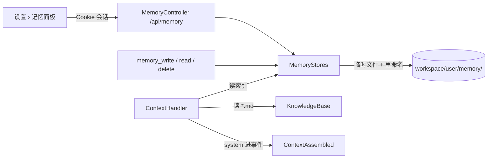

# Design Document

## Overview

给 shell 加一个 `memory` 包：按用户存放的记忆文件、三个内置工具、运行开始时把索引和共享知识读进 system、一组按登录用户的接口，以及设置弹窗里的“记忆”面板。内核和 value 不改：记忆只在 `ContextAssembled.system` 里出现，回放天然确定。



依据：`requirements.md`（决定 M1–M9）。

## Steering Document Alignment

### Technical Standards (tech.md)
三层不变：value、kernel 不加类型；shell 新增 `tantalum.shell.memory` 包，Spring 只出现在 `web` 的控制器和 `boot` 的装配。文件 I/O 只在 `MemoryStore` 和 `KnowledgeBase` 两个类里，解析和校验是纯函数。工具无状态、在 `ToolHandler` 的虚拟线程里跑、受 `tool-timeout` 约束，与现有工具一致。

### Project Structure (structure.md)
项目没有 `structure.md`，结构以本文为准。

## Code Reuse Analysis

### Existing Components to Leverage
- **`Workspaces` / `Workspace`**：按用户给出目录；每人模式下记忆目录是该用户工作目录下的 `memory/`。
- **`ToolArguments`**：参数读取和 schema（必填/可选）。
- **`ContextHandler`**：已经在运行开始读 `AGENTS.md` 进 system，记忆索引和共享知识在同一处拼接。
- **`ApiController` 的模式**：`current()` 取登录用户、`json()`/`error()`、404 不区分“别人的”和“不存在”。
- **`ItemJson` 不需要**：记忆接口返回自己的小结构。
- **console**：`SettingsDialog` 的面板切换、`Dialog`（删除确认）、`Markdown`（正文渲染）、`Button`、`zh.ts`、`client.ts` 的 `request` 封装、TanStack Query。
- **测试**：`TestServer`、`E2eServer`/`E2eModel`、`ClaudeScenarioTest` 的门控与用量汇总、`BuiltinToolsTest` 的工具测试风格。

### Integration Points
- **`Engine` 装配**：`MemoryStores` 和 `KnowledgeBase` 在 `assemble()` 里创建，传给 `ContextHandler`；三个记忆工具注册进 `ToolCatalog`（内置，在 `read_file`、`grep` 之后）。
- **`TantalumProperties`**：新增 `memory` 和 `knowledge` 两组配置。
- **`SecurityConfig`**：`/api/memory/**` 落在现有的 `/api/**` 认证规则和 `Origin` 校验内，不需要改。
- **prompt caching**：索引在 system 末尾、钩子 `PromptPatch` 追加之前（`PromptProjection` 本来就是 `run.system() + patch.systemAppend()`），system 断点整个运行稳定。

## Architecture

### 后端

```
tantalum.shell
├── memory（新）
│   ├── MemoryEntry          record：name、type、description、content、updatedAt
│   ├── MemoryType           enum：USER、FEEDBACK、PROJECT、REFERENCE（小写序列化）
│   ├── MemoryFormat         纯函数：条目文件 ⇄ MemoryEntry（frontmatter），索引行 ⇄ 摘要；名称和长度校验
│   ├── CredentialGuard      纯函数：内容是否像凭据
│   ├── MemoryLimits         record：maxEntries、maxIndexBytes、maxEntryBytes
│   ├── MemoryStore          一个用户的记忆目录：index()、list()、read()、write()、delete()；临时文件 + 重命名；按用户加锁
│   ├── MemoryStores         按 Principal 给出 MemoryStore（像 Workspaces），决定目录位置
│   ├── KnowledgeBase        第四层：读配置目录下的 *.md，按文件名排序，总字节上限，按修改时间缓存
│   ├── MemoryGuidance       system 里的固定指引文本（常量）
│   ├── MemoryWriteTool      memory_write(name, type, description, content)
│   ├── MemoryReadTool       memory_read(name)
│   └── MemoryDeleteTool     memory_delete(name)
├── handler
│   └── ContextHandler       system = base + 指引 + 共享知识 + AGENTS.md + 索引（有才加）
├── web
│   └── MemoryController（新） GET /api/memory、GET /api/memory/{name}、POST /api/memory、DELETE /api/memory/{name}
└── boot
    ├── TantalumProperties   + Memory(maxEntries, maxIndexBytes, maxEntryBytes)、Knowledge(dir, maxBytes)
    └── Engine               装配 MemoryStores、KnowledgeBase、工具、ContextHandler
```

### 目录位置（对需求 1.4 的一处修正）

| 工作目录模式 | 记忆目录 | 理由 |
|---|---|---|
| `per-user`（默认） | `<workspace>/<用户名>/memory/` | 需求 1.1；用户自己的 `read_file`、`grep` 能看到自己的记忆文件，这是有意的 |
| `shared` | `<data-dir>/memory/<用户名>/` | 需求 1.4 写的是 `<root>/memory/<用户名>/`，但共用模式下 `grep` 能搜到整个 root，别人的记忆会被搜出来。放到数据目录下，工具的路径校验（`Workspace.resolve`）天然到不了 |

两种模式下 `MemoryStore` 都自己校验名称（`[a-z0-9-]{1,64}`）并断言最终路径在自己的目录内，不依赖 `Workspace`。

### 文件格式

索引 `MEMORY.md`，每条一行，由条目文件的 frontmatter 生成，每次写或删后整体重写：

```
- [java-version](java-version.md) — user — 回答一律用 Java 25 语法
```

条目 `<name>.md`：

```
---
name: java-version
description: 回答一律用 Java 25 语法
type: user
updated: 2026-11-01T02:10:00Z
---

用户 2026-11-01 明确要求：示例代码和解释都按 Java 25，不提旧版本写法。
```

读索引进 system 时按原文读入（快，几 KB），能解析的行照常，坏行跳过并记日志（需求 1.6）；索引以条目文件为准，下一次写入会把手工改坏的部分重写掉。

### system 组装顺序

```
<基础提示>

## 记忆指引
<MemoryGuidance，固定文本>

## 共享知识
<knowledge-dir 下的 *.md，按文件名；没有则整段省略>

<AGENTS.md 原文；没有则省略>

## 你的记忆索引
<MEMORY.md 原文；为空则整段省略>
```

指引内容：四种类型各记什么；只记跨会话仍有用的事实；写之前先看索引，相近的用同名覆盖；用户让记的要记、让忘的要删；不记一次性任务细节；绝不记凭据；条目正文用 `memory_read` 按需读。

### 并发与原子性

- `MemoryStores` 里每个用户一把锁（`ConcurrentHashMap<Principal, Object>`），`write`/`delete` 在锁内：写条目到 `<name>.md.tmp` → 重命名覆盖 → 重新扫描目录生成索引 → 写 `MEMORY.md.tmp` → 重命名。
- 读不取锁：重命名是原子的，读到的要么是旧版要么是新版。
- 上限检查在锁内做，新建时数条目、算索引字节；超限返回明确错误，不写。

### 工具

| 工具 | 参数 | 结果 |
|---|---|---|
| `memory_write` | `name`（必填）、`type`（必填，四选一）、`description`（必填，≤200 字符）、`content`（必填） | “已记住 name”或“已更新 name”；错误：名称不合法、类型不对、超长、记忆已满、像凭据 |
| `memory_read` | `name` | frontmatter 摘要 + 正文；错误：不存在 |
| `memory_delete` | `name` | “已删除 name”；错误：不存在 |

三个工具 `server()` 返回 `memory`，并发 16，`isConcurrencySafe` 为 true。错误文本不含路径。`ReadOnlyHook` 这类按名单放行的策略要显式把 `memory_*` 加进名单，否则会拦下（这是策略钩子的语义，不是记忆的）。

### 接口

| 方法 | 路径 | 请求 | 响应 |
|---|---|---|---|
| GET | `/api/memory` | | `{ entries: [{name, type, description, updatedAt}], used, max }` |
| GET | `/api/memory/{name}` | | `{ name, type, description, updatedAt, content }`；404 |
| POST | `/api/memory` | `{ name, type, description, content }` | 201 同上；400 带原因（与工具同一校验） |
| DELETE | `/api/memory/{name}` | | 204；404 |

身份来自登录会话；名称不合法按 404 处理，不泄露校验细节。

### 前端

```
console/src
├── api/client.ts           listMemories()、getMemory()、createMemory()、deleteMemory()
├── api/types.ts            MemorySummary、MemoryEntry、MemoryType
├── settings/MemoryPane.tsx 列表（名称、类型标签、描述、相对时间）、查看（Markdown）、删除（Dialog 确认）、新增表单、配额 “已用 n/N 条”
├── settings/useMemories.ts TanStack Query：["memory"]、["memory", name]；写后 invalidate
├── settings/SettingsDialog.tsx 新增 "memory" 面板
└── text/zh.ts              settings.memory.* 文案
```

列表按 `updatedAt` 倒序；面板不订阅 SSE，打开时查询、写后刷新（需求 6.6）。

### 配置

```
tantalum.memory.max-entries=200
tantalum.memory.max-index-bytes=16384
tantalum.memory.max-entry-bytes=8192
tantalum.knowledge.dir=            （空表示没有共享知识层）
tantalum.knowledge.max-bytes=65536
```

非正数启动失败（和 `Loop` 一样在 record 紧凑构造器里校验）。

## Components and Interfaces

### MemoryStore
- **Purpose:** 一个用户的记忆目录的全部 I/O。
- **Interfaces:** `String indexText()`、`List<MemoryEntry> list()`、`Optional<MemoryEntry> read(String name)`、`WriteResult write(MemoryEntry entry)`（CREATED / UPDATED / 拒绝原因）、`boolean delete(String name)`、`MemoryLimits limits()`。
- **Dependencies:** `MemoryFormat`、`CredentialGuard`、`MemoryLimits`、java.nio。
- **Reuses:** `Workspaces` 的目录创建与权限做法。

### MemoryStores
- **Purpose:** 按 Principal 给出 `MemoryStore`，决定目录位置，持有每用户锁。
- **Interfaces:** `MemoryStore of(Principal principal)`。
- **Dependencies:** `Workspaces`（每人模式）、数据目录（共用模式）。

### KnowledgeBase
- **Purpose:** 第四层只读文本。
- **Interfaces:** `String text()`（空串表示没有）。
- **Dependencies:** 配置目录、`maxBytes`；按目录内文件的最大修改时间缓存。

### ContextHandler（改）
- **Interfaces:** 不变；构造器多收 `MemoryStores`、`KnowledgeBase`。
- 组装顺序见上；每段只在有内容时加入。

### MemoryWriteTool / MemoryReadTool / MemoryDeleteTool
- **Purpose:** 模型侧入口。
- **Dependencies:** `MemoryStores`（从 `ToolContext.principal()` 取用户）、`ToolArguments`。

### MemoryController
- **Purpose:** 界面侧入口。
- **Dependencies:** `MemoryStores`、`Engine.codec()` 的 mapper、`SecurityContextHolder`。

### MemoryPane（前端）
- **Purpose:** 看、删、手工新增。
- **Reuses:** `Dialog`、`Markdown`、`Button`、`relativeTime`。

## Data Models

### MemoryEntry
```
name: String          [a-z0-9-]{1,64}
type: MemoryType      user | feedback | project | reference
description: String   1–200 字符，单行
content: String       ≤ maxEntryBytes（UTF-8 字节数）
updatedAt: Instant    写入时由 MemoryStore 用 Clock 填
```

### 索引行
```
- [<name>](<name>.md) — <type> — <description>
```

### 接口 JSON
```
MemorySummary { name, type, description, updatedAt }
MemoryEntry   { name, type, description, updatedAt, content }
MemoryList    { entries: MemorySummary[], used: int, max: int }
```

## Error Handling

### Error Scenarios
1. **名称不合法 / 类型不对 / 描述或正文超长**
   - **Handling:** 工具返回错误结果并说明规则；接口 400 带同一文案。
   - **User Impact:** 模型改参数重试；界面表单下方显示原因。
2. **记忆已满**
   - **Handling:** 不写入，返回“记忆已满（n/N），请先用 memory_delete 删除或用同名 memory_write 合并”。
   - **User Impact:** 模型通常会合并或询问用户；面板显示已用额度。
3. **内容像凭据**
   - **Handling:** 拒绝，返回“记忆不能保存凭据”，不回显内容，不记日志正文。
   - **User Impact:** 模型改写后重试或放弃。
4. **索引损坏**
   - **Handling:** 坏行跳过并记日志；下次写入重建。
   - **User Impact:** 无感知。
5. **共享知识目录不存在或超限**
   - **Handling:** 启动警告；超限按文件名顺序截断并警告。
   - **User Impact:** 无；管理员看日志。
6. **并发写同一用户**
   - **Handling:** 每用户锁串行化；临时文件 + 重命名。
   - **User Impact:** 后写的胜出，索引完整。
7. **接口访问别人的或不存在的名字**
   - **Handling:** 404，同一文案。
   - **User Impact:** 面板提示“不存在”。

## Testing Strategy

### Unit Testing
- `MemoryFormatTest`：frontmatter 往返、索引行往返、坏行跳过、名称校验边界、字节上限按 UTF-8 算。
- `CredentialGuardTest`：各类凭据特征命中，普通文本不误伤（含“password 这个词出现在说明里”的情况）。
- `MemoryStoreTest`：新建/覆盖/删除、索引重建、上限（条目数、索引字节、单条字节）、并发 32 线程写同一用户后文件完整且索引与目录一致、名称越界不可能、`@TempDir`。
- `MemoryStoresTest`：每人模式和共用模式的目录位置；共用模式下别人的记忆不在工作目录内。
- `KnowledgeBaseTest`：排序、截断、目录缺失、修改时间缓存。
- `MemoryToolsTest`：三个工具的成功与每种错误；结果不含路径；schema 的 required。
- `ContextHandlerTest`（扩）：各段的顺序与省略；索引在钩子追加之前（通过 `PromptProjection` 断言）；回放不读文件（`ContextAssembled.system` 已含内容）。
- `TantalumPropertiesTest`（扩）：新配置默认值和非正数失败。

### Integration Testing
- `MemoryApiTest`（`TestServer`）：四个接口；两个用户互不可见；404 一致；`Origin` 校验对 POST/DELETE 生效；手工新增走凭据过滤。
- `TenLoopIntegrationTest` 或新测试：脚本化模型调用 `memory_write`，下一个运行的 `ContextAssembled.system` 含索引行，当前运行的后续调用不含（快照）。
- 真实模型（门控同 `ClaudeScenarioTest`）：
  - 跨会话记住：会话 A “以后回答一律用 Java 25 语法并记住” → 断言 `memory_write` 被调用、文件存在；会话 B 新运行 system 含索引行，问一个 Java 问题，断言回答出现 Java 25 特有写法（如 `void main()` 无参或 `IO.println`）。
  - 让它忘记：“忘掉关于 Java 版本的记忆” → `memory_delete` 被调用、文件消失、下一个运行 system 不含。
  - 结论和用量写进 tech.md 的场景测试表。

### End-to-End Testing
- `E2eModel` 新增关键词 `remember`：调用 `memory_write` 后回答“已记住”。
- `console/e2e/memory.spec.ts`：发送含 `remember` 的消息 → 打开设置 › 记忆 → 看到条目 → 点开看正文 → 删除并确认 → 列表为空。
