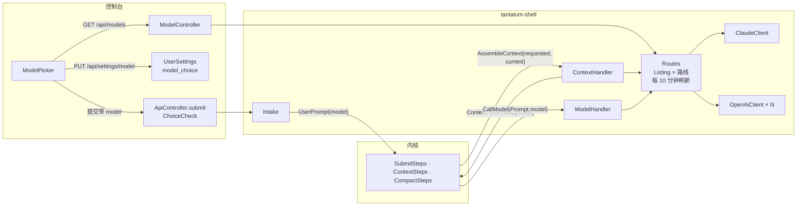

# Design Document

## Overview

把“一个服务器一个模型客户端”改成“几条路线，每个会话选一个”。改动分四层：

- **`tantalum-value` 和内核：** 新的值类型 `ModelChoice(route, model, effort)`。提交事件带“要用什么”，`ContextAssembled` 记“这次用了什么”，`Prompt` 带着它到模型客户端。内核在选择变了时追加一条换模型的说明，换到窗口更小的模型时让压缩前的摘要用上一个模型。
- **`tantalum-shell`：** 新包 `tantalum.shell.route`，管路线、模型列表、模型信息和档位。现有的两个客户端改成按 `Prompt` 里的选择发请求（模型名、`effort`、思考参数），推理块记下是谁写的，按 M9 决定发不发。窗口从“一个值”改成“每个模型一个”。
- **接口：** `GET /api/models`；提交带 `model`；`PUT /api/settings/model` 存“上次的选择”；会话视图带当前选择。
- **控制台：** 输入框旁的选择器 `ModelPicker`，对话页“换成 …”一行，设置页列出所有模型。

不改的：工具全集、工具开关、压缩规则本身、journal 的文件格式（只多几个可以为空的字段，旧行逐字节不变）。

## Steering Document Alignment

### Technical Standards (tech.md)
- **内核零 mock、零线程：** 内核只多搬运一个值、多一种追加的消息，判断“变没变”是纯函数，测试照现有写法。
- **journal 是事实来源（I2）：** 选择进 journal（M13）；回放不读模型列表。密钥和地址不进 journal（`RequestOptions` 本来就不含地址，`tantalum-value/.../model/RequestOptions.java:6-9`）。
- **历史只追加（tech.md Decision 11）：** 换模型的说明是追加的消息，已发出的内容不动；思考块照 Claude 文档原样发回（M9）。
- **只有 `boot`、`web` 读全局配置：** 路线配置在 `boot` 里转成 `RouteSettings` 交给 `route` 包。
- **没有新的第三方依赖。** Claude 模型列表用现有的官方 Java SDK（`client.models().list()`，现在 `ClaudeWindow` 已经用 `models().retrieve`）；OpenAI 兼容的用 JDK `HttpClient`（同 `OpenAiWindow`）。

### Project Structure (structure.md)

| 包 | 类 | 做什么 |
|---|---|---|
| `tantalum.value.model` | 新增 `ModelChoice`、`ModelChangeBlock`；`Prompt`、`ReasoningBlock` 加字段 | 值类型 |
| `tantalum.value.event` / `command` / `state` | `UserPrompt`、`FollowUpSubmitted`、`ContextAssembled`、`AssembleContext`、`SessionContext` 加字段 | 记录和搬运选择 |
| `tantalum.kernel.step` | `SubmitSteps`、`ContextSteps`、`CompactSteps` 改 | 选择怎么生效 |
| `tantalum.shell.route`（新） | `Routes`、`Route`、`RouteSettings`、`ModelInfo`、`Listing`、`ModelList`、`ClaudeModels`、`OpenAiModels`、`Levels`、`ChoiceCheck` | 路线、模型列表、档位、检查选择 |
| `tantalum.shell.model` | `ClaudeRequest`、`ClaudeClient`、`OpenAiClient` 改；新增 `OpenAiThinking`；删 `ClaudeWindow`、`OpenAiWindow`、`WindowSource`、`ContextWindow` | 按选择发请求 |
| `tantalum.shell.settings` | `UserSettings`、`CompactionPolicy` 改 | 上次的选择；按模型算压缩点 |
| `tantalum.shell.web` | 新增 `ModelController`；`ApiController`、`SettingsController` 改 | 接口 |

- 依赖方向：`route` 依赖 `model`（建客户端）和 `settings`；`model` 不依赖 `route`。读列表的代码在 `route`，发请求的代码在 `model`。
- ArchitectureTest 加两条规则：
  1. `tantalum.shell.model` 不依赖 `tantalum.shell.route`。
  2. `tantalum.shell.route` 不依赖 `web`、`handler`、`loop`。
- 名字：`Route` 是一条路线，`Routes` 是全部路线；`ModelInfo` 是一个模型能做什么；`Listing` 是一条路线最近一次读到的列表。

## 实测（2026-11-06，这台 Mac）

数据在 `scratchpad/model-picker-spike/`（`claude-models.json`、`qwen-thinking-*.json`，不含密钥）。

### Claude Models 接口（`GET /v1/models?limit=1000`，Yi 的密钥）

一页返回 14 个模型，`has_more: false`。

| 模型 | 窗口 | 输出上限 | `adaptive` | `effort` 档位 | 能关思考 | 会话中途工具变化（`TOOL_CHANGE_MODELS`） |
|---|---|---|---|---|---|---|
| `claude-haiku-5-5` | 1000000 | 128000 | 是 | low–max | `disabled` | 不支持 |
| `claude-sonnet-5-5` | 1000000 | 128000 | 是 | low–max | 只有 `between_tools` | 支持 |
| `claude-opus-5-5` | 1000000 | 128000 | 是 | low–max | 不能 | 支持 |
| `claude-fable-5-1` | 1000000 | 128000 | 是 | low–max | 不能 | 支持 |
| `claude-opus-5` | 1000000 | 128000 | 是 | low–max | `disabled` | 支持 |
| `claude-sonnet-5` | 1000000 | 128000 | 是 | low–max | `disabled` | 不支持 |
| `claude-fable-5` | 1000000 | 128000 | 是 | low–max | 不能 | 支持 |
| `claude-opus-4-8` | 1000000 | 128000 | 是 | low–max | `disabled` | 支持 |
| `claude-opus-4-7` | 1000000 | 128000 | 是 | low–max | `disabled` | 不支持 |
| `claude-sonnet-4-6` | 1000000 | 128000 | 是 | low、medium、high、max（没有 xhigh） | `disabled` | 不支持 |
| `claude-opus-4-6` | 1000000 | 128000 | 是 | low、medium、high、max | `disabled` | 不支持 |
| `claude-opus-4-5-20251101` | 200000 | 64000 | **否** | low、medium、high | `disabled` | 不支持 |
| `claude-haiku-4-5-20251001` | 200000 | 64000 | **否** | 不支持 `effort` | `disabled` | 不支持 |
| `claude-sonnet-4-5-20250929` | 200000 | 64000 | **否** | 不支持 `effort` | `disabled` | 不支持 |

结论：
- `capabilities.thinking.types` 下有 `enabled`、`adaptive`、`disabled`、`between_tools` 四项，每项有 `supported`；`capabilities.effort` 下每个档位有 `supported`。M3、M5 要的都能直接读，不用自己维护表。
- 按 M3 去掉最后 3 个，能选的是 11 个。其中 5 个不支持会话中途工具变化，按 M11 在有工具变化的会话里灰掉。
- 能不能“关思考”各模型不一样（Opus 5.5、Fable 不能，Sonnet 5.5 只有 `between_tools`）。M5 定为不提供“关”，以后要做可以按 `disabled`、`between_tools` 两项读出来。

### 本地 qwen（llama.cpp，`127.0.0.1:8090`）

- `GET /v1/models`：一个模型 `qwen3.8-flash-next-unsloth-ud-q4_k_xl`，`meta.n_ctx` 131072，`architecture.input_modalities: ["text"]`。
- 同一个问题“17*23=?”，请求里加 `chat_template_kwargs: {"enable_thinking": true}`：`reasoning_content` 132 字符，输出 49 token，1.4 s；`false`：没有 `reasoning_content`，输出 4 token，0.09 s。两次答案都是 391。
- 结论：本地路线用 `thinking=chat-template`，档位“关”“开”，确实起作用。现在不发这个参数时它默认在想（`OpenAiClient` 收到了 `reasoning_content`），所以默认档位是“开”。

## Code Reuse Analysis

### Existing Components to Leverage
- **`ClaudeWindow`、`OpenAiWindow` 的读取代码**（`model/ClaudeWindow.java:33-60`、`model/OpenAiWindow.java:39-71`）：搬进 `ClaudeModels`、`OpenAiModels`，从“读一个模型的窗口”扩成“读整张列表和每个模型的信息”；窗口字段的顺序（`meta.n_ctx`、`max_model_len`、`context_length`）和备用模型取最小（T3）照搬。
- **`ContextWindow` 的启动等待、10 分钟刷新、失败保留**（`model/ContextWindow.java:49-106`）：同样的时序搬进 `Routes`，从一个值变成每条路线一张 `Listing`。
- **`UserSettings`**（`settings/UserSettings.java:59-99`）：加一个键 `model_choice`，值是 JSON。
- **`CompactionPolicy`**（`settings/CompactionPolicy.java:35-60`）：公式不变，`W` 和 `R` 从“服务器一份”改成“这个模型的”。
- **`ToolChangeBlock` 的做法**（`tantalum-value/.../model/ToolChangeBlock.java:5-10`、`kernel/.../projection/PromptProjection.java:35-40`）：换模型的说明照它做成追加的 `SYSTEM` 消息，位置规则相同。
- **`MatchedCodec`**（`shell/journal/MatchedCodec.java:34-58`）：`ContextAssembled` 多一个字段，照现有规则只在变化时写。
- **`ToolChangeNotice`**（`console/src/conversation/ToolChangeNotice.tsx`）：对话页“换成 …”一行照它写。
- **`drafts.ts`**（`console/src/composer/drafts.ts`）：没发出去的选择和没发出去的文字一起存，刷新页面不丢。

### Integration Points
- **`Engine`：** 不再接收一个 `ModelClient`，改为接收 `Routes`；`ModelHandler` 按 `Prompt.model()` 找路线。测试注入脚本化模型的地方改成注入一组路线（`TestRoutes.of(name, client)`）。
- **`TantalumApplication`：** `createClient` 换成 `createRoutes`；密钥按每条路线的 `api-key-env` 读。
- **`Intake`、`ApiController.submit`：** 检查提交里的选择（M14、M15、M11）。
- **控制台：** `Composer` 里的模型名换成 `ModelPicker`；提交带 `model`。

## Architecture



### 一次提问怎么选模型

1. 画面上的选择随提交发来：`{"model": {"route": "local", "model": "qwen3.8-…", "effort": "on"}}`。`ApiController.submit` 用 `ChoiceCheck` 检查（M14、M15、M11），不合格回 400，不进 journal。
2. `Intake` 把选择放进 `UserPrompt.model`（`follow-up` 放进 `FollowUpSubmitted.model`；`steer` 不带）。这一行进 journal，就是“要用什么”。
3. 内核开始运行时（`SubmitSteps`，排队的 follow-up 开始运行时也一样），把这个运行的 `requested` 记在运行状态里；发 `AssembleContext(id, run, requested, current)`，`current` 是 `SessionContext.model`。
4. `ContextHandler` 定这次用什么：
   - 有 `requested` 就用它（第 1 步已经查过；这之间路线掉线的话照用，调用失败走现有的模型失败流程）；
   - 没有就用 `current`，`current` 不可用或为空就用这个用户的默认（M14、M7）；
   - 按这个模型的 `ModelInfo` 算压缩设置（M10）；
   - 结果写进 `ContextAssembled.model`，就是“配上了什么”。`MatchedCodec` 只在变化时写这一项。
5. `ContextSteps.freezeContext`：
   - 新旧不同、旧的不为空、而且路线或模型变了：追加一条 `Message(SYSTEM, [ModelChangeBlock(fromLabel, toLabel)])`（M12），位置照工具变化的规则（在这次的用户消息前面）；
   - 只有档位变了：不追加；
   - `SessionContext.model` 换成新的；路线或模型变了时 `SessionContext.modelBefore` 记下旧的，这个运行的第一次正常调用返回后清掉。
6. 投影出 `Prompt` 时带上 `SessionContext.model`；只有“这个运行第一次调用前的自动压缩”的摘要调用带 `modelBefore`（M10）。
7. `ModelHandler` 按 `prompt.model().route()` 找到路线，在这条路线的 `CallLimiter` 下调它的客户端（M16）。客户端从 `prompt.model()` 取模型名和档位。

回放：第 2、4 步的行在 journal 里，第 5、6 步是内核的纯函数，第 7 步发出的请求由 `Prompt` 决定。回放不经过 `Routes`。

### 换到窗口更小的模型（M10）

- 第 4 步按新模型算出的压缩点进 `ContextAssembled.compaction`；内核在这个运行第一次调模型前照现有规则判断（`context-compaction` 规则 1）。
- 要压缩时，`CompactSteps` 的摘要调用用 `modelBefore`：上一个模型装得下现在的历史，新模型不一定。摘要通过后用新模型发原来的调用。
- 摘要失败、放弃压缩时，这个运行失败，失败原因写“换到 {新} 之前压缩失败，请重试或换窗口更大的模型”。会话的模型回到上一个：
  - `RunEnd` 在这种失败时把 `SessionContext.model` 还原成 `modelBefore`，这是内核的纯函数，回放结果相同；
  - 已经追加的换模型说明不能删（只追加），所以再追加一条反方向的 `ModelChangeBlock`（从新的换回旧的），下一次调用时模型看到的说明和实际一致；
  - 画面上选择器显示的是会话的当前选择，也就回到了旧的；用户再提问时可以重新选。
- 超长恢复（模型报上下文超长）照旧，只是触发的刷新是这一条路线的列表（`Routes.refreshSoon(route)`）。

### 思考块（M9）

- `ReasoningBlock` 加 `route`、`model` 两个可以为空的字段，客户端解析回复时填上这次的路线和实际模型（Claude 用 `ModelReplied.actualModel` 的同一个值，备用模型接手时就是备用模型）。
- `ClaudeRequest.reasoningParam`：`provider` 是 `claude` 就原样发（现在就是这样，`ClaudeRequest.java:367-378`），不看 `model`。
- `OpenAiClient`：只发 `provider` 是 `openai`、`route` 和 `model` 都等于这次选择的；`route` 为空（升级前的旧块）不发。
- 不在发请求前删除或改写历史里的块，只决定“这一次发不发”，所以换回原来的模型时它们又会发出去。

### 历史的样子不随模型变（M11）

- system 文字和工具定义由 `ContextAssembled` 决定，和选哪个模型无关。`ContextHandler` 组 system 时不写模型名，换模型的事只在 `ModelChangeBlock` 里说。
- Claude 路线里，支持和不支持会话中途工具变化的模型看到的历史不一样（不支持的看不到 `defer_loading` 的工具和工具变化消息，`ClaudeRequest.java:149-156`）。所以“会话里有工具变化”时不支持的模型不能选：
  - “有工具变化” = 会话一开始就有关着的工具（`SessionContext.initialTools` 不是全集），或者历史里有 `ToolChangeBlock`；
  - 内核状态的投影 `StateView` 加一个 `toolChangesInHistory(session)`，`ChoiceCheck` 和会话视图用它；
  - `ModelInfo.toolChanges` 来自 `ClaudeRequest.TOOL_CHANGE_MODELS`（OpenAI 兼容路线恒为 `true`：工具变化本来就写成文字，`OpenAiClient.java:320`）。

### 换模型的说明怎么发（M12）

- `ModelChangeBlock(String from, String to)`，两个都是写进 journal 时就定下的文字，如 `Claude Sonnet 5.5 (claude/claude-sonnet-5-5)`，回放时一字不变。
- 发给模型的文字：`[Model changed: earlier assistant turns were written by {from}; you are now {to}.]`
- Claude：写成这次用户消息里的第一个文字块。不用中途的 `role: system` 消息，因为 Sonnet 5 不支持（Claude 文档 SKILL“Mid-Conversation System Messages”），而说明在每个 Claude 模型上要一样。
- OpenAI 兼容：和工具变化一样写成文字，放进这次的用户消息开头（不用中途的 `system` 消息，有的聊天模板只认第一条 `system`）。
- 对话页：`TranscriptPass` 遇到 `ModelChangeBlock` 给出一项 `modelChange`，画面写“换成 {显示名} · {档位}”。

## Components and Interfaces

### `tantalum-value`

- **`ModelChoice(String route, String model, String effort)`**：`route`、`model` 不能为空；`effort` 为空表示这个模型没有档位。`label()` 给日志和说明用。
- **`ModelChangeBlock(String from, String to)`**（实现 `ContentBlock`）。
- **`Prompt`** 加 `ModelChoice model`（可以为空：老测试和旧记录里没有；为空时 `ModelHandler` 用默认路线）。
- **`ReasoningBlock`** 加 `String route, String model`，可以为空。
- **`UserPrompt`、`FollowUpSubmitted`** 加 `ModelChoice model`，可以为空。
- **`ContextAssembled`** 加 `ModelChoice model`，可以为空。
- **`AssembleContext`** 加 `ModelChoice requested, ModelChoice current`。
- **`SessionContext`** 加 `ModelChoice model, ModelChoice modelBefore`。
- 旧的构造函数保留（同 `UserPrompt` 现有的四参数构造），已有测试不用改。

### 内核

- **`SubmitSteps`：** 运行开始时记下 `requested`（来自开始它的 `UserPrompt` 或 `FollowUpSubmitted`）。
- **`ContextSteps.freezeContext`：** 第 5 步。“变没变”按 `route`、`model` 判断，`effort` 不算。
- **`PromptProjection`：** 第 6 步。
- **`CompactSteps`：** 自动压缩的摘要调用在 `modelBefore` 不为空时用它（第 6 步）。
- **`RunEnd`：** M10 的失败还原。
- 内核语义版本不变：旧行没有这些字段，读出来是空，行为和现在一样。

### 包 `tantalum.shell.route`

**`RouteSettings`**（`boot` 从配置转来）
- 共同的：`name`、`displayName`、`kind`（`CLAUDE`、`OPENAI`）、`apiKeyEnv`、`defaultModel`、`allow`（允许列表）、`maxTokens`、`contextWindow`（读不到时用）、`bytesPerToken`、`concurrency`、`firstChunkTimeout`、`betweenChunkTimeout`。
- Claude 的：`defaultEffort`、`fallbacks`。
- OpenAI 兼容的：`baseUrl`、`listModels`、`thinking`（`OpenAiThinking`）、`efforts`、`defaultEffort`、`vision`、`overrides`（模型名 → `thinking`、`efforts`、`defaultEffort`、`vision`、`contextWindow`）。

**`ModelInfo`**
- `route`、`id`、`name`（Claude 的 `display_name`；OpenAI 兼容的就是 `id`）、`window`、`windowSource`（`MODEL`、`CONFIG`）、`maxTokens`、`vision`、`levels`（有序的档位名）、`defaultLevel`（没有档位时为空）、`toolChanges`、`points`（四档压缩点，`CompactionPolicy` 算好）。

**`Levels`**
- Claude：`low`、`medium`、`high`、`xhigh`、`max` 里 `capabilities.effort.<档位>.supported` 为真的，按这个顺序。默认档位：路线的 `defaultEffort` 在列表里就用它，否则取离 `medium` 最近的（相同距离取低的）。
- OpenAI 兼容：`thinking=none` 没有档位；`reasoning-effort` 用 `efforts`（默认 `low,medium,high`），默认 `defaultEffort`（默认 `medium`）；另外三种是 `off`、`on`，默认 `on`。
- 名字只是标识，画面上的中文名在 `zh.ts`（`low` 低、`medium` 中、`high` 高、`xhigh` 很高、`max` 最高、`minimal` 极低、`off` 关、`on` 开；不认识的照原样显示）。

**`ModelList`**（接口，一个方法 `Listing read()`）
- **`ClaudeModels`**：`client.models().list()` 翻完所有页。
  - 去掉 `capabilities.thinking.types.adaptive.supported` 不为真的（M3），日志一行列出去掉的 id；
  - 有允许列表就只留列表里的；允许列表里有、接口里没有的，日志写明；
  - `window` = `max_input_tokens`；`fallbacks` 开着时对每个留下的模型 `retrieve`（带 `server-side-fallback-2026-06-01`），取它和 `allowed_fallback_models` 中最小的（照 `ClaudeWindow.java:33-60`，T3）；
  - `maxTokens` = min(`max_tokens`, 路线的 `max-tokens`)；`vision` = `capabilities.image_input.supported`。
- **`OpenAiModels`**：`GET {base-url}/models`，带 `Authorization: Bearer`（有密钥时），5 秒超时，不跟跳转。
  - `data[].id` 是模型；窗口字段照 T1（`meta.n_ctx`、`max_model_len`、`context_length`），`overrides.{模型}.context-window` 优先于接口；都没有用路线的 `context-window`，来源 `CONFIG`；
  - `list-models=false` 时不发请求，列表就是允许列表，窗口来自配置；
  - `vision`：`overrides` → 路线的 `vision`。

**`Listing`**：`status`（`OK`、`STALE`：这次失败但有上次的、`UNAVAILABLE`：从没读到过）、`models`、`loadedAt`、`error`（给日志和画面的一句话，只写类别，如“连不上”“401”“超时”，不写地址）。

**`Route`**：`settings`、`client`（`ModelClient`）、`limiter`（`CallLimiter`）、当前的 `Listing`（volatile）。

**`Routes`**
- `start(Duration wait)`：每条路线一个虚拟线程读列表，总共等 `wait`（5 s），没读完的先是 `UNAVAILABLE`，读完了再更新。
- 每 10 分钟后台刷新；失败时 `OK` 变 `STALE`，保留模型。
- `refreshSoon(route)`：模型报上下文超长时调（compaction-threshold T2）。
- `route(name)`、`model(choice)` 返回 `Optional<ModelInfo>`；`defaultChoice()`；`snapshot()` 给 `/api/models`。
- 密钥变量没设的路线不建（M2）；默认路线的密钥变量没设时 `Routes.create` 抛异常，启动失败；默认路线只是列表读不到时照常启动，显示“暂时连不上”。

**`ChoiceCheck`**
- `problem(ModelChoice, boolean toolChangesInHistory, boolean hasImages)` 返回 `Optional<String>`，消息直接给画面（M14、M15、M11），见“Error Handling”。
- `usable(ModelChoice)`：给“上次的选择”判断能不能拿来做新会话的默认。

### 包 `tantalum.shell.model`

- **`ClaudeRequest`：** `model` 从 `prompt.model().model()` 取，`effort` 从 `prompt.model().effort()` 取；`Prompt.model` 为空时用构造时的默认（老测试）。期望文件 `claude-requests.txt` 里默认选择的请求体逐字节不变。`ModelChangeBlock` 照“换模型的说明怎么发”写。
- **`ClaudeClient.Settings`：** `model`、`effort` 改名为 `defaultModel`、`defaultEffort`，只在 `Prompt.model` 为空时用。
- **`OpenAiThinking`**（新，enum）：`NONE`、`REASONING_EFFORT`、`ENABLE_THINKING`、`CHAT_TEMPLATE`、`THINKING_TYPE`；`apply(ObjectNode body, String level)` 写进请求体：

  | 写法 | `level` | 请求体里加的 |
  |---|---|---|
  | `reasoning-effort` | `low` 等 | `"reasoning_effort": "low"` |
  | `enable-thinking` | `on` / `off` | `"enable_thinking": true` / `false` |
  | `chat-template` | `on` / `off` | `"chat_template_kwargs": {"enable_thinking": true}` / `false` |
  | `thinking-type` | `on` / `off` | `"thinking": {"type": "enabled"}` / `"disabled"` |

  照 pi `AI/src/api/openai-completions.ts:872-967`（`reasoning_effort` 和几种按服务商的开关写法）；哪个服务用哪种由管理员按服务商文档定，README 给出本机 llama.cpp、vLLM 跑 Qwen3 的写法（`chat-template`，见“实测”）。
- **`OpenAiClient`：** 模型名从 `prompt.model().model()` 取；按这个模型的 `OpenAiThinking` 写思考参数（客户端构造时拿到“模型 → 写法”的函数，由 `route` 提供，`model` 包不依赖 `route`）；`options()` 的 `extra` 里带上加的这些字段，轨迹页能看到；推理块按 M9 过滤。
- 删：`ClaudeWindow`、`OpenAiWindow`（代码搬进 `route`）、`WindowSource`、`ContextWindow`。`ModelClient.window()` 删掉。

### 包 `tantalum.shell.settings`

- **`UserSettings`：** `modelChoice(Principal)` 返回 `Optional<ModelChoice>`；`setModelChoice(Principal, ModelChoice)`。值存 JSON；读不懂的当没有（同 `compaction_percent`，`UserSettings.java:110`）。
- **`CompactionPolicy`：** `settings(Principal, ModelInfo)`、`points(ModelInfo)`；`R` = max(`reserve-tokens`, 这个模型的 `maxTokens`)。

### 改动的已有代码

- **`boot/TantalumProperties`：**
  - `Claude` 加 `apiKeyEnv`（默认 `ANTHROPIC_API_KEY`）、`models`（允许列表）、`displayName`（默认 `Claude`）；`model`、`effort` 的含义改成默认模型、默认档位；`effort` 必须是 `low`、`medium`、`high`、`xhigh`、`max` 之一，否则启动失败（现在不检查，写错只在调用时 400）。
  - 新增 `Map<String, OpenAiRoute> openaiRoutes`，`OpenAiRoute` 的字段见 `RouteSettings`；`thinking` 不认识、`efforts` 为空、`default-effort` 不在档位里，都启动失败。
  - `provider` 改成默认路线的名字，必须是 `claude` 或某条已配的路线。
  - 删掉 `OpenAi openai`；配置里有 `tantalum.openai.` 开头的键时启动失败（M17）。Spring 会把多余的键忽略，所以用一个 `EnvironmentPostProcessor` 扫 `tantalum.openai.` 前缀，消息：“`tantalum.openai.*` 已改为 `tantalum.openai-routes.{名字}.*`，见 README“模型路线””。
  - `model()`、`vision()`、`contextWindow()`、`compactionLimits()` 这些按 `usesClaude()` 分支的方法删掉，改问 `Routes`。
- **`application.properties`：**
  ```
  # 默认路线：新会话、没选过模型的用户用它的默认模型和默认档位（model-picker spec M7）。
  tantalum.provider=claude
  tantalum.claude.model=claude-sonnet-5-5
  tantalum.claude.effort=medium
  # 存密钥的环境变量名；密钥本身不写在这里。
  tantalum.claude.api-key-env=ANTHROPIC_API_KEY
  # 允许列表，逗号分隔；空 = Models 接口里支持 adaptive 思考的全部。
  tantalum.claude.models=
  # OpenAI 兼容路线，要几条写几条，名字只用小写字母、数字、-。例：本机 llama.cpp。
  #tantalum.openai-routes.local.display-name=本地
  #tantalum.openai-routes.local.base-url=http://127.0.0.1:8090/v1
  #tantalum.openai-routes.local.model=qwen3.8-flash-next-unsloth-ud-q4_k_xl
  #tantalum.openai-routes.local.thinking=chat-template
  #tantalum.openai-routes.local.context-window=131072
  #tantalum.openai-routes.local.bytes-per-token=1.75
  #tantalum.openai-routes.local.concurrency=1
  ```
  其余 `tantalum.claude.*` 不变。模型名里有 `/`、`.` 时 `overrides` 要写成 `tantalum.openai-routes.x.overrides[moonshotai/kimi-k2].thinking=…`（Spring 的方括号写法），README 写明。
- **`boot/TantalumApplication`：** `createRoutes(properties)`：Claude 路线的密钥按 `api-key-env` 读；OpenAI 兼容路线有 `api-key-env` 就读，没有不发认证头；每条路线建自己的客户端和 `CallLimiter`。启动日志每条路线一行：名字、种类、模型数、默认模型；云端路线照现有提示“prompt 会发送到 …”（tech.md:120），本机地址（回环）的路线写“本地”。
- **`boot/Engine`：** 构造参数 `ModelClient model, Duration modelWait, int modelConcurrency` 换成 `Routes routes`；`ContextHandler` 拿 `Routes` 和 `UserSettings`；`ModelHandler` 拿 `Routes`；关机时停刷新线程。
- **`handler/ContextHandler`：** “一次提问怎么选模型”第 4 步。
- **`handler/ModelHandler`：** 第 7 步；等待时间按路线的超时；`overflow` 时 `routes.refreshSoon(route)`。
- **`loop/Intake`：** `submit` 多一个 `ModelChoice` 参数，放进 `UserPrompt`、`FollowUpSubmitted`。
- **`web/ApiController`：**
  - `submit` 读 `model`（可以没有），`ChoiceCheck.problem` 不为空回 400；图片检查改成按选的模型（M15）；
  - `GET /api/config` 的 `provider`、`model`、`vision`、`contextWindow`、`windowSource` 改成默认选择的（兼容旧画面），控制台不再用它们显示模型。
- **`web/ModelController`（新）：** `GET /api/models`，见“数据模型”。
- **`web/SettingsController`：** `GET /api/settings` 加 `model`；`PUT /api/settings/model`，`ChoiceCheck.usable` 不过回 400。
- **会话视图**（`GET /api/sessions/{id}/messages` 的返回）：加 `model`（当前选择，没有时为空）和 `toolChangesInHistory`；消息列表里多一种项 `modelChange`。
- **控制台：**
  - `composer/ModelPicker.tsx`（新）：
    - 按钮写“{模型名} · {档位}”，没有档位只写模型名（照 DSH `ModelSelect.tsx:395-407`）；
    - 点开是两栏：左边按路线分组的模型（模型多于 8 个时上面有搜索框；DSH 是多于 4 个，`ModelSelect.tsx:115`），右边是选中模型的档位，没有档位不显示右栏；
    - “暂时连不上”的路线显示成灰色的一组，写 `Listing.error`；灰掉的模型（M11）鼠标移上去写原因；
    - 运行中照样能改，按钮旁写“下一次提问生效”（与当前会话已生效的选择不同时才写）。
  - `composer/useModels.ts`（新）：`useModels()` 取 `/api/models`（`staleTime` 1 分钟）；`useSessionChoice(session)`：没发出的选择（存在 `drafts.ts` 里）→ 会话的当前选择 → `mine` → `default`；选了就 `PUT /api/settings/model`（M7），并留作这个会话没发出的选择；提交成功后清掉。
  - `composer/Composer.tsx`：模型名那一段换成 `ModelPicker`；`ComposerDock`、提交函数带上 `model`。
  - `composer/StatusBar.tsx`：窗口和压缩点用当前会话选择的 `ModelInfo`。
  - `conversation/ModelChangeNotice.tsx`（新）：“换成 {显示名} · {档位}”一行，样式同 `ToolChangeNotice`。
  - `settings/ModelPane.tsx`：按路线列出模型（名字、窗口和来源、图片），下面照旧是 `CompactionPicker`（token 数按当前会话的模型算）；不再显示单个“提供方”“模型名”。
  - `text/zh.ts`：加 `zh.composer.picker`（按钮、搜索、档位名、“下一次提问生效”、“暂时连不上”、灰掉的原因）、`zh.conversation.modelChanged`、`zh.settings.models`。
  - `api/types.ts`：`ModelChoice`、`ModelInfo`、`RouteView`、`ModelsResponse`；`UserSettingsView.model`；会话视图的 `model`、`toolChangesInHistory`、`modelChange` 项。
- **`README.md`：** 新的一节“模型路线”，见“文档”。
- **`.spec-workflow/steering/tech.md`：** “默认模型”那段改成“路线”；Decision 11 的“一次只选一个模型，多模型路由不在本 spec”改成指向本 spec；Decision Log 加一条“思考块跨 Claude 模型照样发回，不照 pi、DSH 丢掉”和理由。

## Data Models

### `GET /api/models`
```json
{
  "routes": [
    {
      "name": "claude", "displayName": "Claude", "kind": "claude", "cloud": true,
      "status": "ok", "error": null,
      "models": [
        {
          "id": "claude-sonnet-5-5", "name": "Claude Sonnet 5.5",
          "window": 1000000, "windowSource": "model", "maxTokens": 64000, "vision": true,
          "levels": ["low", "medium", "high", "xhigh", "max"], "defaultLevel": "medium",
          "toolChanges": true,
          "points": [{"percent": 50, "tokens": 500000}, {"percent": 70, "tokens": 700000},
                     {"percent": 85, "tokens": 850000}, {"percent": 100, "tokens": 936000}]
        }
      ]
    },
    {"name": "local", "displayName": "本地", "kind": "openai", "cloud": false,
     "status": "unavailable", "error": "连不上", "models": []}
  ],
  "default": {"route": "claude", "model": "claude-sonnet-5-5", "effort": "medium"},
  "mine": {"route": "local", "model": "qwen3.8-flash-next-unsloth-ud-q4_k_xl", "effort": "on"}
}
```
- 不返回 `base-url` 和密钥变量名。
- `mine` 是这个用户上次的选择；不可用时为 `null`（画面上用 `default`）。
- `cloud`：Claude 恒为 `true`；OpenAI 兼容路线的地址不是回环时为 `true`。

### 提交（`POST /api/sessions/{id}/submissions`）新增
```json
{"model": {"route": "claude", "model": "claude-opus-5-5", "effort": "high"}}
```
可以没有（M14）。`steer` 带了也不用。

### `PUT /api/settings/model`
请求体同上面的 `model`。成功回 `GET /api/settings` 的内容。

### journal
- `UserPrompt`、`FollowUpSubmitted`：多一个 `"model": {"route": …, "model": …, "effort": …}`，为空不写。
- `ContextAssembled`：多一个 `model`，`MatchedCodec` 照现有规则只在变化时写（`diff: true` 的行里没有它就是没变）。
- `CallModel` 的 `prompt`：`model` 照“请求只写相对上一次的变化”的规则写（README“结果里……请求只写相对上一次的变化”）。
- 推理块：`"route"`、`"model"` 为空不写。
- `ModelChangeBlock`：`{"type": "model_change", "from": "…", "to": "…"}`。
- 旧行读出来这些都是空；旧会话打开后逐字节不变（同 one-line-journal 的旧格式用例）。

### `user_settings`
不改表结构。多一个键 `model_choice`，值如 `{"route":"claude","model":"claude-opus-5-5","effort":"high"}`。

## Error Handling

### Error Scenarios

| 情况 | 处理 | 用户 / 模型看到 |
|---|---|---|
| 提交里的路线不存在或没读到列表 | 400，不进 journal（M14） | “模型路线 local 现在不可用，请换一个模型” |
| 模型不在列表 | 400（M14） | “模型 claude-opus-4-5 现在不提供，请换一个” |
| 档位不是这个模型的 | 400（M5） | “Claude Sonnet 4.6 没有“很高”这一档” |
| 有档位的模型没给档位、没有档位的模型给了档位 | 400 | 同上，写明这个模型有哪些档位 |
| 有工具变化的会话选了不支持的 Claude 模型 | 400（M11） | “这个会话中途改过工具，Claude Sonnet 5 不支持，请换一个模型” |
| 带图片、选的模型不收图片 | 400（M15） | “当前选的模型不支持图片” |
| 提交没带选择、会话的选择也不可用 | 用这个用户的默认，记成换模型（M14） | 对话页那一轮上面“换成 …” |
| 路线的密钥变量没设 | 不建这条路线；默认路线时启动失败 | 启动日志：“路线 kimi 没有启用：环境变量 KIMI_API_KEY 没有设置” |
| 读列表失败 | 保留上次的（`STALE`）或 `UNAVAILABLE` | 选择器里这一组写“暂时连不上（连不上 / 401 / 超时）” |
| 换到小窗口前的压缩失败 | 运行失败，模型还原（M10） | “换到 本地 · qwen3.8 之前压缩失败，请重试或换窗口更大的模型” |
| 调用时路线掉线 | 照现有模型失败流程（`ModelFailures`） | 现有的失败说明 |
| 配置里还有 `tantalum.openai.*` | 启动失败（M17） | 启动日志写明改成什么 |
| `thinking`、`effort`、`default-effort` 写错，路线名不合规或重复 | 启动失败 | 启动日志写明哪一项、可以写什么 |
| `PUT /api/settings/model` 的选择不可用 | 400 | 同第一、二行 |

日志：路线相关只记路线名、模型名、错误类别和 HTTP 状态码，不记地址里的路径、请求头和密钥。

## Testing Strategy

每个测试都对应一条需求或一个已知风险，写在括号里。

### Unit Testing
- **内核**（零 mock，需求 5.1–5.5、7.1）：
  - `UserPrompt` 带选择 → `AssembleContext.requested` 是它；`steer` 不改 `requested`；排队的 follow-up 开始运行时用它自己的选择；
  - 路线或模型变了追加一条 `ModelChangeBlock`，只换档位不追加，旧的为空不追加（需求 7.4）；
  - 换到小窗口要压缩时，摘要调用的 `Prompt.model` 是 `modelBefore`，之后的调用是新模型；
  - 摘要失败：运行失败，`SessionContext.model` 还原，追加一条“换回”的说明，已有消息不变。
- **`Levels`**（需求 2.6、2.7）：用 `claude-models.json` 实测数据，Sonnet 4.6 没有 `xhigh`、Haiku 4.5 被 M3 去掉；默认档位取法；OpenAI 五种写法的档位和默认值。
- **`ClaudeModels`、`OpenAiModels`**（需求 2.2–2.5）：
  - 实测的 `claude-models.json` 作为测试资源，假的 Models 接口返回它；允许列表；备用模型取最小窗口；
  - llama.cpp 的实测返回（`meta.n_ctx`）、vLLM（`max_model_len`）、LM Studio（`context_length`）各一份；`overrides` 优先；`list-models=false` 不发请求。
- **`Routes`**（需求 1.2、1.3、2.1、2.4、NFR Reliability）：并行读、5 秒内返回、慢的路线后来补上；失败保留（`STALE`）；从没读到（`UNAVAILABLE`）；密钥变量没设不建；默认路线没设密钥变量时启动失败、列表读不到时照常启动；截获日志里没有密钥和地址路径。
- **`ChoiceCheck`**（需求 5.6、5.7、3.5）：Error Handling 表里的每一行。
- **配置**（需求 1.4、1.5）：`tantalum.openai.base-url` 还在时启动失败、消息对；路线名、`thinking`、`effort` 写错时启动失败。
- **请求体**（需求 6.1–6.3）：
  - `claude-requests.txt` 默认选择逐字节不变；`effort` 跟着选择变；
  - 历史里有两个 Claude 模型的思考块和一个 OpenAI 推理块：发给 Claude 的请求里两个思考块都在、没有 OpenAI 的；发给 OpenAI 路线 A 模型 X 的只有 A/X 的 `reasoning_content`；旧块（`route` 为空）不发给 OpenAI；
  - `OpenAiThinking` 四种写法的请求体期望文件；`ModelChangeBlock` 在两种协议里的样子。
- **`UserSettings`**（需求 4.1–4.4）：存取、读不懂当没有、两个用户互不影响。
- **`MatchedCodec`**（需求 7.1）：`model` 不变时 `diff` 行里没有它，变了才有；旧行读出来为空。

### Integration Testing
- **`ModelSwitchReplayTest`**（`tantalum-examples`，脚本化模型，需求 5、6.4、7.2–7.4）：两条脚本化路线（一条 Claude 协议、窗口 1M，一条 OpenAI 协议、窗口 8000），一个会话里换三次，其中一次换到小窗口触发压缩：
  - 每次调用到了对的路线、对的模型名和档位；
  - 换模型前后 system 和工具定义逐字节相同（需求 6.4）；
  - 重启后回放：prompt 与实时发出的逐个相同，不调用 `Routes`（把路线全部下线后回放照样成功）；
  - 一个本 spec 之前的会话文件（测试资源）打开后逐字节不变，继续提问不追加说明（需求 7.4）。
- **提交接口**（`ApiController`，需求 5.6、5.7、1.6）：每种 400；`/api/models` 没有 `base-url`；`PUT /api/settings/model` 只改自己的。
- **ArchitectureTest**：两条新规则，各做一次变异。

### End-to-End Testing
- **Playwright**（`E2eServer` 配两条脚本化路线，需求 3、4、8.4）：
  - 选择器显示“模型 · 档位”，换成没有档位的模型时档位栏消失；
  - 运行中改选择，按钮旁出现“下一次提问生效”；下一次提问后对话页出现“换成 …”；
  - 新开会话显示上次的选择；换一个用户是默认；
  - 有工具变化的会话里，不支持的模型灰掉（`E2eServer` 的脚本化 Claude 路线带一个不支持工具变化的模型名）；
  - 刷新页面后没发出的选择还在。
- **真实模型**（`ModelSwitchScenario`，`TANTALUM_SMOKE_CLAUDE=1` 门控，需求 6.5）：Claude 严格校验（`prefix_mismatch_behavior: error`）和本地 qwen，同一个会话：Sonnet 5.5 调工具 → Opus 5.5（`high`）调工具 → 本地 qwen（`off`）调工具 → Sonnet 5.5（`low`）→ Haiku 5.5（会话没有工具变化，可选）。判定：所有调用没有 400；发给 Claude 的请求里带着之前所有 Claude 思考块；发给 qwen 的请求里没有 Claude 的推理内容；第一轮让模型记住的暗号在最后一轮答对；用量记进 tech.md。
- **8091 真实演示（主会话做）：** 同一个会话里在 Claude 和本地 qwen 之间换模型和档位，看对话页、轨迹页、状态栏；报告用量。

## 文档

- **README 新的一节“模型路线”：**
  - 配置：Claude 路线和 `tantalum.openai-routes.{名字}.*` 的每一项、默认值、`api-key-env`（密钥只放环境变量）；
  - 模型列表：从哪读、允许列表、`list-models=false`、刷新和失败时怎样；M3 不提供的模型（只收 `budget_tokens` 的老模型）；
  - 思考档位：Claude 按 Models 接口；OpenAI 兼容的五种 `thinking` 写法，本机 llama.cpp、vLLM 跑 Qwen3 用 `chat-template`（实测），托管服务按服务商文档选；`overrides` 的方括号写法；
  - 换模型：从下一次提问生效；缓存会没命中、换档位也一样（M16）；窗口变小时先压缩（M10）；思考块怎么处理（M9）；有工具变化的会话里哪些 Claude 模型灰掉（M11）；
  - 迁移：`tantalum.openai.*` 改成什么（M17）。
- “能力对照”表加一行“画面上选模型和思考档位”：pi 有（`/model`、Shift+Tab）、DSH 有（输入框旁下拉）、我们有（本 spec）。
- `BACKLOG.md`“画面上选模型和思考强度”一行改成完成，写 spec 名；“钩子补丁会破坏思考签名”一行补一句：换模型的说明照只追加做，没有引入新的签名问题。
