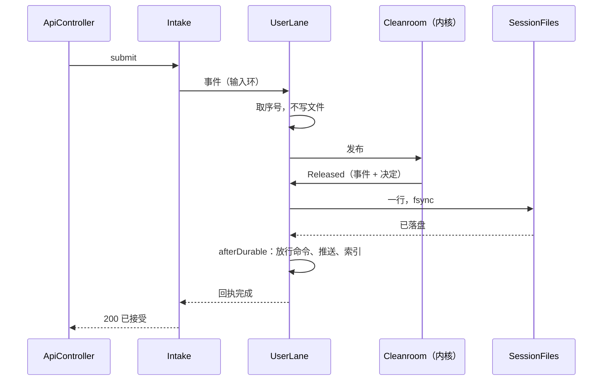

# Design Document

## Overview

会话文件从“事件一行、结果一行”改成“一件事一行”：内核处理完一个事件后，事件本身和它的决定写成同一行，fsync 后才放行命令、推送、写索引，也才回应用户的提交。上下文组装事件（`ContextAssembled`）里配上的插件、工具、MCP、system 段在文件里只记和上一次相比的变化。内核多做一件事：压缩后告诉模型哪些工具已不可用。对话页显示工具变化。启动时预热读文件的代码。

内存里的值不变：解码出来的 `EventEnvelope`、`StepRecord`、`ContextAssembled` 和现在逐字段相同，内核、投影、查询照常使用。改动集中在 `shell/journal`（文件格式）、`shell/loop`（写入时机和回应）、`shell/store`（删掉配对和补写），另有 `kernel/step/ContextSteps` 的提示和 `shell/conversation` 的画面条目。

## Steering Document Alignment

### Technical Standards (tech.md)
- 计算线程不做 I/O、每个用户一个写入通道、同一用户按序、不同用户互不等待：不变。
- 每一步一次 fsync：不变（现在事件不 fsync、结果行 fsync，改后只有一行、fsync 一次）。
- journal 不含凭据：工具来源只写 `builtin`、`plugin:<名字>`、`mcp:<服务器名>`，不写 MCP 的地址和令牌。

### Project Structure (structure.md)
- 文件格式只在 `shell/journal`；内核和 value 模块不知道文件格式（ArchitectureTest 现有规则）。
- 新类放在已有的包里，不新建包。

## Code Reuse Analysis

### Existing Components to Leverage
- **`EventCodec`**：事件部分的编码不变，只是不再单独成行；`ContextAssembled` 的载荷交给新的 `MatchedCodec`。
- **`RecordCodec`、`RecordMemo`**：决定部分的编码、正文去重（长字符串哈希、“来自本事件”、消息下标）照用。`RecordMemo` 多记一份“这个会话上一次配上了什么”。
- **`SessionFile`、`SessionFiles`**：追加、fsync、末尾半行截断照用，去掉“只写不 fsync”的分支。
- **`SubmissionLedger`**：按 `requestId` 去重照用；重复提交遇到还没落盘的原提交时，等同一个回执。
- **`ContextUpdate`**：压缩后的“工具已不可用”提示用它的开头，压缩时照现在的规则认出它。
- **`ToolChangeBlock`、`ToolChanges.describe`、`ClaudeRequest.systemMessage`**：现有的工具变化消息和两种发法照用。
- **`RecordCheck`**、`ReadBench`、`LaneBench`、`RecordSizeProbe`：检查工具和测量照用，改读新格式。

### Integration Points
- **索引（`SessionIndex`、`IndexCatchUp`）**：照现在在落盘后写；追赶时读新格式的行。
- **控制台**：提交接口的回应时机变了，接口形状不变；对话页多一种条目。

## Architecture



现在的流程里，`UserLane` 先把事件写成一行（不 fsync）再发布，cleanroom 处理完再写结果行（fsync）。改后通道收到事件只取序号就发布，收到 `Released` 才写，写的是合并后的一行。

### 一行的样子

现在（两行）：
```json
{"seq":0,"at":"…","type":"UserPrompt","version":1,"run":null,"payload":{…}}
{"result":0,"session":{…},"runs":[…],"facts":[…],"commands":[…]}
```
改后（一行）：
```json
{"seq":0,"at":"…","type":"UserPrompt","version":1,"run":null,"payload":{…},"result":{"session":{…},"runs":[…],"facts":[…],"commands":[…]}}
```
`result` 里的内容和现在的结果行相同，只是去掉了重复的序号。

### 配上了什么：全文和变化

`ContextAssembled` 的载荷有两种写法：

```json
"payload":{"command":…,"full":true,"system":"…","tools":[…],"toolSources":{"grep":"builtin","fetch_url":"plugin:web"},
           "compaction":{…},"sections":[…],"enabledTools":[…],"enabledPlugins":[…]}

"payload":{"command":…,"compaction":{…},
           "tools":{"added":[{完整定义}],"removed":["fetch_url"],"changed":[{完整定义}]},
           "toolSources":{"added":{"write_file":"builtin"},"removed":["fetch_url"]},
           "enabledTools":[…]}
```

- 写全文：这个会话的第一次组装；上一次组装之后发生过压缩（这一行之前某行的决定里有 `ContextCompacted`）；写入方不知道文件前面写过什么（`RecordMemo.blind()`）。
- 写变化：其余情况。`system`、`sections`、`enabledTools`、`enabledPlugins` 和上一次相同就不写，变了就写新值；工具按名字比较，写增、删、改；`compaction` 很小，总是写。什么都没变时载荷只剩 `command` 和 `compaction`。
- 读的时候 `MatchedCodec` 用 `RecordMemo` 里上一次的完整内容套上变化，还原出完整的 `ContextAssembled`。读到“变化”却没有上一次（文件被截断、拼接）时，按 `SessionCorruptException` 拒绝载入。
- 以后加 skill：载荷多一个按名字比较的集合 `skills`，规则同 `tools`。中途新增的工具已经能写（`added` 带完整定义），反向沙箱 spec 只需决定什么时候交给模型。

## Components and Interfaces

### `journal/Line`（改）
- **Purpose:** 会话文件头之后的一行。
- **Interfaces:** `record Line(EventEnvelope envelope, StepRecord record, Map<CommandId, String> fingerprints)`；`seq()`。原来的 `Line.Event`、`Line.Result` 删掉。
- **Reuses:** `StepRecord`、`EventEnvelope`。

### `journal/LineCodec`（新）
- **Purpose:** 一行的编码和解码：事件部分交给 `EventCodec`（`ContextAssembled` 的载荷交给 `MatchedCodec`），决定部分交给 `RecordCodec`。
- **Interfaces:** `String encode(Line line, RecordMemo memo)`；`Line decode(JsonNode tree, RecordMemo memo)`。
- **Dependencies:** `EventCodec`、`RecordCodec`、`MatchedCodec`。
- 编码顺序：先让 memo 看到事件（`RecordMemo.seeEvent`），再编码决定，这样决定里的“来自本事件”能引用同一行的正文（同现在）。

### `journal/MatchedCodec`（新）
- **Purpose:** `ContextAssembled` 载荷的全文和变化两种写法（见上）。
- **Interfaces:** `JsonNode encode(ContextAssembled event, RecordMemo memo)`；`ContextAssembled decode(JsonNode payload, RecordMemo memo)`。
- **Dependencies:** `RecordMemo` 新增的 `matched()`、`matched(ContextAssembled)`、`compacted()`（看到 `ContextCompacted` 时清空上一次的内容）。

### `journal/SessionFileReader`（改）
- **Purpose:** 按序读出每一行。每行 `JsonText` 解析一次，得到的树交给 `LineCodec.decode`，不再先判断类型、再从文本解码一遍（`SessionFileReader.java:100-143`）。
- **Interfaces:** `forEachLine(Path, Consumer<Line>)` 不变，回调的类型变成新的 `Line`。末尾半行照现在截断。

### `journal/SessionFile`、`SessionFiles`（改）
- `FORMAT` 2 → 3。
- `appendLines` 只剩一种：每批 fsync 一次，返回时已落盘。只写不 fsync 的分支和 `append(…, List<EventEnvelope>)` 删掉。

### `journal/StoreFormat`（改）
- `storage` 2 → 3。`storage = 2` 且 `sessions/` 下有文件：拒绝启动，信息写明移走 `sessions/` 和 `index.db`；没有文件：改成 3。

### `loop/UserLane`（改）
- 收到事件：取序号、钉住会话、需要时载入冷会话（只读已落盘的行，序号都小于新事件）、发布。不写文件。
- 收到 `Released`：按会话分组写行（多个会话并行，同现在），全部写完后依次运行 `afterDurable` 和 `done`。写失败照现在停止处理事件（`exit.failed`），只运行 `done`。
- 类注释里“事件不单独 fsync……崩溃丢了也没关系”改成新的说法。

### `loop/Receipts`（新）
- **Purpose:** 提交的回执：提交那一行落盘后完成，写失败、进程停止时以失败完成。
- **Interfaces:** `CompletableFuture<Void> await(SubmissionId)`；`void durable(SubmissionId)`；`void failed(SubmissionId, Throwable)`。完成后从表里删掉。
- **Dependencies:** 无。由 `Engine` 在包装 `afterDurable`、`done` 时调用：事件是 `Submitted` 时，落盘后调 `durable`；只运行了 `done`（写失败、被丢弃）时调 `failed`。

### `loop/Intake`（改）
- `Submission` 多一个 `CompletableFuture<Void> durable`。新提交：发布成功后返回 `receipts.await(id)`。重复提交：原提交还在途时返回同一个回执，已落盘的（`SubmissionLedger` 从索引查到的）返回已完成的回执。
- 被拒绝的（404、429、503）照现在立即返回。

### `web/ApiController`（改）
- 提交接口等 `durable`，最多 `tantalum.loop.ack-timeout`（默认 10 s）：完成 → 现在的 200 回应；失败 → 500“保存失败，请重发”；超时 → 503“服务器忙，请重发”。手动压缩接口同样等回执。取消不变（不去重，不等）。
- Tomcat 用虚拟线程，等待不占平台线程。

### `store/RecordReplay`（改）、`store/Backfill`（删）
- `Fold` 不再配对：每行直接 `line.record().apply(line.envelope(), before)`。`waiting`、`requireAnswered`、`Folded.unanswered` 删掉；查询时“末尾正在处理的事件跳过”这条也没有了，因为没处理完的事件不在文件里。
- `Backfill` 和 `BackfillTest` 删掉；`Storage.catchUp` 只剩索引追赶。

### `store/RecordCheck`（改）
- 读新格式：每行用当前内核重放这个事件，和行里记的决定比较。输出和退出码不变。

### `value/event/ContextAssembled`（改）
- 加 `Map<String, String> toolSources`（工具名 → `builtin`、`plugin:<名字>`、`mcp:<服务器名>`），内核不读它，画面用来写原因。`version` 1 → 2；旧版本不再读（旧数据拒绝启动）。
- `ContextHandler` 按 `ToolCatalog`（`serverName`）和 `PluginGate` 填来源。

### `value/state/SessionState`（改）、`value/model/ToolChangeBlock`（改）
- `SessionState` 加 `List<String> toolsSeen`：这个会话里任何时候配上过、开着过的工具名，按第一次出现的顺序。压缩不清空它。
- `ToolChangeBlock` 加 `List<String> unavailable`：除这次移除的以外，仍然不能用的工具。Claude 的发法不变（只对 `removed` 发 `tool_removal`）；文字发法（`ToolChanges.describe`）在后面加 “Still unavailable: …”。`TokenEstimate` 一并计入。

### `kernel/step/ContextSteps`（改）
`freezeContext` 加两处，其余不变：
1. **压缩后重新组装**（`frozen == null` 且 `toolsSeen` 不空）：`gone = toolsSeen − 现在开着的工具`；不空时追加一条 `ContextUpdate` 用户消息：“These tools were available earlier in this conversation and are no longer available. Do not call them: fetch_url.” 这条消息在请求里，所以进请求指纹、请求详情页看得到；下一次压缩时 `Compactor` 照现在认出它（`Compactor.java:194`），压缩后重新组装时再加一次。
2. **工具变化时**：`ToolChangeBlock(added, removed, unavailable)`，`unavailable = toolsSeen − 现在开着的 − removed`。

每次组装后 `toolsSeen` 并入现在开着的工具。

### `shell/conversation/TranscriptPass`（改）、控制台 `ToolChangeNotice`（新）
- 投影看到决定里追加了 `ToolChangeBlock` 时，生成一个对话条目 `toolChange`：新增、不再可用的工具名，以及每个不再可用工具的原因。原因从同一行的 `ContextAssembled` 判断：名字还在 `tools` 里（服务器上有、用户关了）→ `disabled`；不在 → `gone`。
- 控制台对话列表在这个位置显示一行灰色小字：“工具变化：不再可用 `fetch_url`（插件已删除或未加载）”“新增 `write_file`”“（已在插件页关闭）”。文字放在 `zh.ts`。
- 压缩后的提示是给模型的，画面上不重复显示（原来那行工具变化还在原位）。

### `boot/Warmup`（新）
- **Purpose:** 启动完成后在后台虚拟线程里，把内置的小会话文件（jar 里的 `warmup/session.jsonl`，约 200 行，有工具调用、压缩、工具变化）复制到临时目录，用 `RecordReplay` 折叠 5 遍，导出对话条目和轨迹一遍，然后删掉临时文件。
- 不碰数据目录、不进索引、不占名额；失败只记 WARN 日志。日志写一行“warmup done in N ms”。
- 文件由测试 `WarmupFileTest` 生成和检查：平时检查它能用当前代码读出来；格式改了检查会失败，提示用 `-Dwarmup.write=true` 重新生成。

## Data Models

### Line（文件里的一行）
```
seq:       long        这件事的序号（同现在）
at:        Instant
type, version, run, payload   同现在的事件行；ContextAssembled 的 payload 见“全文和变化”
result:    object      同现在的结果行，去掉序号
```

### RecordMemo 新增
```
matched:   ContextAssembled | null   这个文件上一次的完整组装；看到 ContextCompacted 后清空
```

### SessionState 新增
```
toolsSeen: List<String>   配上过、开着过的工具名；压缩不清空
```

## Error Handling

### Error Scenarios
1. **写一行时进程崩溃**
   - **Handling:** 这件事不在文件里，命令没执行。半行由读取方截掉。在途的运行重启时照 H9 收尾。
   - **User Impact:** 提交还没回“已接受”，浏览器显示失败，文字留在输入框，重发即可。
2. **写失败（磁盘满、权限）**
   - **Handling:** 照现在停止处理事件；回执以失败完成。
   - **User Impact:** 提交回 500“保存失败，请重发”。
3. **10 秒内没落盘（冷会话载入慢、磁盘卡住）**
   - **Handling:** 回 503。之后这一行如果写进去了，重发按 `requestId` 去重。
   - **User Impact:** “服务器忙，请重发”；重发不会处理两次。
4. **读到“变化”却没有上一次的全文**
   - **Handling:** `SessionCorruptException`，拒绝载入这个会话，信息写明序号。
   - **User Impact:** 同现在的“会话文件损坏”。
5. **旧格式数据目录**
   - **Handling:** `StoreFormat` 拒绝启动，不改文件。
   - **User Impact:** 部署的人看到移走 `sessions/`、`index.db` 的提示。
6. **预热失败**
   - **Handling:** 记 WARN，服务照常。
   - **User Impact:** 无，第一次打开会话慢一些。

## Testing Strategy

### Unit Testing
- `LineCodecTest`：每种事件的一行编码后解码，和原值逐字段相同；“来自本事件”只在同一行内引用。
- `MatchedCodecTest`：第一次写全文；之后只写变化；压缩后写全文；什么都没变；增、删、改工具；没有上一次的“变化”被拒绝。
- `ReceiptsTest`、`IntakeTest`：落盘后完成；写失败、被丢弃时失败；重复提交等同一个回执。
- `ContextStepsTest`、`ToolSwitchStepsTest`：压缩后的提示、重申仍不可用的工具、`toolsSeen` 不被压缩清空。
- `ToolChangesTest`、`ClaudeRequestTest`、`OpenAiClientTest`：`unavailable` 的两种发法。
- `StoreFormatTest`：`storage = 2` 有文件拒绝、没有文件升级。

### Integration Testing
- `EvictionInvarianceTest`：每一步后模拟崩溃，只读文件恢复的状态、条目、轨迹和内存里逐字节相同。
- 崩溃在写一行之前（`JarCrashIT` 加一个场景）：重启后这件事不在文件里，提交没有回 200，运行照 H9 收尾。
- 删插件后：旧会话的对话页、轨迹、请求详情不变；新一步不再配上它的工具和钩子。
- `CompactionStressTest`：检查工具报告全部一致。
- `WarmupFileTest`：内置小会话能读出来。

### End-to-End Testing
- 新增 `console/e2e/one-line-journal.spec.ts`：E2eServer 加一个能在运行时拿掉的测试工具 `e2e_fetch`。会话里用它 → 拿掉 → 移出内存后重新打开，旧对话照原样 → 接着问，对话页显示“不再可用 `e2e_fetch`（插件已删除或未加载）”。
- `record-results.spec.ts` 现有三个场景照常通过。

### 测量
- 基线：用 `git worktree` 检出 `766655f`（record-results 之前），在同一台机器、同一份 1 万事件语料上跑 `ReadBench`，作为冷载入基线，改正 `tech.md`。
- 文件大小：`RealSizeProbe`（手动跑，同 `RecordSizeProbe`）只读 `~/.local/share/tantalum-sessions-backup-2026-11-04/` 的 4 个会话，用当前内核重放，按新格式编码，和原文件大小比较。
- 真实模型：手动测试 `ClaudeSmokeTest.toolGoneAfterCompaction`，用一次工具 → 拿掉 → 压缩 → 问一个会用到它的问题，判定模型不调用它。只跑这一个，花费约 0.05 美元以内。
- `LaneBench`：命令放行和提交回应的 P99。

## 上线步骤（J14）

| 步 | 内容 | 做完的标志 |
|---|---|---|
| ① | `Line`、`LineCodec`、读文件只解析一次、`UserLane` 只写一行、`Receipts` 和提交回应、删 `Backfill` 和配对、格式 3 | 回归全过；`LaneBench` P99 ≤ 50 ms；8091 更新（先把 `s-recordsmoke` 移到备份） |
| ② | `MatchedCodec`、`toolSources` | `MatchedCodecTest`、大小测量；8091 更新 |
| ③ | `toolsSeen`、压缩后提示、`unavailable`、对话页条目、e2e、真实模型一次 | 在 8091 演示：装插件、用工具、删插件、接着聊 |
| ④ | `Warmup`、基线重测、`tech.md` 改正 | `ReadBench` 不比基线慢；启动 ≤ 5 s |

读文件只解析一次原定在第 ④ 步，因为第 ① 步本来就要重写读文件的代码，提前到第 ① 步一起做。
