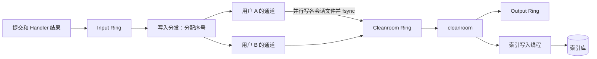

# Design Document

## Overview

每个会话一个 JSONL 文件，内存只放在用的会话。Input Ring 和 Output Ring 不变，cleanroom 仍是单线程，事件仍先落盘再处理。新增的只有落盘和 cleanroom 之间这一段。



## 参照

| 内容 | 出处 |
|---|---|
| 每批追加后 fsync，新文件 fsync 目录，首次写才创建文件 | DSH `session-persistence-jsonl/README.md:77`、`src/index.ts:1312,1409` |
| 残缺尾部只丢不完整的记录，已完整的不丢 | DSH `docs/subsystems/persistence.md`；pi `session-manager.ts` 的 `loadEntriesFromFile` |
| 恢复时补工具错误和中断标记 | DSH `interruptedTurnClosers` |
| 投影缓存在运行结束、释放时必写，其余按 N 事件或 T 毫秒写；日志领先，缓存跟随；不兼容就丢弃 | DSH `session-projection-cache/README.md`，默认 200 事件、5 秒沿用它的配置示例 |
| 冷读缓存有上限，按修订号失效 | DSH `session-persistence-jsonl/src/index.ts`（上限 2 条），我们是多用户，取 16 |
| 分页：至少 50 条消息且跨 2 轮，最多 500 条 | DSH `session-controller/README.md` |
| 性能预算 | DSH `benchmarks/AGENTS.md` |

自定（DSH 单用户，没有对应问题）：用户通道、全局序号、索引库的跨用户表、SSE 按用户的补读位置、登录失效。

## 对已批准需求的偏离

| 需求 | 改为 | 原因 |
|---|---|---|
| H7“提交线程载入” | 用户通道的线程载入 | Handler 结果和提交都走通道，放这里一处就够 |
| H12“全部落盘才放行” | 同一用户的一批全部落盘后，按序号放行 | 需求只要求同一用户内按序，这是最简单的做法 |

## 存储

```
<data-dir>/format.json                     {"storage":1,"semantics":1}
<data-dir>/index.db                        可重建的索引库
<data-dir>/sessions/<用户>/<会话>.jsonl    事实来源
```

**文件。** 第一行是头部 `{"format":1,"session":..,"principal":..}`，之后每行一个事件 `{"seq","at","type","version","run","payload"}`。权限 600，目录 700。

**文件名。** 会话 ID 来自客户端，用户名来自管理员，都可能含 `/` 或 `..`。文件名用 URL 安全编码，超过 120 字节时截短并加 SHA-256。解析路径后校验仍在 `sessions/` 内。这是新增的攻击面，有专门测试。

**写入。** 每个会话一个 `FileChannel`，按 LRU 保留打开的句柄。每批追加后 `force(true)`，新文件再 fsync 目录。实测（任务 3）`FileChannel.force` 在 macOS 上约 5 ms，和 SQLite 开 `fullfsync` 相同，而 `FileDescriptor.sync` 只要 0.04 ms。所以这里用 `force`，它是更严格的那种。（更正：本文原来写反了。）

**残缺尾部。** 打开写入前检查末尾：没有换行或最后一行解析失败，就截掉这一行并记日志。**文件中间**损坏时只拒绝这个会话（接口返回 500 并记日志），不影响其他会话。

**写失败。** 和现在一样：`halted` 置位，入口返回 503。

**格式版本。** `format.json` 比程序新时拒绝启动。`storage` 升级时写带版本的新文件，不就地改写，同 DSH。

`semantics` 表示内核语义（比如压缩规则）。它变化时不拦截，旧会话载入时记警告，因为旧程序已经不在了，无法精确重放。未结束的运行已经被 H9 收尾，所以不会有等待中的命令对不上。**结果是：内核语义变化后，旧会话的 prompt 回放可能不再和当时逐字节相同，journal 原文不受影响。** 这是回放承诺的边界，写进 README。

## 写入管线

**写入分发（`JournalDispatcher`）。** Input Ring 的唯一消费者。分配全局序号，取一个放行名额，放进该用户的通道。名额总数等于 Cleanroom Ring 的大小，所以这个环不会满，已落盘的事件不会丢。名额用完时分发线程等待，Input Ring 随之填满，入口返回 429。这只在严重过载时发生。

**用户通道（`UserLane`）。** 每个有事件的用户一个虚拟线程，没事件就退出。

1. 取走队列里的全部事件，按会话分组，每个会话一个虚拟线程写文件并 fsync。
2. 全部完成后，载入这批涉及的冷会话（见下一节）。
3. 按序号发布到 Cleanroom Ring。

同一用户内严格按序，不同用户互不等待。

**Cleanroom Ring。** 多生产者，消费者就是现在的 cleanroom。

**序号（H14）。** 约定只有三条：全局唯一、同一用户内递增、可以有空洞。`JournalDispatcher` 通过接口 `Sequence` 取号，现在的实现是单进程计数器，启动时取索引和文件尾部的最大值加一。读取只要求每个文件内递增。序号不超过 2^53，因为控制台用 JavaScript 数字解析它。

没有改成每用户各自计数：`run-<seq>` 和 `<seq>-<index>` 由序号生成，`/api/runs/{run}` 和 `runs` 表按运行 ID 全局查找，各自计数后两个用户会有相同的运行 ID。以后做多实例时，换一种满足上述三条的 `Sequence` 即可，比如按实例取号段；用户被另一实例接管时，新实例要从该用户的最大序号之后取号。这一点留给以后的 spec。

## 按需载入和回收

**按需的含义。** 启动不载入，只处理未结束的运行。打开会话看历史是只读重放，不进常驻。在会话里提交才载入常驻。

**内核不变。** `Kernel.step` 语义不变。`KernelState` 增加 `without(session)`，只由 shell 调用，不是事件。

**重放（`SessionReplay`）。** 读一个会话文件，从空状态逐事件调 `Kernel.step` 和 `Transcript`。内核是纯函数，可以在任何线程调。每个事件前，把该用户的用量设为“截至这个序号的累计”（H4）。

**载入。** 通道发现事件所属会话不在内存时，从快照（有效时）加尾部事件重放出一个切片（会话、运行、对话条目），随事件进入 Cleanroom Ring，cleanroom 处理事件前并入。cleanroom 不做 I/O。

**钉住。** `Residency` 记录每个会话的在途事件数。通道判断前加一，cleanroom 处理完减一。只有计数为零的会话才能回收，所以回收和载入不会竞争。

**回收。** cleanroom 按批检查：钉住为零、没有活动运行、没有排队提交，且空闲超过 30 分钟，或常驻数超过 1000 时最久未用。先写投影缓存，再从状态和 `Transcript` 移除。

**只读查询。** `/messages`、`/runs`、`/turns`、`/trace` 查冷会话时用 `SessionReplay` 重放到私有状态，不进内存常驻。LRU 缓存 16 个，用文件大小判断是否变化。

**快照（H13）。**

```
<data-dir>/snapshots/<用户>/<会话>.json    可丢弃
{"storage":1,"semantics":1,"seq":..,"offset":..,"checksum":..,"session":..,"runs":[..],"transcript":..}
```

路径用同一套文件名编码，权限 600/700。内容是该会话的 `SessionState`、它的 `RunState`，以及 `Transcript` 的完整内部状态（条目、排队 ID、`stepByCall`、`seenMessages`、`lastSeq`）。不含 `PrincipalState`，尾部重放时用量仍按 H4 注入。`offset` 是快照截至的文件字节位置。

- **何时写：** 回收前，以及运行结束且距上次快照超过 200 个事件（可配）时；有活动运行时不写。
- **谁来写：** cleanroom 把不可变的状态和复制好的对话条目交给 `SnapshotWriter` 线程，自己不做 I/O。写临时文件再重命名。失败只记日志，旧快照仍可用。
- **校验：** 校验和、两个版本号都对，且 `offset` 不超过文件大小、`offset` 前一行的序号等于 `seq`。任何一项不符就全量重放并记警告。
- **作用范围：** 用于载入和冷会话只读查询（`/messages`、`/runs`）。`/turns`、`/trace` 要逐事件的内容，仍读整个文件。`semantics` 变化后旧快照全部失效，回到全量重放。

**用户级状态。** `PrincipalState` 留在内存，用户数远小于会话数。启动时不加载，通道第一次见到该用户时从 `usage` 表读取。

## 索引库（SQLite，只有写入线程写）

```
sessions(session PK, principal, title, last_activity, run_status, last_seq, file_offset, format)
runs(run PK, session)
submissions(principal, request_id, submission, PK(principal, request_id))
usage(principal, seq, input, output, cache_read, cache_write, PK(principal, seq))
```

**怎么写。** cleanroom 处理完事件，把变化放进内存队列，不做 I/O，由写入线程批量写。运行结束和回收时必写，其余 200 事件或 5 秒。崩溃时索引只会落后。

**用量从哪来。** 比较 `kernel.step` 前后的 `PrincipalState`，不从事件提取，因为内核会忽略迟到的回复，只有状态变化才是真的。

**启动。**

1. 校验 `format.json`，需要时拆分旧 journal。
2. 扫描 `sessions/` 的文件大小，和 `file_offset` 比较，不读内容。这一步随会话数增长，随事件数不增长，同 DSH 的列表重扫。
3. 落后的会话重放尾部，补齐索引。
4. `run_status` 未结束的会话载入内存，按 H9 收尾。

索引库缺失或版本不符时，全部文件重放重建，并记日志。

**归属。** 提交时 `INSERT OR IGNORE` 会话和用户，读回比较，不是本人就返回 404。这在 Web 线程上做，同时解决了同一新会话 ID 被两个用户抢的竞争。

**去重（H10）。** 内存占位最近的 10 万条，未命中时查 `submissions`。补上 `CompactRequested`，修复 `rebuild` 漏掉的问题。

## 崩溃收尾（H9）

新事件 `RunInterrupted` v1。启动时对每个未结束的运行发布一条。内核处理：`ToolPairing` 补“结果未知”，并入未消费的插话，运行以 `CANCELLED` 结束，详情 `interrupted by restart`。排队的提交照常开始，这和现有规则一致。

`RunState.pendingRecovery` 和接口、控制台里的“待恢复”一并删除。旧 journal 里的未结束运行同样收尾。

## 回放接口和 SSE

**`/turns`、`/trace`。** 从 `runs` 表找到会话，只读这个文件。

**SSE 位置（需求里没想到）。** `SseHub` 的 `recent` 和 `evictedSeq` 假设序号全局递增。现在不同用户可以乱序到达，所以改成每个用户一份。同一用户内仍有序，`Last-Event-ID` 的语义不变。

**超出内存范围的补读。** 取该用户 `last_seq` 大于位置的会话，加上它常驻的会话（索引可能落后），分别重放，按（序号，下标）合并。

## 历史分页

`GET /api/sessions/{id}/messages?before=<seq>`，默认返回最近一页。从这个位置往前按运行取，到至少 50 条用户消息和回复文本、跨 2 个运行为止，最多 500 条。响应多一个 `hasMore`。

控制台 `ConversationStore` 增加 `prependItems`，滚到顶部时加载上一页，用内容高度差保持位置。SSE 的合并规则不变，因为它按条目 ID 和序号。

## 连接

**按登录会话。** `subscribe` 增加 `HttpSession` ID，`SseHub.closeSession` 只断这一个。退出调用它，停用用户才调 `closeAll`。

**过期和停用。** `pump` 每个心跳检查三件事：`HttpSession` 超时（自己算最后访问时间加上限，不等容器后台清理）、用户被停用、口令戳变化。检查读 `UserStore`，所以命令行在服务外修改也能在一个心跳内生效。

`UserStore` 增加口令戳列，登录时存进 `HttpSession`。

## 关闭

`Engine.close` 依次：

1. 入口返回 503。
2. `hub.closeEveryone`。
3. 等 `InFlightCommands` 清空，最多 `tantalum.shutdown-wait`（默认 30 秒），到时中断。
4. 排空 Input Ring、各通道、Cleanroom Ring、Output Ring。
5. 写投影缓存。
6. 关闭文件和索引库，释放锁。

每步失败不跳过后面的。配置 `server.shutdown=graceful`，让 Web 层等已接受的请求。

## 旧 journal 拆分

`journal.db` 存在且没有 `format.json` 时：

1. 全部读出，写到 `sessions.tmp/`，fsync。
2. 重命名为 `sessions/`，写 `format.json`。
3. 建索引。

中断后删掉 `sessions.tmp/` 重来。`journal.db` 不动，不再使用，README 说明确认后可以手动删除。

## 性能预算

Maven profile `bench`，在 `tantalum-examples`：合成数据、每个样本新进程、记录中位数和内存峰值、预算写在代码里。**基线要在改造前测**，所以这是第一批任务。对比项：单一 SQLite 和并行 fsync 的吞吐与延迟。

**基线和预算（任务 5，Yi 已于 2026-11-02 确认）。** 基线见 tech.md。50 万事件的现状没有实测（外推启动约 50 分钟），改造后实测。

| 需求 | 指标 | 现状（10 万事件） | 预算 |
|---|---|---|---|
| 2.2 | 50 万事件、无未结束运行时启动 | 125.7 s | 5 s |
| 2.3 | 启动后留存堆，50 万事件 | 229 MB | 100 MB，且比 1 万事件时多不超过 20 MB |
| 5.3 | 安静用户的 `/turns`、`/trace`，50 万事件 | 约 125 s | 200 ms |
| 8.2 | 打开 500 条消息的会话：常驻 / 冷载入 | 70 ms / 无此路径 | 100 ms / 1 s |
| 非功能 | 100 会话、每会话每秒 1 事件的落盘 P99 | 19 ms（SQLite，`fullfsync`） | 50 ms |

## 现有钩子核对（H5，任务 4）

| 钩子 | 读什么 | 结论 |
|---|---|---|
| `DailyQuotaHook` | `state.principals()` 中当前用户的用量 | 符合，依赖 H4 的用量注入 |
| `ReadOnlyHook` | `context.call()` | 符合 |
| `CitationCheckHook` | 当前会话的消息、`context.work()` | 符合 |
| 测试里的 `RecordingHook`、`NO_RM` | 只读 `context` | 符合 |

内核本身：运行 ID 和命令 ID 只由序号决定，没有跨会话计数器；步骤里没有遍历全部会话或运行，只有 `UsageProjection` 读当前用户。所以按会话重放可行。`KernelHook` 拿到的是整个 `KernelState`，接口上拦不住钩子读别的会话，只能靠 README 约束。

## Error Handling

| 情况 | 处理 |
|---|---|
| 文件中间损坏 | 只拒绝这个会话，日志指出行号 |
| 载入失败 | 该事件所属运行以 FAILED 结束；事件已落盘 |
| 索引库写失败 | 记日志，缓存落后，下次启动补齐；服务继续 |
| 文件写失败 | `halted`，503 |
| 拆分中断 | 下次启动重做，旧文件没动 |

## Testing Strategy

- **不变量（需求 9.1）：** 同一组事件在“从不回收”和“每个事件后回收”下，prompt、对话视图、钩子结果逐字节相同，覆盖压缩、工具轮、记忆变化、额度钩子。
- **快照：** 不变量测试加“每次都从快照载入”；快照截断、改字节、超前、版本不符时都回到全量重放；删除 `snapshots/` 后结果不变。
- **序号：** 用跳号的 `Sequence` 跑回归，确认没有代码依赖连续或跨用户顺序。
- **隔离：** 放慢一个用户的 fsync，其他用户不受影响；同一用户内仍按序。
- **压测：** 现有并发压测的不变量在回收不断发生时全部成立。
- **崩溃：** 打包 jar，`kill -9` 后事件不丢，尾部残缺被截掉，运行收尾，不重新调用模型和工具。
- **安全：** 恶意会话 ID 和用户名不越出目录；别人的会话 404 且不载入。
- **升级：** 用真实的旧 journal 拆分，结果和全量回放相同；中断后可重做；未来版本被拒绝。
- **真实 Claude：** 崩溃收尾后在严格校验下继续提交（需求 9.5）。
- **Playwright：** 两个上下文同一用户，一个退出另一个仍收事件；回收的会话打开完整；长会话分页，滚动不跳；崩溃后的运行显示已中断。
