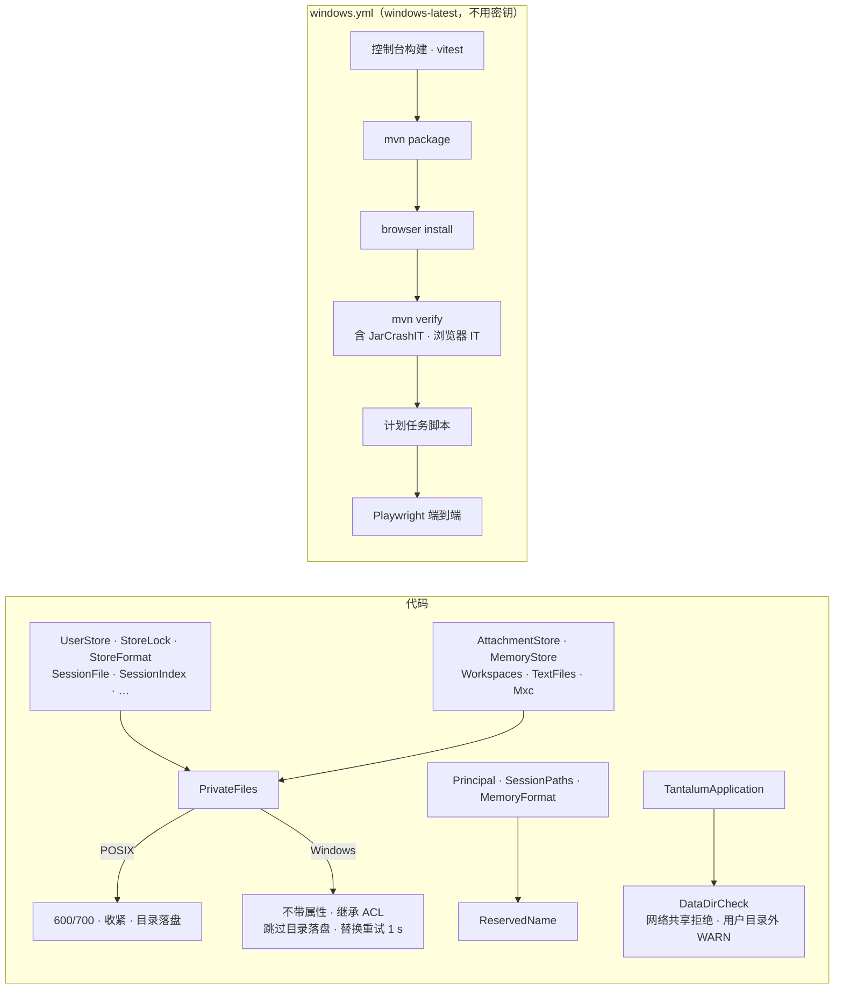

# Design Document

## Overview

服务器的代码本来就几乎只用 JDK 的跨平台接口（`Path.resolve`、NIO 通道、`HttpClient`、套接字），Windows 上跑不起来的原因集中在几类文件操作上。本设计：

- **一个新类 `PrivateFiles`**（`tantalum-local` 的 `tantalum.local.fs` 包），收拢所有“只有本人能读”的创建、收紧、替换和目录落盘。POSIX 文件系统上行为和现在逐字节一样；Windows 上不带 POSIX 属性、跳过目录落盘、替换时短暂重试（N2、N6、N7）。现有 13 个类里的 POSIX 权限代码都改成调用它，ArchUnit 规则保证以后没人绕过它。
- **一个新枚举 `ReservedName`**（`tantalum-value`），Windows 保留设备名。用户名、记忆名拒绝，会话文件名编码避开（N5）。
- **一个新类 `DataDirCheck`**（`tantalum.shell.boot`），启动时检查数据目录：网络共享拒绝，用户目录外和不支持 ACL 的卷 WARN（N3、N4）。
- **三处小改动：** `BrowserDriver` 的并发解压和 `--with-deps`（N11）；`users` 命令读密码的编码（N12）；`.gitattributes`（N9）。
- **真实 Windows：** GitHub Actions 工作流 `windows.yml`，在 `windows-latest` 上跑全部测试，不用密钥（N14）。
- **后台运行：** PowerShell 脚本 `docs/windows/tantalum-task.ps1` 登记计划任务（N13）。

内核、会话文件格式、接口、控制台都不改。不加第三方依赖（N17）。

**先测后改。** 没有 Windows 机器，下面“JDK 在 Windows 上的行为”一表来自 JDK 的 Windows 实现（`sun.nio.fs.WindowsFileSystemProvider`、`WindowsFileCopy`、`WindowsChannelFactory`），没有实测。所以任务 2 先在 `windows-latest` 上跑一遍**不改代码**的测试，拿到真实的失败清单，核对这张表；有不符的地方先改设计再动代码。

行号都是 2026-11-06 写设计时的（提交 7811e59）；`web-tools` 正在并行实施，`shell/browser/`、`shell/boot/` 的行号可能会移动，实施时按方法名找。

## Steering Document Alignment

### Technical Standards (tech.md)
- **journal 不含凭据、数据目录只有本人能读：** POSIX 上不变；Windows 上靠继承的 ACL（N2），不在用户目录下时提示（N3）。
- **默认只绑 127.0.0.1：** 不变。README 提醒：绑 `0.0.0.0` 时 Windows 防火墙会问是否放行 `java.exe`。
- **离线构建：** 本地照旧 `mvn -o … -am`，本 spec 不加依赖，不用联网。CI 的 runner 没有 `~/.m2`，联网下载，用 `actions/setup-java` 的 Maven 缓存。
- **测试不访问外网、不花钱：** 工作流里不设任何密钥，`TANTALUM_SMOKE_*` 这些真实模型的冒烟测试不会打开。CI 只为下载依赖、Chromium 联网。

### Project Structure (structure.md)

| 包 | 类 | 做什么 |
|---|---|---|
| `tantalum.local.fs` | 已有 `AllowedDirs`；新增 `PrivateFiles` | 只有本人能读的文件：创建、收紧、替换、目录落盘 |
| `tantalum.value.id` | 已有 `Principal`；新增 `ReservedName`（枚举） | Windows 保留设备名 |
| `tantalum.shell.boot` | 新增 `DataDirCheck` | 启动时检查数据目录的位置和卷 |

- **`PrivateFiles` 为什么放在 `tantalum-local`：** 服务器和连接程序都要建私有文件（`TextFiles`、`Mxc` 在连接程序里）。`tantalum-value` 只许有 record、接口和枚举（`ArchitectureTest.java:68-77`），内核不许用 `java.nio.file`（`ArchitectureTest.java:53-58`），`tantalum-local` 是最底下一个能做文件 I/O 的模块，`tantalum-shell` 本来就依赖它。
- **`ReservedName` 为什么是枚举：** `Principal`（在 `tantalum-value` 里）要用它，而 `tantalum-value` 只许有枚举、record 和接口。
- **ArchitectureTest 加一条规则：** 除了 `tantalum.local.fs.PrivateFiles`，没有类依赖 `java.nio.file.attribute.PosixFilePermissions`、`PosixFilePermission`，也没有类调用 `Files.setPosixFilePermissions`、`Files.getPosixFilePermissions`。`ArchitectureTest` 分析整个 `tantalum` 包（`ArchitectureTest.java:24`），连接程序的代码也在内。这条规则在 macOS 上就能拦住新写的、Windows 上会崩的权限代码（N14 不用 Jimfs 的理由）。

## JDK 在 Windows 上的行为

任务 2 的基线运行逐行核对。

| 操作 | macOS、Linux | Windows | 对应决定 |
|---|---|---|---|
| `Files.createFile`、`createDirectories`、`createTempFile`、`FileChannel.open` 带 `posix:permissions` 属性 | 按属性建 | `UnsupportedOperationException`：Windows 的文件系统只支持 `basic`、`dos`、`acl`、`owner`、`user` 视图 | N2 |
| `Files.setPosixFilePermissions`、`getPosixFilePermissions` | 改、读权限 | `UnsupportedOperationException` | N2 |
| `FileChannel.open(目录, READ)` 再 `force(true)` | 目录项落盘 | `AccessDeniedException`：不带 `FILE_FLAG_BACKUP_SEMANTICS` 打不开目录 | N6 |
| `Files.move(a, b, ATOMIC_MOVE)` | `rename(2)`，原子替换 | `MoveFileEx(MOVEFILE_REPLACE_EXISTING)`，原子替换；目标被不带“共享删除”的句柄打开时 `AccessDeniedException`；目标是已存在的目录时也报 `AccessDeniedException`（不是 `FileAlreadyExistsException`） | N7、N11 |
| NIO 打开文件的共享方式 | — | `Files.newByteChannel`、`FileChannel.open` 默认带读、写、删除共享，所以本进程读着的文件可以被替换；`java.io.FileInputStream` 不带删除共享 | N7 |
| `FileChannel.tryLock()` | 建议锁 | `LockFileEx`，强制锁；进程退出由系统释放 | N8 |
| 超过 247 字符的路径 | — | JDK 自动加 `\\?\` 前缀 | N5 |
| `Path.equals`、`startsWith` | Linux 区分大小写 | 不区分大小写 | N5 |
| `toRealPath()` | 解析符号链接 | 还展开 8.3 短名、改成磁盘上的大小写。GitHub runner 的临时目录是 `C:\Users\RUNNER~1\AppData\Local\Temp` | N5 |
| 默认字符集 | UTF-8 | UTF-8（JEP 400）；控制台输入用代码页（中文系统 936） | N12 |
| `Process.destroy()` | `SIGTERM` | `TerminateProcess`，和 `destroyForcibly()` 一样 | N10 |

**`windows-latest` 实测补充（2026-11-07，任务 2、10）：** 上表的行为都对上了（属性视图的 UOE 原文是 “'posix:permissions' not supported as initial attribute”；`LockFileEx` 是强制锁，`LinkIT` 读被锁住的 `store.lock` 报 “another process has locked a portion of the file”；`destroyForcibly` 的退出码是 1，不是 137）。另有几条和表里不同或表里没有的：

| 操作 | macOS、Linux | Windows | 改法 |
|---|---|---|---|
| `Files.move(…, ATOMIC_MOVE)` 替换一个本进程用 NIO 读着的文件 | 正常 | 上表说“NIO 带删除共享，所以能替换”不对：只要目标还有句柄开着，`MoveFileEx` 就报 `AccessDeniedException` | 靠 1 秒的重试：读的人关掉以后替换成功（`WindowsFilesTest`）；一直开着就报原来的错 |
| 两个虚拟线程同时在一个套接字上等读、等写（出口的隧道） | 正常 | 等写的那个收不到“可写”的唤醒，往回转发卡死：`FetcherTlsIT` 抓 6 MB 页面 30 秒超时，转储里 `egress-relay` 停在 `NioSocketImpl.implWrite`；同样的代码换成平台线程 2.6 秒通过 | `Egress` 的连接线程在 Windows 上用平台线程（任务 10） |
| Jackson `DefaultPrettyPrinter` | `\n` | 系统换行 `\r\n` | 只有测试在用：逐字节比较的测试改成 `\n` 缩进（任务 10） |
| 测试里把 `C:\…` 直接拼进 JSON | — | `\U` 不是合法转义，400 | 测试里转义（任务 10） |

## 现状清单

`grep` 了 `PosixFilePermission`、`PosixFileAttributeView`、`setPosixFilePermissions`、`ATOMIC_MOVE`、`REPLACE_EXISTING`、`FileChannel.open`、`tryLock`、`force(true)`、`ProcessBuilder`、`ProcessHandle`、`os.name`、`user.home`、`java.io.tmpdir`、`createTemp`、`"/"` 拼接、`split("\n")`、`lines()`、`lineSeparator`、`InputStreamReader`、`jdbc:sqlite:`，范围是六个模块的 `src/main`。路径前缀同 tasks.md：`shell/`、`local/`、`value/`、`connect/` 分别是各模块 `src/main/java/tantalum/...` 下的包目录。

### 权限（POSIX 属性）

| 位置 | 现在 | Windows 上 | 改法（任务） |
|---|---|---|---|
| `shell/auth/UserStore.java:36,38` | 建 `users.db` 带 600，再收紧 | 启动的第一步就抛 UOE | `PrivateFiles.createFile`、`restrict`（4） |
| `shell/journal/StoreLock.java:28-30` | 打开 `store.lock` 带 600，再收紧 | UOE | `PrivateFiles.fileAttributes`、`restrict`（4） |
| `shell/journal/StoreFormat.java:86-87` | 临时文件带 600 | UOE | `PrivateFiles.createTempFile`（4） |
| `shell/journal/SessionFile.java:57,69,92` | 会话文件 600、目录 700，打开时收紧 | UOE | `createFile`、`createDirectories`、`restrict`（4） |
| `shell/store/SessionIndex.java:65` | 建 `index.db` 带 600 | UOE | `createFile`（4） |
| `shell/access/PluginSwitches.java:68`、`shell/local/LocalTokens.java:91`、`shell/settings/UserSettings.java:51` | 同一个 `users.db`，不存在时带 600 建 | UOE | `createFile`（4） |
| `shell/attachment/AttachmentStore.java:52-53,347-355` | 附件目录 700、文件 600 | UOE | `createDirectories`、`createFile`（5） |
| `shell/memory/MemoryStore.java:207-216` | 建目录后设 700，已经接住 UOE | 能用 | 改用 `PrivateFiles.createDirectories`，让规则没有例外（5） |
| `shell/tool/Workspaces.java:78-84` | 设 700，已经接住 UOE | 能用 | 改用 `PrivateFiles.restrict`（5） |
| `local/tool/TextFiles.java:37-40,190,199-200,204,215-216` | 连接程序的写文件：新目录 700、新文件 600、保留原文件的权限 | UOE（Windows 连接程序还没做，但 `WriteEditToolsTest` 在 Windows CI 上会失败） | `createDirectories`、`createFile`、`copyPermissions`（5） |
| `local/sandbox/Mxc.java:147` | MXC 规则文件 600 | 只在 macOS 上走到（`Mxc.java:62`） | 改用 `createFile`，让规则没有例外（5） |

### 目录落盘、改名替换

| 位置 | 现在 | Windows 上 | 改法（任务） |
|---|---|---|---|
| `shell/journal/SessionFile.java:96-99`（`:128` 调用） | 新会话文件写第一批行后，落盘所在目录 | `AccessDeniedException`：第一次提问就失败 | `PrivateFiles.syncDirectory`（4） |
| `shell/journal/StoreFormat.java:97-99` | 写 `format.json` 后落盘数据目录 | `AccessDeniedException`：启动失败 | `syncDirectory`（4） |
| `shell/journal/StoreFormat.java:93` | `ATOMIC_MOVE` 替换 `format.json` | 一般能用；被杀毒软件占用时失败 | `PrivateFiles.replace`（4） |
| `shell/memory/MemoryStore.java:224`、`shell/attachment/AttachmentStore.java:198,261`、`local/tool/TextFiles.java:218` | `ATOMIC_MOVE` 加 `REPLACE_EXISTING` | 同上 | `replace`（5） |
| `shell/browser/BrowserDriver.java:95-101` | 解压完把目录改名，`FileAlreadyExistsException` 时用别人解好的 | 目标目录已存在时报 `AccessDeniedException`，接不住 | 接 `FileSystemException`，目标完整就用它（8） |
| `shell/journal/SessionFileReader.java:220-232` | 截掉残缺的尾部后 `force(true)` | 普通文件，能用 | 不改 |
| `shell/attachment/AttachmentStore.java:357-360` | 文件 `force(true)` | 普通文件，能用 | 不改 |

### 删除、锁、SQLite

| 位置 | 现在 | Windows 上 | 改法 |
|---|---|---|---|
| `shell/store/SessionIndex.java:53-59` | 索引坏了：先关连接，再删 `index.db`、`-wal`、`-shm` | 连接已关，能删 | 不改 |
| `shell/browser/BrowserDriver.java:112-133` | 删掉别的版本的驱动目录，删不掉记 WARN | 别的进程正用着里面的 `node.exe` 时删不掉，照样 WARN | 不改 |
| `shell/boot/Warmup.java:48,73-77` | 预热用临时目录，读完删掉 | 读文件的通道没关就删不掉；看基线 | 看任务 2 的结果 |
| `shell/journal/StoreLock.java:31-41` | `tryLock`，拿不到就拒绝启动 | `LockFileEx`，同样的效果 | 只改权限那两行（4） |
| `shell/auth/UserStore.java:39`、`shell/access/PluginSwitches.java:70`、`shell/local/LocalTokens.java:93`、`shell/settings/UserSettings.java:53`、`shell/store/SessionIndex.java:67` | `"jdbc:sqlite:" + file` | `sqlite-jdbc` 认盘符和 `\`；含空格、中文的路径在任务 11 里测 | 不改 |

### 路径和名字

| 位置 | 现在 | Windows 上 | 改法（任务） |
|---|---|---|---|
| `value/id/Principal.java:9,19-21` | 用户名 `[a-z0-9_-]{1,64}` | `con`、`nul` 合法，但在 Windows 上是设备 | 拒绝保留名（6） |
| `shell/journal/SessionPaths.java:74-87` | 会话 ID、用户名编码进文件名，只留小写字母、数字、`_`、`-` | 会话 ID `nul` 变成 `nul.jsonl`，写进空设备，数据悄悄丢失 | 编码结果是保留名时把第一个字符写成 `%xx`（6） |
| `shell/memory/MemoryFormat.java:19,56-58` | 记忆名 `[a-z0-9-]{1,64}`，文件名加 `.md` | `con.md` 是设备 | 拒绝保留名（6） |
| `shell/tool/Workspaces.java:61-63`、`shell/memory/MemoryStores.java:37-47` | 用 `Principal.isUsable` 后直接拿用户名作目录名 | 跟着 `Principal` 一起修好 | 随任务 6 |
| `shell/journal/SessionPaths.java:102-108`、`shell/attachment/AttachmentStore.java:323-329`、`shell/tool/Workspaces.java:69-71` | `normalize` 后 `startsWith(root)` 检查不越界 | `startsWith` 不区分大小写；`Workspaces` 两边都用 `toRealPath`，8.3 短名一致 | 不改，任务 11 在 runner 的短名临时目录里测 |
| `shell/attachment/AttachmentStore.java:174` | `dirName + "/" + id` | 内存里的键，不是路径 | 不改 |
| `shell/journal/SessionFile.java:113-114`、`shell/store/RecordCheck.java:68` | 消息里拼 `用户/会话` | 只是文字 | 不改 |
| `local/tool/ListDir.java:47` | 目录名后加 `/` 给模型看 | 只是显示，归 Windows 连接程序 | 不改 |
| `shell/attachment/FileNames.java:13,28,45` | 显示用的文件名已去掉 Windows 不许的字符；存储按哈希 | 能用 | 不改 |

### 换行、编码、系统属性、临时目录

| 位置 | 现在 | Windows 上 | 改法（任务） |
|---|---|---|---|
| 仓库根目录 | 没有 `.gitattributes` | Windows 上的 Git 默认 `core.autocrlf=true`，文本检出成 CRLF；`tantalum-shell/src/test/resources/wire/` 的逐字节期望文件全失败 | 加 `.gitattributes`（1） |
| `shell/memory/MemoryFormat.java:77` | 先把 CRLF 换成 LF 再解析 | 用户在 Windows 上编辑过的记忆也能读 | 不改 |
| `shell/journal/SessionFileReader.java:128,222` | 按 `\n` 切自己写的会话文件 | 文件是自己写的，一律 `\n` | 不改 |
| `shell/auth/UserCommand.java:23-51` | `println` 输出 | 输出 CRLF，测试用 `contains`，不受影响 | 不改 |
| `shell/boot/TantalumApplication.java:56` | `new InputStreamReader(System.in)`，默认 UTF-8 | 中文控制台输入是 GBK，中文密码解错 | 按控制台编码（9） |
| `shell/boot/TantalumApplication.java:149` | 缺密钥时提示 `~/.config/tantalum/env` | Windows 上没有这个习惯 | Windows 上提示用户环境变量（9） |
| `tantalum-shell/src/main/resources/application.properties:10-11`、`shell/boot/TantalumApplication.java:68-72` | 默认 `${user.home}/.local/share/tantalum` | `C:\Users\yi\.local\share\tantalum`，JDK 认 `/` | 不改（N4）；启动时加 `DataDirCheck`（7） |
| `shell/boot/Warmup.java:48` | `createTempDirectory` | `%TEMP%`，在用户目录下 | 不改 |

### 进程（服务器以外的归 Windows 连接程序）

| 位置 | 现在 | Windows 上 | 改法（任务） |
|---|---|---|---|
| `shell/browser/BrowserDriver.java:140` | Windows 上找 `node.exe` | 对 | 不改 |
| `shell/browser/BrowserDriver.java:149,160-168` | `node.exe cli.js install … chromium-headless-shell`，可带 `--with-deps` | `--with-deps` 只对 Linux 有意义 | Windows 上去掉并提示（8） |
| `local/tool/Git.java:126,143`、`local/sandbox/Mxc.java:62,77,143,153-154,218-223`、`connect/Main.java:99-101,238,320-322` | 连接程序启动 `git`、MXC，`/dev/null`，`HOME` | 连接程序只做了 macOS | 不改，归 Windows 连接程序 spec；它们的测试见任务 10 |

### 测试代码

| 位置 | Windows 上 | 改法（任务） |
|---|---|---|
| 检查 600/700 的 21 个测试类：`localtest/tool/ReadGrepTest`、`TextFilesTest`、`WriteEditToolsTest`，`localtest/sandbox/MxcIT`，`shelltest/access/PluginSwitchesTest`、`attachment/AttachmentStoreTest`、`auth/UserStoreTest`、`browser/BrowserDriverTest`、`journal/SequenceTest`、`SessionFileTest`、`StoreFormatTest`、`local/LocalTokensTest`、`memory/MemoryStoreTest`、`MemoryStoresTest`、`store/IndexStoreTest`、`PerSessionQueryTest`、`tool/WorkspacesTest`、`web/RestartInterruptTest`、`SaveBeforeAcceptTest`，`examples/SecurityEndToEndTest`，`connecttest/LinkBench` | 读 POSIX 权限抛 UOE | 权限断言只在 POSIX 上做；Windows 的 ACL 由 `WindowsFilesTest` 检查（10） |
| `localtest/sandbox/MxcPolicyTest.java:124-125`（`/bin/sh`）、`MxcTest.java:55`（`/usr/bin/false`） | 没有这些程序 | 只在 macOS 上跑，写明原因（10） |
| `examples/JarCrashIT.java:480-481`、`ExamplesJarIT.java:77` | `destroy()` 在 Windows 上是直接结束，“优雅关闭”那部分没测到；断言照样成立 | 不改；README 写明 Windows 上的关闭方式（N10） |
| 用 `@TempDir` 且开着 SQLite、通道的测试 | 没关的文件删不掉，`@TempDir` 清理失败 | 看基线，改测试关掉文件（10） |

## Code Reuse Analysis

### Existing Components to Leverage
- **现有的“接住 UOE”写法**（`Workspaces.java:78-84`、`MemoryStore.java:207-216`）：已经是“不支持就靠默认 ACL”，`PrivateFiles` 把它推广到所有地方，改成事先判断而不是接异常（创建时带属性失败会抛在建文件之前，判断更直接）。
- **`SessionPaths.encode` 的编码规则**（`SessionPaths.java:74-87`）：已经保证大小写不撞名、没有分隔符；保留名只是在它的结果上多一步。
- **`BrowserDriver` 按系统选 `node.exe`**（`BrowserDriver.java:140`）：照用。
- **`MxcIT` 的跳过写法**：没有条件时用 `assumeTrue` 跳过并写明原因，Windows 上的跳过照它写。
- **`JarCrashIT`、`ExamplesJarIT`**：已经用 `java -jar` 启动打好的 jar，Windows CI 上直接验证可执行 jar 能启动、崩溃能恢复，不用另写 jar 冒烟测试。
- **`scratchpad/regress.sh`**：macOS 上的全量回归照旧。

### Integration Points
- **`TantalumApplication`：** `userStore` 这个 bean 是第一个打开数据目录的地方，`DataDirCheck` 放在它前面；`users`、`check`、`browser` 三个子命令共用的 `dataDirFromEnvironment` 之后也调一次。
- **GitHub：** 工作流文件进仓库，推到 `windows-server` 分支和 `main` 时运行（见“定下的两件事”）。

## Architecture



### 一次“建私有文件”
1. 调用方要建 `users.db`：`PrivateFiles.createFile(file)`。
2. `posix(file)`：看 `file.getFileSystem().supportedFileAttributeViews()` 里有没有 `posix`。macOS、Linux 有，Windows 没有。按文件系统判断而不是按 `os.name`，Jimfs 这类内存文件系统和将来别的平台也对。
3. 有：`Files.createFile(file, 600 的属性)`，和现在一样。
4. 没有：`Files.createFile(file)`，新文件继承目录的 ACL。

### 一次“替换”
1. `PrivateFiles.replace(temp, target)`：`Files.move(temp, target, ATOMIC_MOVE, REPLACE_EXISTING)`。
2. 不是 Windows：失败就抛，和现在一样。
3. Windows 上抛 `AccessDeniedException`，或者类正好是 `FileSystemException`（共享冲突时 JDK 抛的就是它，消息是本地化的，所以按类判断，不按消息）：等 10、20、40、80、160、200、200… 毫秒再试，累计到 1 秒为止，然后抛最后一次的异常。
4. `NoSuchFileException`、`FileAlreadyExistsException`、`DirectoryNotEmptyException` 不重试：重试也不会好。
5. 调用方的 `finally` 照旧删临时文件；替换成功后临时文件已经不在了。

## Components and Interfaces

### `tantalum.local.fs.PrivateFiles`（新）

```java
public final class PrivateFiles {
    public static boolean posix(Path path);
    public static FileAttribute<?>[] fileAttributes(Path path);   // POSIX 上是 600，否则空数组
    public static void createFile(Path file) throws IOException;
    public static void createDirectories(Path dir) throws IOException;   // 新建的每一级都是 700
    public static Path createTempFile(Path dir, String prefix, String suffix) throws IOException;
    public static void restrict(Path path) throws IOException;   // 已有的文件 600、目录 700；非 POSIX 不做
    public static void copyPermissions(Path from, Path to) throws IOException;   // 非 POSIX 不做
    public static void replace(Path source, Path target) throws IOException;
    public static void syncDirectory(Path dir) throws IOException;   // Windows 上不做

    // 测试用：可替换的改名、是否 Windows、等待
    static void replace(Path source, Path target, Mover mover, boolean windows, Sleeper sleeper) throws IOException;
}
```

- `createDirectories` 只给新建的那几级加 700，已有的上级不碰（同 `Files.createDirectories` 带属性时的语义）。
- `copyPermissions` 给 `TextFiles` 用：替换用户的文件时保留原来的权限。Windows 上替换后的文件继承目录的 ACL，原文件单独设过的 ACL 会丢。DSH 用 `ReplaceFileW` 保留它（`fs/fs-local/src/win32.ts:103-122`），这是 Windows 连接程序的事，本 spec 只保证不崩，写进 BACKLOG 那一行。
- “是否 Windows”是一个常量，取 `System.getProperty("os.name")` 以 `Windows` 开头。只用于目录落盘和替换重试，这两件事是平台行为，不是文件系统属性。
- 日志：重试成功不记；用完 1 秒还失败时，异常照常抛给调用方，调用方现有的日志不变。

### `tantalum.value.id.ReservedName`（新，枚举）

```java
public enum ReservedName {
    CON, PRN, AUX, NUL,
    COM0, COM1, COM2, COM3, COM4, COM5, COM6, COM7, COM8, COM9,
    LPT0, LPT1, LPT2, LPT3, LPT4, LPT5, LPT6, LPT7, LPT8, LPT9;

    /** 第一个句点之前的部分（不分大小写）是保留名：nul、NUL、nul.jsonl、con.md 都算。 */
    public static boolean matches(String fileName);
}
```

- 名单照微软《Naming Files, Paths, and Namespaces》。`COM¹` 这类带上标的也在名单里，但我们的三种名字都只许 ASCII，不会出现，不列。
- 所有平台用同一条规则（N5）：数据目录从一个平台搬到另一个平台时文件名不变。

### 名字规则（改）

- **`Principal.isUsable`：** 加 `!ReservedName.matches(name)`。`UserStore.add` 的错误消息写明：“`con` is reserved by Windows and cannot be a user name.”。
- **`SessionPaths.encode`：** 编码完的名字（会话 ID 或用户名，`.` 已经被编码成 `%2e`，所以名字里没有句点）如果是保留名，把第一个字符写成 `%xx`：`nul` → `%6eul`。为什么不会撞名：输入里的 `%` 本身编码成 `%25`，所以开头的 `%6e` 只能来自这一步；截短加哈希的名字以 `~` 加哈希结尾，不会是保留名。
- **`MemoryFormat.isValidName`：** 加 `!ReservedName.matches(name)`；记忆工具的错误消息写明原因。
- **已有数据：** 只有名字正好是保留名的会话文件会换文件名，原来那个读不到了。任务 6 部署前先在 8091 的数据目录里查一遍有没有这种文件（`sessions/*/`、`attachments/`、工作目录下的 `memory/`），有就停下来问 Yi。

### `tantalum.shell.boot.DataDirCheck`（新）

```java
final class DataDirCheck {
    record Result(Optional<String> refusal, List<String> warnings) {}

    /** 只在 Windows 上检查；macOS、Linux 返回空结果。 */
    static Result check(Path dataDir);

    // 测试用：把要查的事实传进来
    static Result check(String dataDir, String home, String user, boolean windows, boolean networkPath,
                        boolean insideHome, boolean aclSupported);
}
```

- **网络路径：** 绝对路径的根以 `\\` 开头（包括 `\\?\UNC\`）就拒绝。映射成盘符的网络驱动器（`Z:`）认不出来，README 写明只能用本地磁盘。
- **在不在用户目录下：** 取数据目录最近一个已存在的上级，两边都 `toRealPath()` 后比 `startsWith`。`toRealPath` 展开 8.3 短名，`startsWith` 不分大小写，所以 `C:\Users\RUNNER~1\…` 和 `C:\Users\runneradmin` 算同一个（DSH 也专门处理短名和大小写，`fs/fs-sandbox/src/containment.ts:45-53`）。
- **卷支不支持 ACL：** `Files.getFileStore(上级).supportsFileAttributeView(AclFileAttributeView.class)`。
- **消息**（日志一律英文，同现有日志；`icacls` 用 SID，`*S-1-5-18` 是 SYSTEM，`*S-1-5-32-544` 是 Administrators，不受系统语言影响；用户名取 `user.name`）：

  ```
  The data directory \\nas\share\tantalum is on a network share. SQLite cannot keep the index consistent there; use a local disk.

  The data directory D:\tantalum is outside your user profile (C:\Users\yi), so other users of this computer may be able to read it. To limit it to you, SYSTEM and Administrators, run:
    icacls "D:\tantalum" /inheritance:r /grant:r "yi:(OI)(CI)F" "*S-1-5-18:(OI)(CI)F" "*S-1-5-32-544:(OI)(CI)F"

  The data directory E:\tantalum is on a volume without file permissions (FAT32 or exFAT), so anyone using this computer can read it. Use an NTFS volume.
  ```

- 管理员照 `icacls` 改好以后 WARN 还在（按位置判断，不读 ACL，原因见 N3）。WARN 只在启动时一行，不刷屏。
- 调用：拒绝时抛 `IllegalStateException`，Spring 启动失败并打出这句话；子命令打印这句话后退出码 1。

### `BrowserDriver`、`BrowserCommand`（改，N11）
- `unpackTo` 里把 `catch (FileAlreadyExistsException other)` 改成 `catch (FileSystemException other)`：目标完整就用它，不完整就抛原来的异常。两种系统上的“别人刚解好”都接得住。
- `installCommand(dir, withDeps, windows)`：Windows 上不加 `--with-deps`；`BrowserCommand` 在 Windows 上收到 `--with-deps` 时打印一行“--with-deps installs Linux system libraries; it is not needed on Windows and is ignored.”。
- 驱动目录在 Windows 上的完整路径最长约为数据目录加 90 字符（`driver` jar 里最长的条目 87 字符），默认数据目录下不到 160 字符。

### `TantalumApplication`、`UserCommand`（改，N12）
- `users` 子命令的输入：`System.console()` 不为空且 `isTerminal()` 时用 `Console.charset()` 解码，否则 UTF-8（管道、重定向时按 UTF-8，和现在一样）。
- 缺 API 密钥的提示在 Windows 上改成：`[Environment]::SetEnvironmentVariable("ANTHROPIC_API_KEY", "...", "User")`，然后重新打开 PowerShell。

### `.gitattributes`（新，N9）

```
* text=auto eol=lf
*.cmd text eol=crlf
*.bat text eol=crlf
*.png binary
*.jpg binary
*.jpeg binary
*.gif binary
*.webp binary
*.ico binary
*.pdf binary
*.jar binary
*.woff2 binary
```

- 仓库是在 macOS 上建的，现有文件本来都是 LF；`git add --renormalize .` 之后应该没有内容变化。任务 1 确认这一点。
- `.ps1` 不设 CRLF：PowerShell 认 LF；pi 设了（`.gitattributes:1-9`），DSH 没设（`.gitattributes:1-7`），我们跟 DSH，少一个例外。

### `.github/workflows/windows.yml`（新，N14）

```yaml
name: Windows

on:
  push:
    branches: [main, windows-server]
  pull_request:
  workflow_dispatch:

permissions:
  contents: read

concurrency:
  group: windows-${{ github.ref }}
  cancel-in-progress: true

jobs:
  test:
    runs-on: windows-latest
    timeout-minutes: 60
    defaults:
      run:
        shell: pwsh
    steps:
      - uses: actions/checkout@SHA # vX.Y.Z
        with:
          persist-credentials: false
      - uses: actions/setup-java@SHA # vX.Y.Z
        with:
          distribution: temurin
          java-version: '25'
          cache: maven
      - uses: pnpm/action-setup@SHA # vX.Y.Z
        with:
          version: 11.7.0
      - uses: actions/setup-node@SHA # vX.Y.Z
        with:
          node-version: '25.6.0'
          cache: pnpm
          cache-dependency-path: console/pnpm-lock.yaml
      - name: Console build and unit tests
        working-directory: console
        run: |
          pnpm install --frozen-lockfile
          pnpm build
          pnpm test
      - name: Package
        run: mvn -B -ntp package "-DskipTests"
      - name: Cache Chromium
        uses: actions/cache@SHA # vX.Y.Z
        with:
          path: ~\AppData\Local\ms-playwright
          key: ms-playwright-java-1.64.0-windows
      - name: Install Chromium
        run: java -jar tantalum-shell\target\tantalum-shell-0.1.0-SNAPSHOT-exec.jar browser install
      - name: Maven verify
        run: mvn -B -ntp verify "-Djacoco.haltOnFailure=false"
      - name: Browser tests were not skipped
        run: ./.github/scripts/assert-not-skipped.ps1 UserBrowserIT BrowserToolsIT
      - name: Scheduled task
        run: ./docs/windows/tantalum-task.ps1 -Action selftest -Jar tantalum-shell\target\tantalum-shell-0.1.0-SNAPSHOT-exec.jar
      - name: Console end-to-end
        working-directory: console
        run: |
          pnpm exec playwright install chromium
          pnpm e2e
      - name: Upload reports
        if: failure()
        uses: actions/upload-artifact@SHA # vX.Y.Z
        with:
          name: windows-reports
          path: |
            **/target/surefire-reports/
            **/target/failsafe-reports/
            console/test-results/
          retention-days: 7
```

- **不用密钥：** 没有 `secrets.*`；`permissions: contents: read`；`persist-credentials: false`，检出后不留令牌；不用 `pull_request_target`，别人的 PR 拿不到任何权限。照 DSH `.github/workflows/ci-windows.yml:9-12,46-48`。
- **action 固定到提交哈希**，后面注释版本（照 pi `build-binaries.yml:124`）。哈希在实施时查当前稳定版填上。
- **`-D` 参数加引号：** PowerShell 会把 `-Djacoco.haltOnFailure=false` 在句点处拆开。
- **为什么 Windows 上不卡覆盖率：** 覆盖率按模块算，`tantalum-local` 的 MXC 代码在 Windows 上不跑（跳过），比例会低于 80%；覆盖率门槛留在 macOS 的全量回归上。报告照常生成。
- **跳号回归**（`sequence-step=7`）不在 Windows 上跑：它测的是序号逻辑，和平台无关。
- **浏览器测试不许跳过：** `UserBrowserIT`、`BrowserToolsIT` 没装浏览器时会跳过（web-tools 的写法），在 CI 上跳过就等于没测。`assert-not-skipped.ps1` 读 failsafe 的 XML 报告，这两个类有跳过的用例就失败。
- **上传的报告**是公开的（公开仓库），里面只有测试日志；测试本来就不用密钥。
- **时间：** Maven 依赖、pnpm、Chromium 都有缓存；第一次没有缓存时约多 10 分钟。

### `docs/windows/tantalum-task.ps1`（新，N13）

```powershell
param(
  [Parameter(Mandatory)][ValidateSet('install','status','uninstall','selftest')][string]$Action,
  [string]$Jar,                         # install、selftest 要
  [int]$Port = 8080,
  [string]$DataDir,                     # 不给就用默认的数据目录
  [string]$Name = 'Tantalum'
)
```

- **install：** `javaw.exe` 取 `JAVA_HOME\bin`，没有就取 `PATH` 上的；参数 `-jar "jar" --server.port=… --logging.file.name=数据目录\logs\tantalum.log`（给了 `-DataDir` 时加 `--tantalum.data-dir=…`）；`New-ScheduledTaskPrincipal -UserId 当前用户 -LogonType Interactive -RunLevel Limited`；触发器 `-AtLogOn -User 当前用户`；设置 `-ExecutionTimeLimit 0`、`-MultipleInstances IgnoreNew`、`-RestartCount 10 -RestartInterval 1 分钟`、`-AllowStartIfOnBatteries -DontStopIfGoingOnBatteries`。照 DSH `windows-runner-task.ps1:61-69`。任务已存在时报错，要先 `uninstall`。
- **status：** 任务状态、上次运行结果、端口能不能连上、日志文件位置。
- **uninstall：** 停止并删除任务；数据目录、日志不删。
- **selftest**（给 CI 用）：用临时数据目录和随机端口 `install`，`Start-ScheduledTask`，最多等 60 秒直到 `http://127.0.0.1:端口/api/config` 返回 200，`Stop-ScheduledTask`，确认进程没了，`uninstall`。runner 上 `Interactive` 登录方式跑不起来时（runner 是否有交互会话没有核实），`selftest` 改用 `S4U`，并在 tasks 里记下原因；两种都不行就去掉这一步，只在任务 17 的手工检查里验证。
- **为什么用 `javaw.exe`：** 计划任务用 `java.exe` 会弹出一个控制台窗口，关掉窗口就结束服务。DSH 为同一个原因做了不弹窗口的启动器（`ci-windows.yml:91-93`）。
- **API 密钥：** 不写进任务；任务启动时继承用户的环境变量。README 用 `[Environment]::SetEnvironmentVariable(…, "User")`。
- **日志：** 计划任务没有控制台，用 Spring Boot 的 `logging.file.name` 写文件（默认 10 MB 滚动）。放在数据目录下，ACL 同数据目录。日志里本来就没有提问正文和密钥。

## Data Models

不改任何存储格式。只有会话文件名的编码多一条规则（保留名），影响的只是名字正好是保留名的会话（任务 6 先查 8091）。

数据目录多一个 `logs/`，只在用计划任务脚本时出现。

## Error Handling

### Error Scenarios

| 情况 | 处理 | 管理员 / 用户看到 |
|---|---|---|
| 数据目录是网络共享 | 拒绝启动（N4） | “The data directory … is on a network share …; use a local disk.” |
| 数据目录不在用户目录下 | WARN 一行，照常启动（N3） | 日志里那句话和 `icacls` 命令 |
| 卷不支持 ACL | WARN 一行，照常启动 | “… on a volume without file permissions …” |
| 替换时目标被占用，1 秒内放开了 | 重试成功（N7） | 无 |
| 替换时目标一直被占用 | 抛最后一次的异常；调用方照现有规则处理：写会话失败回 500，记忆写失败给模型错误结果 | 现有的错误消息 |
| 注册保留名的用户 | 拒绝 | “`con` is reserved by Windows and cannot be a user name.” |
| 模型用保留名作记忆名 | 错误结果 | 记忆工具的错误：名字是 Windows 保留名，换一个 |
| 会话 ID 是保留名 | 文件名编码避开 | 无，照常 |
| 第二个进程打开同一个数据目录 | 拒绝启动（N8） | 现有的 “store is locked by another process” |
| 在 Windows 上带 `--with-deps` | 忽略 | 一行说明 |
| 两个进程同时解压驱动 | 后完成的用先完成的结果 | 无 |
| 结束计划任务、任务管理器结束进程 | 等于崩溃，下次启动收尾（N10） | 控制台显示“服务重启，这次运行已中断” |
| 计划任务已存在时再 `install` | 脚本报错 | “Task Tantalum already exists; run -Action uninstall first.” |
| 找不到 `javaw.exe` | 脚本报错 | 写明去装 JDK 25 或设 `JAVA_HOME` |
| Windows arm64 | 不处理（范围外） | 浏览器起不来时是 web-tools 现有的错误 |

## Testing Strategy

每个测试都对应一条需求或一个风险，写在括号里。只在 Windows 上有意义的测试用 `@EnabledOnOs(OS.WINDOWS)`，在 macOS 上不跑；在 CI 上必须跑到（工作流里检查）。

### Unit Testing（所有平台）
- **`PrivateFilesTest`**（需求 1.3、4.1）：
  - POSIX 上新文件 600、新目录每一级 700、已有的上级不变，`restrict` 收紧 644 的文件，`copyPermissions` 复制 640；
  - `replace` 用可替换的改名：Windows 模式下前两次抛 `AccessDeniedException`、第三次成功 → 调了三次；一直抛 → 1 秒的预算内放弃，抛出最后一次的异常，临时文件还在由调用方删；抛 `NoSuchFileException` → 不重试；非 Windows 模式抛 `AccessDeniedException` → 不重试。等待用可替换的 `Sleeper`，测试不真睡。
- **`ReservedNameTest`**（需求 3.1–3.3）：表驱动，`con`、`NUL`、`nul.jsonl`、`com0`、`lpt9.md` 是；`console`、`con-1`、`nul_`、`com10`、`lpt` 不是。
- **`SessionPathsTest`**（需求 3.2）：`nul` 编码成 `%6eul`；`%6eul` 这个输入编码成 `%256eul`，两者不同；`con` 作用户名时用户目录名也避开。
- **`UserStoreTest`、`MemoryFormatTest`**（需求 3.1、3.3）：`con` 注册被拒、消息对；`nul` 作记忆名被拒。
- **`DataDirCheckTest`**（需求 2.2–2.4）：用传入事实的那个重载：非 Windows 空结果；网络路径拒绝；用户目录外 WARN、消息里有真实用户名和两个 SID；不支持 ACL 时 WARN；用户目录内、支持 ACL 时没有 WARN。
- **`BrowserDriverTest`**（需求 5.3、5.4）：目标目录已经完整时，改名抛 `AccessDeniedException` 也用现成的；目标不完整时抛原来的异常；`installCommand` 在 Windows 模式下没有 `--with-deps`。
- **ArchitectureTest**：新规则；变异：在 `MemoryStore` 里临时直接调 `Files.setPosixFilePermissions`，确认规则抓到后删掉。

### Windows 上才跑的测试：`shelltest/journal/WindowsFilesTest`
- **ACL 继承**（需求 2.1）：在 `@TempDir`（runner 的用户目录下）里经 `UserStore.open`、`SessionFile.open`、`AttachmentStore.upload` 建出的文件，ACL 里没有给 `Everyone`、`BUILTIN\Users`、`NT AUTHORITY\Authenticated Users` 的允许读条目。runner 是英文系统，按名字比对可行；产品代码不按名字判断（N3）。
- **长路径**（需求 3.4）：数据目录嵌套到会话文件完整路径约 300 字符，写会话、重启读回、上传附件、写记忆再替换。
- **保留名真的落到文件上**（需求 3.2）：会话 `nul` 写入后，目录里有 `%6eul.jsonl` 且大小大于 0，重开读回内容相同。
- **替换和占用**（需求 4.1）：目标被本进程的 NIO 通道读着时替换成功；目标被 `FileInputStream`（不带删除共享）占着、300 毫秒后放开时，替换靠重试成功；一直占着时 1 秒后失败，没有留下临时文件。
- **两个进程一份数据**（需求 4.3）：子 JVM 拿着 `store.lock` 时本进程打开同一个数据目录被拒；`destroyForcibly` 子进程后能打开。
- **数据目录检查的真实情况**（需求 2.2、2.4、5）：`@TempDir`（路径里是 `RUNNER~1` 短名）算在用户目录内、没有 WARN；`C:\` 下新建的目录 WARN；`\\localhost\C$\tantalum` 被拒（只解析路径，不访问）。

### 所有平台都跑：路径含空格和中文
- **`DataDirPathTest`**（需求 1.5）：数据目录 `@TempDir/数据 目录`，`UserStore`、`SessionIndex`、`SessionFile`、`AttachmentStore` 都能打开、写入、重开读回。macOS 上顺便跑，真正的风险在 Windows 上 `sqlite-jdbc` 的路径转换。

### Integration Testing（Windows CI 上的现有测试）
- `mvn verify` 的全部测试，包括 `FetcherIT`、`EgressTest`（需求 5.2）、`UserBrowserIT`、`BrowserToolsIT`（需求 5.2，不许跳过）、`LinkIT`、`JarCrashIT`（需求 4.4，Windows 上的强制结束和重启）、`ExamplesJarIT`（可执行 jar 和 `loader.path`）、`WireFormatTest`（需求 4.5）。
- `selftest` 跑计划任务脚本（需求 6.1–6.3）。

### End-to-End Testing
- **Windows CI：** 控制台 vitest 和 Playwright 端到端（`E2eServer` 经 Maven 启动，vite 开发服务器）。
- **macOS：** `scratchpad/regress.sh` 全量回归照旧，每个阶段结束跑一次，确认 POSIX 上什么都没变。
- **手工检查（任务 17，有 Windows 电脑时）：**
  1. 装 JDK 25，`java -jar tantalum.jar users add yi`，在中文控制台输入含中文的密码，浏览器用同一个密码登录（需求 1.2、N12，这一项只能手工测）；
  2. 提问、上传一张图、写一条记忆、关掉一个插件开关、重启后都还在（需求 1.2）；
  3. `browser install`，让模型截一张本地页面的图（需求 5.1）；
  4. 以普通用户（非管理员）运行 `tantalum-task.ps1 install`，注销再登录后服务自动起来，`status` 正常，`uninstall` 干净（需求 6.1、6.2、6.4）；
  5. 把数据目录指到 `D:\` 下看到 WARN，照 `icacls` 命令改完后确认别的本机账号读不到（需求 2.2）。

## 定下的两件事（批准本设计即批准）

1. **推到公开仓库跑 Windows CI。** 每个阶段结束把提交推到 GitHub 的 `windows-server` 分支（`intelac/tantalum` 是公开仓库，Actions 免费），工作流在那里跑；spec 完成后合进 `main`，以后 `main` 的每次推送都跑。推之前照规定扫描密钥。
2. **数据目录在用户目录外只 WARN，不拒绝启动。** 拒绝更安全，但管理员可能有意把数据放在 `D:\` 并自己设好了 ACL（例如给备份账号读权限），而我们按位置判断，没法确认 ACL 已经改好；拒绝会逼他们关掉检查。WARN 写明风险和修法。
